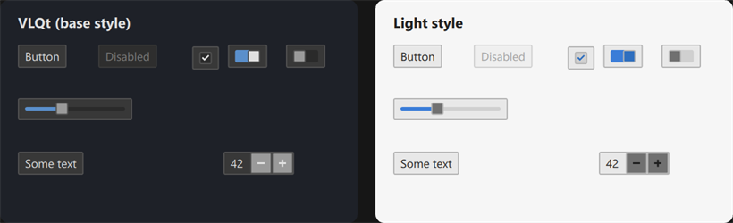
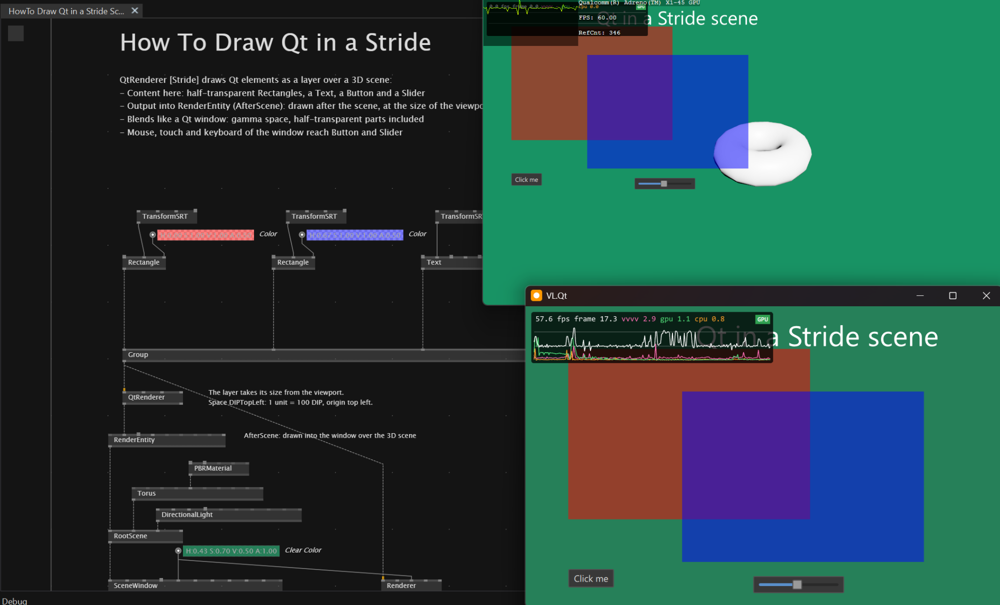

# VL.Qt

[](LICENSE)
[](https://www.nuget.org/packages/VL.Qt/)
[](https://github.com/sebllll/VL.Qt/actions/workflows/build.yml)


Qt Quick for [vvvv gamma](https://visualprogramming.net), the visual live-programming environment for .NET. You patch a tree of elements (shapes, text, images, video, widgets), VL.Qt hands it to Qt Quick and shows it in a Qt window. Made for 2D motion graphics, typography, layout and interactive UI.

> [!NOTE]
> **Early release (`0.x`).** The API may still change. Requires **vvvv gamma 8.x (preview)** on .NET 10; vvvv 7.x (.NET 8) is not supported.
> The output is a Qt window, or, with the companion package `VL.Qt.Stride` (Windows only, experimental), a Stride texture (`QtTexture`) or a Stride layer (`QtRenderer`); there is no Skia layer. Linux (x64 and ARM64) works as a console export with its own Qt window, tested under WSL2/WSLg so far (see [Platforms](#platforms)).

**Contents:** [Features](#features) · [Install](#install) · [First patch](#first-patch) · [Platforms](#platforms) · [Compared to Qt Bridge](#compared-to-qt-bridge-for-c) · [Contributing](#contributing) · [License](#license)

<table>
<tr>
<td align="center"><a href="docs/shapes.md"></a><br>Shapes and paths</td>
<td align="center"><a href="docs/styles.md"></a><br>Widgets and styles</td>
<td align="center"><a href="docs/effects-and-shaders.md"></a><br>Effects and shaders</td>
<td align="center"><a href="docs/stride.md"></a><br>Qt in Stride</td>
</tr>
</table>

## Features

| | |
|---|---|
| [**Elements**](docs/help-patches.md#basics) | Rectangle, Circle, Text, Image, Video, Group, Row, Column, ShaderEffect, QmlElement, Labeled; the same element can be placed several times in the tree |
| [**Paths**](docs/shapes.md) | Line, Polyline, Polygon and Path elements with fill and stroke, Bezier and spline generators, a `Qt.Paths` builder chain |
| [**Layout**](docs/coordinates.md#layout) | automatic sizing and spacing with Row/Column, also fed with a spread of elements |
| [**Widgets**](docs/help-patches.md#widgets-and-styles) | Button, Toggle, Slider (Float), Input (String), Input (Int), with value channels |
| [**Styles**](docs/styles.md) | own base style VLQt, `Style` pin on widgets and Group, Dark/Light presets, `IStylable` for self-patched widgets |
| [**Interaction**](docs/help-patches.md#interaction) | hover, press, click and pointer position as channels on every element; drag, mouse wheel, multitouch |
| [**Images**](docs/images.md) | LoadImage (Async), ToQtImage from other libraries, VideoSourceToQtImage, Snapshot of any element as `IImage`, FileWriter (Element) saves any element as PNG/JPG |
| [**Video**](docs/help-patches.md#images-and-video) | play/pause, loop, rate, volume; the sound as VL.Audio signals with [`VL.Qt.Audio`](docs/video-audio.md) |
| [**Effects**](docs/effects-and-shaders.md#effects) | `Effect` pin on every element: Blur, DropShadow, ColorAdjust, Colorize, Mask, Glow and more, plus your own filter shaders as chain nodes |
| [**Shaders**](docs/effects-and-shaders.md#shaders) | ShaderEffect with GLSL in a string pin; every `.frag` file in a `qtshaders/` folder becomes a node with one pin per uniform |
| [**Stride**](docs/stride.md) | `QtTexture` renders an element tree into a Stride `Texture` on the GPU, `QtRenderer` draws it as a layer (package `VL.Qt.Stride`, Windows only, experimental) |
| [**QML**](docs/user-qml.md) | QmlElement loads your own `.qml` file; every `.qml` file in a `qml/` folder becomes a node (experimental) |
| [**Animation**](docs/contributing/architecture.md#timing-and-animation) | driven by vvvv's `IFrameClock`, so scrubbing and pausing are deterministic |
| [**Window**](docs/help-patches.md#window-and-diagnostics) | WindowSettings node (Icon, Bounds), Title, Borderless, Fullscreen, Save Bounds, VSync on by default |
| [**Export**](docs/export.md) | standalone apps with the vvvv exporter or `tools/vvvvc.ps1`; [Linux](docs/linux.md) as a console export with its own Qt window |
| [**Tooltips**](docs/tooltips.md) | hovering a link with `Element` or `QtImage` in the vvvv editor shows a preview image |
| [**Diagnostics**](docs/diagnostics.md) | `F2` perfmeter, `F5` stats panel, `Debug` pin for a layout overlay; Qt errors show up at the node and in the vvvv Log window |

## Install

VL.Qt is on [nuget.org](https://www.nuget.org/packages/VL.Qt/). In vvvv, open the **References** of your document, switch to **Browse Packs**, search for `VL.Qt` and click **Add**.


- `VL.Qt.Stride` (Windows only, depends on `VL.Qt`, same version): the nodes `QtTexture` and `QtRenderer` for Stride, see [Qt in Stride](docs/stride.md).
- `VL.Qt.Audio` (Windows only, depends on `VL.Qt` of the same version and on `VL.Audio`): the node `Video (VL.Audio)`, see [Video sound through VL.Audio](docs/video-audio.md). `Video` of VL.Qt is unchanged and plays through Qt's own audio output.
- The packages are also attached to the [GitHub releases](https://github.com/sebllll/VL.Qt/releases). To build them yourself, see [Development](docs/contributing/development.md).

## First patch

Put a `Renderer [Qt]` into a patch and feed it an element tree:

```
Rectangle [Qt]   Text [Qt]
          \       /
          Group [Qt]
              |
        Renderer [Qt]
```

The `Space` pin of the renderer sets origin and unit of all lengths (default: origin top left, 1 unit = 100 DIP); see [Coordinates and layout](docs/coordinates.md). The help patches in `help/Qt/` show one topic each; open them from the Help Browser (F1). The full list is in [Help patches](docs/help-patches.md). To ship the result as an app, see [Exporting an app](docs/export.md).

## Platforms

| Platform | Status | Notes |
|---|---|---|
| Windows x64 | ✅ | CI-built |
| Windows ARM64 | ✅ | CI-built on a native arm64 runner |
| Linux x64 | ✅ | console export with a Qt-owned window (kiosk-style); tested under WSL2 with WSLg |
| Linux ARM64 | ✅ | same as x64; tested under WSL2 with WSLg |

vvvv exports only console apps on Linux, without Stride/Skia, so VL.Qt opens its own Qt window there. A native X11 or Wayland desktop and a Raspberry Pi are not tested yet. Export, WSL setup, fonts and known problems: [Linux](docs/linux.md).

## Compared to Qt Bridge for C#

[Qt Bridge for C#](https://www.qt.io/development/qt-framework/qt-bridges/csharp-gui) (beta, by The Qt Company) and VL.Qt both bring Qt Quick to .NET, but from opposite sides:

| | Qt Bridge for C# | VL.Qt |
|---|---|---|
| UI written in | QML files | the vvvv patch (element tree) |
| C# is | the backend (view models, data models) | what builds the scene |
| Main loop and time | owned by Qt | owned by vvvv (`IFrameClock`, deterministic) |
| Glue between C# and Qt | generated at build time, needs a C++ toolchain | prebuilt QtNative, no toolchain needed |
| Made for | desktop apps with a QML front end | live-patched 2D motion graphics, typography and interactive UI |

The two do not mix in one process: Qt allows one application object per process, and each of them runs it in its own loop. Details: [design note](docs/design/qt-bridge.md).

## Contributing

Contributions are welcome: see [CONTRIBUTING.md](CONTRIBUTING.md) for the workflow and the Contributor License Agreement, and [CONTRIBUTORS.md](CONTRIBUTORS.md) for the people who contributed.
To build from source, run the tests or add an element, start at [Development](docs/contributing/development.md) and the [documentation index](docs/README.md); coding agents also read [AGENTS.md](AGENTS.md).

## License

VL.Qt is licensed under the [MIT License](LICENSE) and free to use.

**In short:** You may use, change and sell VL.Qt and what you build with it, also in closed-source commercial projects. You must keep the copyright notice from [LICENSE](LICENSE) and ship the Qt/FFmpeg license texts with your app; you may not modify the Qt/FFmpeg libraries or stop users from replacing them. There is no warranty.

**vvvv:** The MIT license covers VL.Qt only. vvvv gamma has its own license: free for evaluation, non-commercial use and open-source projects; any commercial use needs a per-developer license. See [vvvv licensing](https://vvvv.org/licensing/).

The package ships Qt (LGPL-3.0) and FFmpeg (LGPL-2.1-or-later) as unmodified libraries. If you export an application, ship their license texts from [LICENSES/](LICENSES/) and keep the DLLs unmodified and replaceable. Details and component list: [LICENSES.md](LICENSES.md). Codec patents (H.264/HEVC) and LGPL duties for locked-down devices are your responsibility, see the [notes for users](LICENSES.md#notes-for-users).

Qt® is a registered trademark of The Qt Company Ltd. and its subsidiaries. VL.Qt is an independent project and not affiliated with The Qt Company.
