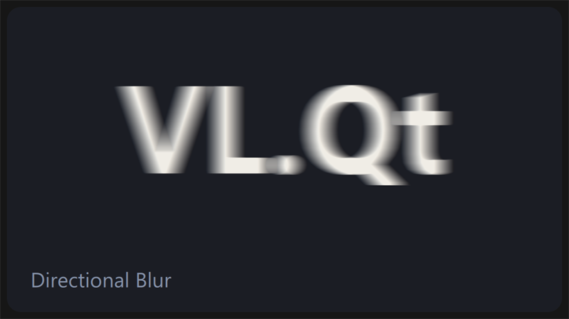
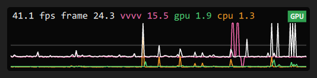

# VL.Qt

[](LICENSE)
[](https://www.nuget.org/packages/VL.Qt/)
[](https://github.com/sebllll/VL.Qt/actions/workflows/build.yml)

-orange)

Qt Quick for [vvvv gamma](https://visualprogramming.net), the visual live-programming environment for .NET. You patch a tree of elements (shapes, text, images, video, widgets), VL.Qt hands it to Qt Quick and shows it in a Qt window. Made for 2D motion graphics, typography, layout and interactive UI.

> [!NOTE]
> **Early release (`0.x`).** The API may still change. Requires **vvvv gamma 8.x (preview)** on .NET 10; vvvv 7.x (.NET 8) is not supported.
> The output is a Qt window; there is no Stride or Skia layer. Linux is a preview (see [Platforms](#platforms)).

**Contents:** [Features](#features) · [Getting Started](#getting-started) · [Platforms](#platforms) · [Styles](#styles) · [Images](#images) · [Effects](#effects) · [Shaders](#shaders) · [Tooltips](#tooltips-in-the-vvvv-editor) · [Diagnostics](#diagnostics) · [How It Works](#how-it-works) · [Development](#development) · [Documentation](#documentation) · [Contributing](#contributing) · [License](#license)

## Features

| | |
|---|---|
| [**Elements**](docs/help-patches.md#drawing) | Rectangle, Circle, Text, Image, Video, Group, Row, Column, ShaderEffect, Labeled; the same element can be placed several times in the tree |
| [**Layout**](docs/help-patches.md#structure-and-layout) | automatic sizing and spacing with Row/Column, also fed with a spread of elements (Spectral) |
| [**Widgets**](docs/help-patches.md#widgets-and-styles) | Button, Toggle, Slider, TextInput, Input (Int), with value channels |
| [**Styles**](docs/styles.md) | own base style VLQt, Style pin on widgets and Group (inherited down the tree), style nodes per part and state, Dark/Light presets, `IStylable` for self-patched widgets |
| [**Interaction**](docs/help-patches.md#interaction) | hover, press, click and pointer position as channels on every element; drag, mouse wheel, multitouch (pinch, rotate, touch points) |
| [**Images**](docs/images.md) | LoadImage (Async) in the background, ToQtImage from other libraries, VideoSourceToQtImage for VL.Video sources, Snapshot of any element as `IImage` |
| [**Video**](docs/help-patches.md#drawing) | play/pause, loop, rate, volume |
| [**Effects**](docs/effects-and-shaders.md#effects) | Effect pin on every element: Blur, DropShadow, ColorAdjust, Colorize and Mask (neighbours merged into one offscreen layer), plus your own filter shaders as chain nodes |
| [**Shaders**](docs/effects-and-shaders.md#shaders) | ShaderEffect with GLSL in a string pin, baked at runtime; every `.frag` file in a `qtshaders/` folder becomes a node with one pin per uniform |
| [**Animation**](docs/architecture.md#timing-and-animation) | driven by vvvv's `IFrameClock`, so scrubbing and pausing are deterministic |
| [**Window**](docs/help-patches.md#window-and-diagnostics) | WindowSettings node (Icon, Title, Borderless, Fullscreen, Bounds), Fullscreen (F11 / Alt+Enter), Save Bounds, optional VSync |
| [**Tooltips**](docs/tooltips.md) | hovering a link with `Element` or `QtImage` in the vvvv editor shows a preview image (editor only) |
| [**Diagnostics**](docs/diagnostics.md) | `F2` perfmeter, `F5` stats panel, `Debug` pin for a layout overlay; Qt errors show up at the node and in the vvvv Log window |

## Getting Started

### Install

Download the package from the [GitHub releases](https://github.com/sebllll/VL.Qt/releases) or build it yourself (see [Development](docs/development.md)). Add `VL.Qt` to your vvvv dependencies.

### First patch

Put a `Renderer [Qt]` into a patch and feed it an element tree:

```
Rectangle [Qt]   Text [Qt]
          \       /
          Group [Qt]
              |
        Renderer [Qt]
```

Row and Column lay out their children with spacing, padding and alignment:


The help patches in `help/Qt/` show one topic each; open them from the Help Browser (F1). They cover drawing, structure and layout, interaction, widgets and styles, images, effects and shaders, window and diagnostics. The full list is in [Help patches](docs/help-patches.md).

### Export a standalone app

```powershell
tools/vvvvc.ps1 -File "help/Qt/Demo Typo Motion.vl" -Out build/export
```

The export bundles the Qt runtime next to the executable, only for the runtime identifier of the exported app, and copies a `qtshaders/` folder along. More: [Exporting an app](docs/export.md); for Linux see [Linux](docs/linux.md).

## Platforms

| Platform | Status | Notes |
|---|---|---|
| Windows x64 | ✅ | CI-built |
| Windows ARM64 | ✅ | CI-built on a native arm64 runner |
| Linux x64 / ARM64 | 🚧 Preview | console export with a Qt-owned window (kiosk-style); no Stride/Skia mixing |

vvvv exports only console apps on Linux, without Stride/Skia. VL.Qt therefore opens its own Qt window there. Closing the window or SIGTERM/SIGINT ends the app cleanly (exit code 0, patches are disposed).

You export on Windows and run the result on Linux; WSL2 with WSLg (Windows 11) is enough to try it, the window opens on the Windows desktop. A minimal or kiosk system needs a font package, otherwise all text renders as empty boxes.

More: [Linux](docs/linux.md) (prepare the patch, export, WSL setup, fonts, building the Linux runtime).

## Styles

All widgets (Button, Toggle, Slider, TextInput, Input (Int)) are drawn in VL.Qt's own base style **VLQt**: flat, neutral, the same on Windows and Linux. Every widget and every `Group [Qt]` has a `Style` pin to change it:

- A style only holds what you set; everything else is inherited: base style → each Group on the way → the widget's own Style pin.
- A Group passes its style to everything inside, also to Row/Column and nested Groups.
- Each field has a value per state: Normal, Hovered, Pressed, Disabled, Checked.
- Build a style by chaining the nodes `Colors`, `Frame`, `Text`, `Indicator` and `Track` (namespace `Qt.Style`); `Dark` and `Light` are complete presets, `Merge` combines two styles.
- A patched class that implements `IStylable` follows the surrounding style like a built-in widget.


Help patches: `HowTo Style a Widget`, `HowTo Style Control Parts`, `HowTo Style Widgets with a Group`, `HowTo Patch a Stylable Widget`.

More: [Styles](docs/styles.md) (all style nodes and fields, self-made widgets).

## Images

Images are GPU resources (`QtImage`), separate from the `Image [Qt]` element that draws them. A loaded image is uploaded once and can be shown by any number of Image elements in any window; switching between loaded images costs nothing.


- `LoadImage` loads a file (everything Qt reads, EXIF rotation applied); `LoadImage (Async)` does it in the background and keeps the previous image until the new one is ready.
- `ToQtImage` uploads an `IImage` from other libraries (Skia, OpenCV, camera, …); `VideoSourceToQtImage` shows a VL.Video source in the Image element.
- `Snapshot` goes the other way: it grabs an element or Group as an `IImage`, e.g. for thumbnails, export or processing in Skia/OpenCV.

Help patches: `HowTo Draw an Image`, `HowTo Preload Images`, `HowTo Use an IImage`, `HowTo Take a Snapshot`, `HowTo Show a VL.Video player in Qt`.

More: [Images](docs/images.md) (all nodes, mipmaps, frame budget, errors, device loss).

## Effects

Every element has an `Effect` pin. Chain the nodes of `Qt.Effects` to it, like the Interaction nodes on the `Interaction` pin: `Blur`, `DropShadow`, `ColorAdjust`, `Colorize`, `Mask` (any element as alpha mask), `Glow`, `InnerShadow`, `DirectionalBlur`, `ZoomBlur`, `RadialBlur`, `Displace` and `Blend`.


The chain runs in data flow order, like TextureFX in Stride: the top node acts first, the node at the `Effect` pin last. Neighbouring `Blur`, `DropShadow`, `ColorAdjust`, `Colorize` and `Mask` nodes are merged into one offscreen layer; a shader node ends such a run and costs a layer of its own. Glow, InnerShadow, the three motion blurs, Displace and Blend are shader effects:

<table>
<tr><td align="center"><br>Glow</td><td align="center"><br>Directional Blur</td><td align="center"><br>Zoom Blur</td></tr>
<tr><td align="center"><br>Radial Blur</td><td align="center"><br>InnerShadow</td><td align="center"><br>Displace</td></tr>
</table>

Your own filter shaders (see [Shaders](#shaders)) appear as nodes of the same chain; here the order does matter, because each shader works on what comes out of the node before it:


Help patches: `HowTo Chain Effects`, `HowTo Mask an Element`, `HowTo Add a Glow`, `HowTo Use Motion Blurs`, `HowTo Displace an Element`, `HowTo Blend Elements`, `HowTo Chain Shader Effects`, `HowTo Combine Effects`.

More: [Effects](docs/effects-and-shaders.md#effects) (all nodes, mask and padding, [shader effects](docs/effects-and-shaders.md#shader-effects), [shaders in the effect chain](docs/effects-and-shaders.md#shaders-in-the-effect-chain)).

## Shaders

Own fragment shaders are written in Qt's GLSL (version 440). There are two ways to use them:

- **ShaderEffect element:** the shader code goes into the `Fragment Code` string pin (or `Fragment Shader` points to a pre-baked `.qsb` file). VL.Qt bakes it in a worker; while a new version is baking or has errors, the last working one keeps drawing, and compile errors show at the `Error` output with their line number. An element or Group on `Input` becomes the `source` texture.
- **Shader nodes from files:** every `.frag` file in a folder named `qtshaders` next to the patch becomes a node with one pin per uniform. A middle click on the node opens the file; edit and save, and the node updates while vvvv runs. A `sampler2D source` makes the shader a filter that also works in the effect chain; without it, it is a generator.


Comments such as `// @default`, `// @min`, `// @max`, `// @color` and `// @summary` shape the pins. The `Sampler` node sets how a shader reads a texture (filter, mip filter, wrap).

Help patches: `HowTo Write a ShaderEffect`, `HowTo Create Shader Nodes from Files`, `HowTo Set a Sampler`, `HowTo Blur an Image with a Control Mask`.

More: [Shaders](docs/effects-and-shaders.md#shaders) (annotations, the [Sampler node](docs/effects-and-shaders.md#sampler-node), a complete example, export notes).

## Tooltips in the vvvv editor

Hover a link that carries an `Element` or a `QtImage` and the tooltip shows a preview image. It comes from `VL.Qt.HDE.vl`, which only the editor loads, so exports are not affected. Element previews are live, limited in rate and size; elements containing a `Video` get text only.

More: [Tooltips](docs/tooltips.md).

## Diagnostics

Press these keys in a Qt window (no modifiers). Both overlays are drawn by QtNative, so they cost no vvvv time.

<table>
<tr>
<td valign="top"><b>F2</b> perfmeter<br></td>
<td valign="top"><b>F5</b> stats panel, Summary and Timeline pages<br> </td>
</tr>
</table>

`F5` steps through the pages Summary, Timeline, Scene, System and Resources (live images with state and size). The same numbers are available in a patch through the optional `Perf` output of `Renderer [Qt]` (`HowTo Read Performance`).

Every element node and the Renderer also have a `Debug` pin that draws a layout overlay (frames, padding, spacing, overflow, text baseline) on top of the scene, without affecting layout or hit-testing:


Qt errors show up at the node and in the vvvv Log window; after a GPU reset, windows and images are rebuilt by themselves.

More: [Diagnostics](docs/diagnostics.md) ([performance overlay](docs/diagnostics.md#performance-overlay), [debug overlay](docs/diagnostics.md#debug-overlay), [logging and errors](docs/diagnostics.md#logging-and-errors), [GPU device loss](docs/diagnostics.md#gpu-device-loss)) and [Profiling](docs/profiling.md) for repeatable CPU measurements.

## How It Works

VL.Qt is a declarative element tree: your patch builds `Element` objects each frame, a reconciler diffs them against what Qt already has, and QtNative, the C++ layer, applies the changes to real Qt Quick items.

```
patch ──► Element tree ──► Reconciler ──► CommandWriter ──► QtNative ──► Qt Quick ──► Qt window
                              (diff)        (binary buffer)    (C++)     (scene graph)
                                                                  │
patch ◄── channels / outputs ◄── EventReader ◄─────── events ◄────┘
```

vvvv's `IFrameClock` is the single time source, so scrubbing and pausing are deterministic. Qt renders directly into its own window, pumped once per vvvv frame; events come back to the patch as channels.

More: [Architecture](docs/architecture.md) (data flow, timing, interop, rendering, events, reusing elements, performance).

## Development

```powershell
tools/setup-qt.ps1      # once: Qt for your machine's architecture into C:\Qt
tools/build.ps1         # QtNative + Qt deploy + C# library
tools/build.ps1 -Test   # plus unit tests and SmokeTest
tools/start-vvvv.ps1 -Help "Draw a Rectangle"
```

Prerequisites are Visual Studio with the .NET desktop and C++ workloads, CMake, Qt 6.12 and Git LFS. More: [Development](docs/development.md) (Visual Studio solution, scripts, tests, project layout, typical workflows); contributors and coding agents also read [AGENTS.md](AGENTS.md).

## Documentation

The index with a one-line description per page is in [docs/README.md](docs/README.md).

- [Help patches](docs/help-patches.md): the `help/Qt/` patches by topic
- [Exporting an app](docs/export.md): standalone apps with vvvvc
- [Linux](docs/linux.md): export and run on Linux, WSL setup, fonts, building the Linux runtime
- [Styles](docs/styles.md): base style, Style pin, style nodes, self-made widgets
- [Images](docs/images.md): `QtImage`, loaders, Snapshot
- [Effects and shaders](docs/effects-and-shaders.md): effect chain, custom shaders, `qtshaders/` nodes
- [Tooltips](docs/tooltips.md): previews in the vvvv editor
- [Diagnostics](docs/diagnostics.md): overlays, logging, GPU device loss
- [Profiling](docs/profiling.md): repeatable CPU measurements
- [Architecture](docs/architecture.md): how the element tree reaches Qt, QtNative
- [Development](docs/development.md): build from source, scripts, tests, workflows

## Contributing

Contributions are welcome: see [CONTRIBUTING.md](CONTRIBUTING.md) for the workflow and the Contributor License Agreement, and [CONTRIBUTORS.md](CONTRIBUTORS.md) for the people who contributed.

## License

VL.Qt is licensed under the [MIT License](LICENSE) and free to use.

**In short:** You may use, change and sell VL.Qt and what you build with it, also in closed-source commercial projects. You must keep the copyright notice from [LICENSE](LICENSE) and ship the Qt/FFmpeg license texts with your app; you may not modify the Qt/FFmpeg libraries or stop users from replacing them. There is no warranty.

**vvvv:** The MIT license covers VL.Qt only. vvvv gamma has its own license: free for evaluation, non-commercial use and open-source projects; any commercial use needs a per-developer license. See [vvvv licensing](https://vvvv.org/licensing/).

The package ships Qt (LGPL-3.0) and FFmpeg (LGPL-2.1-or-later) as unmodified libraries. If you export an application, ship their license texts from [LICENSES/](LICENSES/) and keep the DLLs unmodified and replaceable. Details and component list: [LICENSES.md](LICENSES.md). Codec patents (H.264/HEVC) and LGPL duties for locked-down devices are your responsibility, see the [notes for users](LICENSES.md#notes-for-users).

Qt is a registered trademark of The Qt Company Ltd. and its subsidiaries. VL.Qt is an independent project and not affiliated with The Qt Company.
