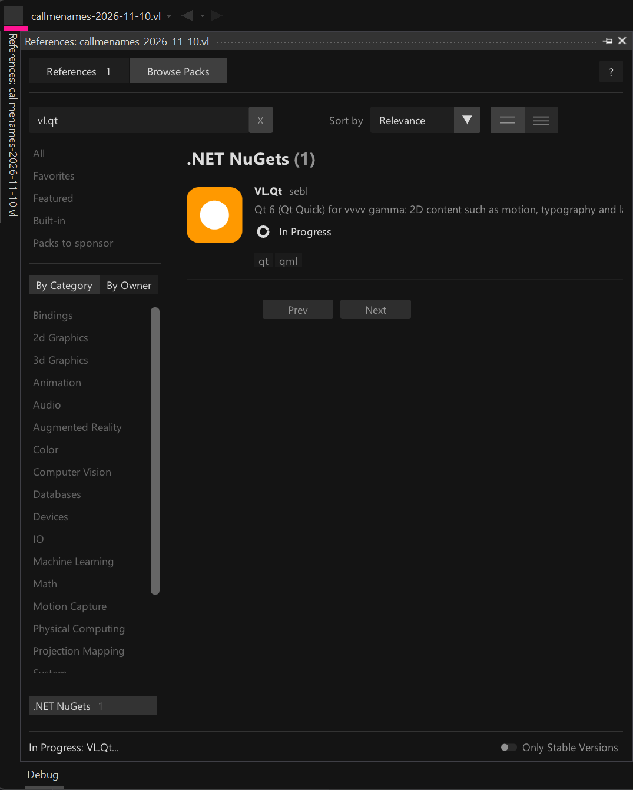
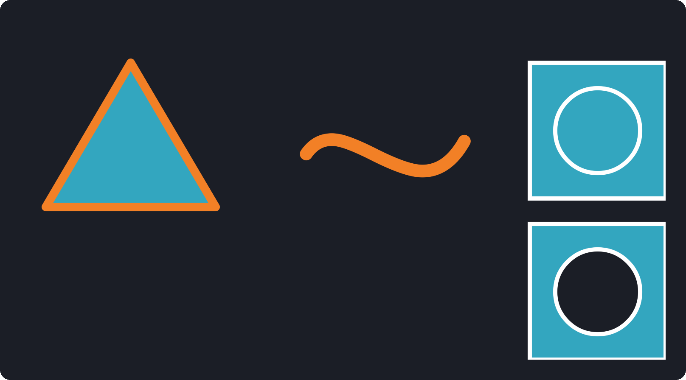
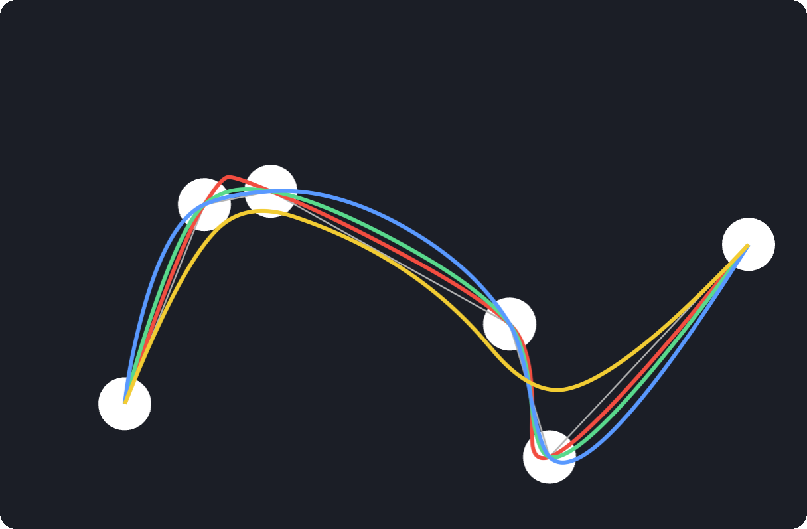
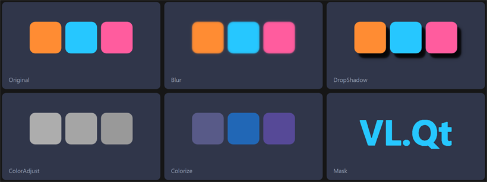
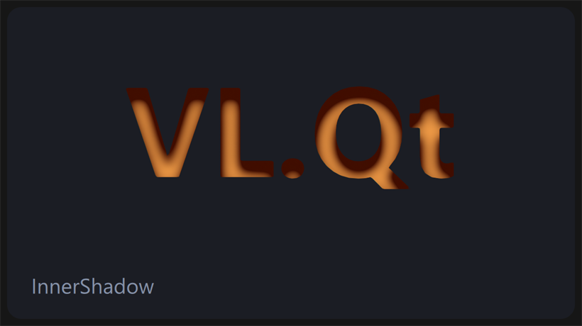
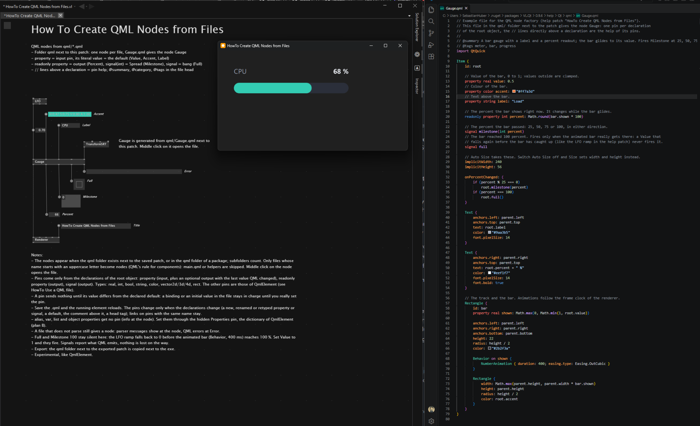
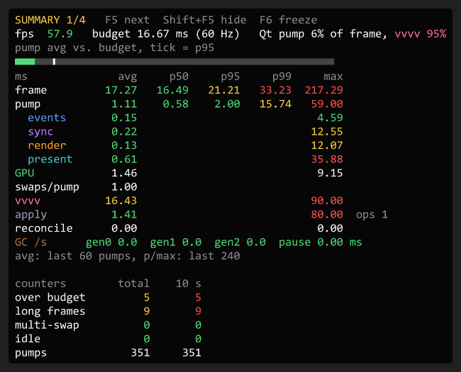
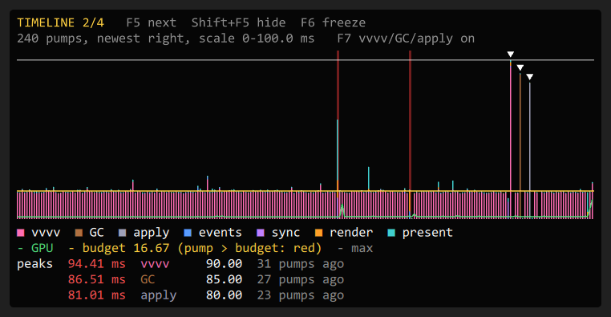
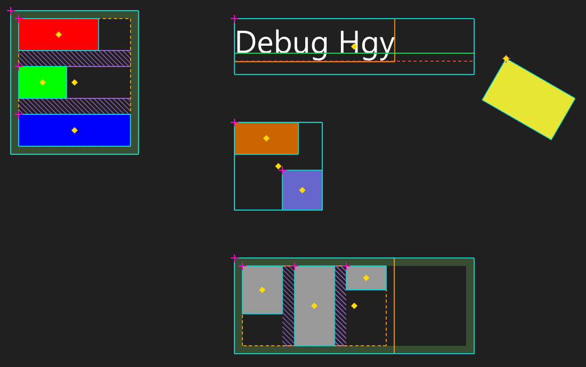

# VL.Qt

[](LICENSE)
[](https://www.nuget.org/packages/VL.Qt/)
[](https://github.com/sebllll/VL.Qt/actions/workflows/build.yml)


Qt Quick for [vvvv gamma](https://visualprogramming.net), the visual live-programming environment for .NET. You patch a tree of elements (shapes, text, images, video, widgets), VL.Qt hands it to Qt Quick and shows it in a Qt window. Made for 2D motion graphics, typography, layout and interactive UI.

> [!NOTE]
> **Early release (`0.x`).** The API may still change. Requires **vvvv gamma 8.x (preview)** on .NET 10; vvvv 7.x (.NET 8) is not supported.
> The output is a Qt window, or, with the companion package `VL.Qt.Stride` (Windows only, experimental), a Stride texture (`QtTexture`) or a Stride layer (`QtRenderer`); there is no Skia layer. Linux (x64 and ARM64) works as a console export with its own Qt window, tested under WSL2/WSLg so far (see [Platforms](#platforms)).

**Contents:** [Features](#features) · [Getting Started](#getting-started) · [Linux via WSL](#try-it-on-linux-through-wsl) · [Platforms](#platforms) · [Styles](#styles) · [Paths](#lines-shapes-and-paths) · [Images](#images) · [Write to file](#write-to-a-file) · [Effects](#effects) · [Shaders](#shaders) · [Stride texture](#stride-texture) · [QML](#qml) · [Tooltips](#tooltips-in-the-vvvv-editor) · [Diagnostics](#diagnostics) · [How It Works](#how-it-works) · [Compared to Qt Bridge](#compared-to-qt-bridge-for-c) · [Development](#development) · [Documentation](#documentation) · [Contributing](#contributing) · [License](#license)

## Features

| | |
|---|---|
| [**Elements**](docs/help-patches.md#drawing) | Rectangle, Circle, Text, Image, Video, Group, Row, Column, ShaderEffect, QmlElement, Labeled; the same element can be placed several times in the tree |
| [**Paths**](#lines-shapes-and-paths) | Line, Polyline, Polygon and Path elements with fill and stroke, Bezier and spline generators, a `Qt.Paths` builder chain; draggable points in the help patches |
| [**Layout**](docs/help-patches.md#structure-and-layout) | automatic sizing and spacing with Row/Column, also fed with a spread of elements (Spectral) |
| [**Widgets**](docs/help-patches.md#widgets-and-styles) | Button, Toggle, Slider (Float), Input (String), Input (Int), with value channels |
| [**Styles**](docs/styles.md) | own base style VLQt, Style pin on widgets and Group (inherited down the tree), style nodes per part and state, Dark/Light presets, `IStylable` for self-patched widgets |
| [**Interaction**](docs/help-patches.md#interaction) | hover, press, click and pointer position as channels on every element; drag, mouse wheel, multitouch (pinch, rotate, touch points) |
| [**Images**](docs/images.md) | LoadImage (Async) in the background, ToQtImage from other libraries, VideoSourceToQtImage for VL.Video sources, Snapshot of any element as `IImage` |
| [**Write to file**](#write-to-a-file) | `FileWriter (Element)` saves any element as PNG/JPG, `FileWriter` writes an `IImage`; asynchronous, with `Scale` for pixels per DIP |
| [**Video**](docs/help-patches.md#drawing) | play/pause, loop, rate, volume |
| [**Effects**](docs/effects-and-shaders.md#effects) | Effect pin on every element: Blur, DropShadow, ColorAdjust, Colorize and Mask (neighbours merged into one offscreen layer), plus your own filter shaders as chain nodes |
| [**Shaders**](docs/effects-and-shaders.md#shaders) | ShaderEffect with GLSL in a string pin, baked at runtime; every `.frag` file in a `qtshaders/` folder becomes a node with one pin per uniform |
| [**Stride texture**](#stride-texture) | `QtTexture` (package `VL.Qt.Stride`, Windows only, experimental) renders an element tree offscreen into a Stride `Texture`, on the GPU, in the same frame; `QtRenderer` draws it as a layer into a Stride render target |
| [**QML**](docs/user-qml.md) | QmlElement loads your own `.qml` file into the element tree; every `.qml` file in a `qml/` folder becomes a node with one pin per property and signal (experimental) |
| [**Animation**](docs/architecture.md#timing-and-animation) | driven by vvvv's `IFrameClock`, so scrubbing and pausing are deterministic |
| [**Window**](docs/help-patches.md#window-and-diagnostics) | WindowSettings node (Icon, Bounds), Renderer pins Title, Borderless and Fullscreen, Fullscreen (F11 / Alt+Enter), Save Bounds, VSync on by default (see `HowTo Avoid Tearing`) |
| [**Tooltips**](docs/tooltips.md) | hovering a link with `Element` or `QtImage` in the vvvv editor shows a preview image (editor only) |
| [**Diagnostics**](docs/diagnostics.md) | `F2` perfmeter, `F5` stats panel, `Debug` pin for a layout overlay; Qt errors show up at the node and in the vvvv Log window |

## Getting Started

### Install

VL.Qt is on [nuget.org](https://www.nuget.org/packages/VL.Qt/). In vvvv, open the **References** of your document, switch to **Browse Packs**, search for `VL.Qt` and click **Add**.



For Stride users there is the companion package `VL.Qt.Stride` (Windows only, depends on `VL.Qt`, same version) with the `QtTexture` and `QtRenderer` nodes, see [Stride texture](#stride-texture). Both packages are built from this repository, see [Development](docs/development.md#packages).

For VL.Audio users there is the companion package `VL.Qt.Audio` (Windows only, depends on `VL.Qt` of the same version and on `VL.Audio`) with the node `Video (VL.Audio)`: the sound of a video as `AudioSignal`s, synchronized to the picture, see [Video sound through VL.Audio](docs/video-audio.md). `Video` of VL.Qt is unchanged and plays through Qt's own audio output.

The packages are also attached to the [GitHub releases](https://github.com/sebllll/VL.Qt/releases). To build VL.Qt yourself, see [Development](docs/development.md).

### First patch

Put a `Renderer [Qt]` into a patch and feed it an element tree:

```
Rectangle [Qt]   Text [Qt]
          \       /
          Group [Qt]
              |
        Renderer [Qt]
```

Row and Column lay out their children with spacing, padding and alignment:


Lengths are in units; the `Space` pin of the renderer sets origin and unit: `DIPTopLeft` (default: origin top left, 1 unit = 100 DIP, the device independent pixels of Qt), `DIP` (origin in the center), `Normalized` (origin in the center, height from -1 to 1) and `PixelTopLeft` (origin top left, 1 unit = 100 device pixels). y points down in all of them, as in Skia. See `HowTo Choose a Space`.

The help patches in `help/Qt/` show one topic each; open them from the Help Browser (F1). They cover drawing, structure and layout, interaction, widgets and styles, images, effects and shaders, window and diagnostics. The full list is in [Help patches](docs/help-patches.md).

### Export a standalone app

```powershell
tools/vvvvc.ps1 -File help/HelloWorld.vl -Out build/export
```

The export bundles the Qt runtime next to the executable, only for the runtime identifier of the exported app, and copies a `qtshaders/` folder along. More: [Exporting an app](docs/export.md); for Linux see [Linux](docs/linux.md).

## Platforms

| Platform | Status | Notes |
|---|---|---|
| Windows x64 | ✅ | CI-built |
| Windows ARM64 | ✅ | CI-built on a native arm64 runner |
| Linux x64 | ✅ | console export with a Qt-owned window (kiosk-style); no Stride/Skia mixing; tested under WSL2 with WSLg |
| Linux ARM64 | ✅ | same as x64; tested under WSL2 with WSLg |

vvvv exports only console apps on Linux, without Stride/Skia. VL.Qt therefore opens its own Qt window there. Closing the window or SIGTERM/SIGINT ends the app cleanly (exit code 0, patches are disposed).

You export on Windows and run the result on Linux; WSL2 with WSLg (Windows 11) is enough to try it, the window opens on the Windows desktop. A minimal or kiosk system needs a font package, otherwise all text renders as empty boxes.

The release test covered WSL2 Ubuntu 24.04 with WSLg on x64 and on arm64. A native X11 or Wayland desktop and a Raspberry Pi (eglfs) are **not tested yet**; what to expect there is in [Other Linux systems](docs/linux.md#other-linux-systems-not-tested).

More: [Linux](docs/linux.md) (prepare the patch, export, WSL setup, fonts, building the Linux runtime).

### Try it on Linux through WSL

The same path for x64 and arm64; use the architecture of the machine that runs WSL. Details and troubleshooting: [Linux](docs/linux.md).

1. **Patch.** In vvvv, open or build a patch that ends in a `Renderer [Qt]` (for example one from `help/Qt/`). Add a `KeepAppAlive [System]` with `Is Alive` = true to the top patch; a console app otherwise ends after the first frame, without a window ([details](docs/linux.md#1-prepare-the-patch)).
2. **Export for Linux.** Open the application exporter from the quad menu and set `Output type` = `Exe`, `Target framework` = `net10.0`, `Runtime identifier` = `linux-x64` (arm64: `linux-arm64`); then export. The console export does the same: `tools/vvvvc.ps1 -File "<patch>.vl" -Out build/export-linux --rid linux-x64 --output-type Exe --asset-behavior RelativeToOutput` ([details](docs/linux.md#2-export-from-vvvv)). The export is self-contained, so the target needs no .NET.
3. **Set up WSL once.** In an admin PowerShell: `wsl --install -d Ubuntu-24.04`, restart if asked, create the user. In the Ubuntu shell install the system libraries Qt uses: `bash /mnt/c/<path-to-repo>/tools/setup-wsl.sh --runtime-only`, or, on a machine without the repo (only the export folder), the `apt` packages from [Linux](docs/linux.md#3-set-up-wsl-once). Do not skip this step: without these libraries the app aborts with `This application failed to start because no Qt platform plugin could be initialized` (even though `xcb` is listed as available).
4. **Run it.** Copy the export folder into the Linux file system and start the executable (the name of the patch, without extension):

   ```bash
   cp -r /mnt/c/<path>/export-linux/<name> ~/ && cd ~/<name>
   chmod +x <name> && ./<name>
   ```

   The Qt window opens on the Windows desktop. End it with its close button or `Ctrl+C`.

## Styles

All widgets (Button, Toggle, Slider (Float), Input (String), Input (Int)) are drawn in VL.Qt's own base style **VLQt**: flat, neutral, the same on Windows and Linux. Every widget and every `Group [Qt]` has a `Style` pin to change it:

- A style only holds what you set; everything else is inherited: base style → each Group on the way → the widget's own Style pin.
- A Group passes its style to everything inside, also to Row/Column and nested Groups.
- Each field has a value per state: Normal, Hovered, Pressed, Disabled, Checked.
- Build a style by chaining the nodes `SetColors`, `SetFrame`, `SetText`, `SetIndicator` and `SetTrack` (namespace `Qt.Style`); `Dark` and `Light` are complete presets, `Merge` combines two styles.
- A patched class that implements `IStylable` follows the surrounding style like a built-in widget.


Help patches: `HowTo Style a Widget`, `HowTo Style Control Parts`, `HowTo Style Widgets with a Group`, `HowTo Patch a Stylable Widget`.

More: [Styles](docs/styles.md) (all style nodes and fields, self-made widgets).

## Lines, shapes and paths

`Line`, `Polyline` and `Polygon` draw point lists; `Path` draws anything you build with the `Qt.Paths` chain (`MoveTo`, `LineTo`, `CubicTo`, `ArcTo`, `Close`, …) with fill, stroke, `Trim Start`/`Trim End` and a fill rule. `Bezier (Handles)`, `Spline (CatmullRom)` and `Spline (BSpline)` turn a few points into a smooth curve you can feed to `Path`.



*`HowTo Draw a Path`: fill and stroke, and a fill rule for a path with a hole.*



*`HowTo Draw Splines`: the same five points as `Spline (CatmullRom)` with three Alpha values and as `Spline (BSpline)`.*


*`HowTo Draw a Polygon`: draggable corners; the fill rule decides what is inside of a self-intersecting polygon.*

Help patches: `HowTo Draw a Line`, `HowTo Draw a Polyline`, `HowTo Draw a Polygon`, `HowTo Build a Path`, `HowTo Draw a Path`, `HowTo Draw a Bezier Curve with Handles`, `HowTo Draw Splines`.

More: [Help patches](docs/help-patches.md).

## Images

Images are GPU resources (`QtImage`), separate from the `Image [Qt]` element that draws them. A loaded image is uploaded once and can be shown by any number of Image elements in any window; switching between loaded images costs nothing.


- `LoadImage` loads a file (everything Qt reads, EXIF rotation applied); `LoadImage (Async)` does it in the background and keeps the previous image until the new one is ready.
- `ToQtImage` uploads an `IImage` from other libraries (Skia, OpenCV, camera, …); `VideoSourceToQtImage` shows a VL.Video source in the Image element.
- `Snapshot` goes the other way: it grabs an element or Group as an `IImage`, e.g. for thumbnails, export or processing in Skia/OpenCV.

Help patches: `HowTo Draw an Image`, `HowTo Preload Images`, `HowTo Use an IImage`, `HowTo Take a Snapshot`, `HowTo Show a VL.Video player in Qt`.

More: [Images](docs/images.md) (all nodes, mipmaps, frame budget, errors, device loss).

## Write to a file

`FileWriter (Element)` grabs an element (or a Group with its children) on `Write` and saves it; the extension of `File Path` picks the format (PNG, JPG, BMP, WebP). `Scale` sets the pixels per DIP, so `Scale` 2 doubles the resolution regardless of the screen. Writing is asynchronous: `Is Done` comes in a later frame and `Success` says whether the file was written; why a write failed goes to the log. To save an `IImage` you already have (for example from `Snapshot`), use `FileWriter`.

The pictures of the help patches in this README were made with it: the element that goes into the `Renderer` also goes into a `FileWriter (Element)`, and the patch writes its own picture.

Help patch: `HowTo Write an Element to a File`.

## Effects

Every element has an `Effect` pin. Chain the nodes of `Qt.Effects` to it, like the Interaction nodes on the `Interaction` pin: `Blur`, `DropShadow`, `ColorAdjust`, `Colorize`, `Mask` (any element as alpha mask), `Glow`, `InnerShadow`, `DirectionalBlur`, `ZoomBlur`, `RadialBlur`, `Displace` and `Blend`.



The chain runs in data flow order, like TextureFX in Stride: the top node acts first, the node at the `Effect` pin last. Neighbouring `Blur`, `DropShadow`, `ColorAdjust`, `Colorize` and `Mask` nodes are merged into one offscreen layer; a shader node ends such a run and costs a layer of its own. Glow, InnerShadow, the three motion blurs, Displace and Blend are shader effects:

<table>
<tr><td align="center"><br>Glow</td><td align="center"><br>Directional Blur</td><td align="center"><br>Zoom Blur</td></tr>
<tr><td align="center"><br>Radial Blur</td><td align="center"><br>InnerShadow</td><td align="center"><br>Displace</td></tr>
</table>

Your own filter shaders (see [Shaders](#shaders)) appear as nodes of the same chain; here the order does matter, because each shader works on what comes out of the node before it:


Help patches: `HowTo Chain Effects`, `HowTo Mask an Element`, `HowTo Add a Glow`, `HowTo Blur An Element`, `HowTo Displace an Element`, `HowTo Blend Elements`, `HowTo Draw Trails`.

More: [Effects](docs/effects-and-shaders.md#effects) (all nodes, mask and padding, [shader effects](docs/effects-and-shaders.md#shader-effects), [shaders in the effect chain](docs/effects-and-shaders.md#shaders-in-the-effect-chain)).

## Shaders

Own fragment shaders are written in Qt's GLSL (version 440). There are two ways to use them:

- **ShaderEffect element:** the shader code goes into the `Fragment Code` string pin (or `Fragment Shader` points to a pre-baked `.qsb` file). VL.Qt bakes it in a worker; while a new version is baking or has errors, the last working one keeps drawing, and compile errors show at the `Error` output with their line number. An element or Group on `Input` becomes the `source` texture.
- **Shader nodes from files:** every `.frag` file in a folder named `qtshaders` next to the patch becomes a node with one pin per uniform. A middle click on the node opens the file; edit and save, and the node updates while vvvv runs. A `sampler2D source` makes the shader a filter that also works in the effect chain; without it, it is a generator.


Comments such as `// @default`, `// @min`, `// @max`, `// @color` and `// @summary` shape the pins. The `Sampler` node sets how a shader reads a texture (filter, mip filter, wrap).

Help patches: `HowTo Write a ShaderEffect`, `HowTo Create Shader Nodes from Files`, `HowTo Set a Sampler`, `HowTo Blur an Image with a Control Mask`.

The five built-in effects (Blend, Displace, DirectionalBlur, ZoomBlur, RadialBlur) also ship as annotated example shaders in `help/Qt/qtshaders/`: copy one and make an effect of your own.

More: [Shaders](docs/effects-and-shaders.md#shaders) (annotations, the [Sampler node](docs/effects-and-shaders.md#sampler-node), a complete example, [own effects from templates](docs/effects-and-shaders.md#own-effects-from-templates), export notes).

## Stride texture

`QtTexture` (category `Stride.Textures.Source`, package `VL.Qt.Stride`) works like `Renderer [Qt]`, but opens no window: it renders the element tree offscreen and outputs a Stride `Texture` that you draw, mix or feed to TextureFX like any other texture. **Windows only and experimental** (the pins may still change).

- **Pins:** `Input` (element tree), `Size` (pixels, default 1920×1080; 1 DIP = 1 pixel), `Space` (default `DIPTopLeft`; the device pixel ratio is 1, so `PixelTopLeft` is the same), `Clear Color` (default transparent, so the texture has an alpha channel), `Clear` (default on; off keeps the previous frame: trails and feedback, where the alpha of `Clear Color` is the fade strength per frame, 0 = no fade, which is the default here, see the help patch `HowTo Draw Trails`), `Format` (default `B8G8R8A8_UNorm_SRgb`; 8-bit RGBA/BGRA or `R16G16B16A16_Float`; SRgb and Float hold linear premultiplied values, UNorm the gamma-space values of a Qt window), `Enabled`, `Debug`; output `Output` (`Texture`). Errors show at the node and in the log.
- **GPU only:** no readback to the CPU. Qt renders on its own D3D11 device into a texture shared with Stride's device; shared fences make Stride wait on the GPU until Qt has written. The texture is ready in the same frame, the scene is rendered only when it changed, and several `QtTexture` nodes do not block each other.
- **Alpha:** the texture is premultiplied: draw it with `AlphaBlendPremultiplied` (`AlphaBlend` expects straight alpha and darkens half-transparent parts); where straight alpha is expected, unpremultiply it first (RGB divided by alpha); VL.Stride has no TextureFX for that yet.
- **Input:** the optional pin `Input Notifications` takes mouse, touch and keyboard notifications in texture pixels; `ToTexturePixels` maps a window's input onto a texture on a quad. A press inside the texture gives the scene keyboard focus.
- **Adapter:** QtNative's device must sit on Stride's adapter. It follows Stride's adapter as long as no Qt window renders on it; otherwise the node shows an error and `Output` stays empty.

**`QtRenderer` or `QtTexture`?** `QtRenderer` (category `Stride.Rendering`, same package) is a Stride layer like `SkiaRenderer`: it draws the element tree into the render target it is connected to, sized to the viewport, and takes the window's mouse, touch and keyboard input. Half-transparent content looks the same as in a Qt window, but you get no texture. Draw it after the 3D scene, into a window or a typeless 8-bit render texture; into any other target (sRGB, float) it still draws, but blends in linear light like `QtTexture` and shows a warning at the node. It draws into one render target per frame: connected to a second window, that one stays empty and the node warns; use one `QtRenderer` per window. Use `QtTexture` when you need a texture to manipulate, feed to TextureFX or put on a mesh: it blends in linear light, so half-transparent colours differ slightly from a Qt window.


*`HowTo Draw Qt in a Stride Scene`: the `QtRenderer` layer over a 3D scene in the Stride window (top) and the same elements in a Qt window (bottom right); the half-transparent rectangles blend the same way.*

Help patches: `HowTo Draw Qt in a Stride Scene`, `HowTo Render Qt into a Stride Texture`, `HowTo Interact with a QtTexture`, `HowTo Draw a QtTexture with Transparency`, `HowTo Render many QtTextures` (in the Help Browser under `Qt`, package `VL.Qt.Stride`).

More: [Render texture](docs/decisions/render-texture.md) (decisions: device, fences, lifetime, frame timing), [Architecture](docs/architecture.md#rendering).

## QML

What VL.Qt has no element for can be written in QML and brought into the tree. Experimental, like the shaders it was modelled on.

- **QmlElement** loads a `.qml` file next to the patch. The patch sets properties of the QML root by name; changed properties and emitted signals come back as outputs. Saving the file reloads it while vvvv runs.
- **Nodes from `.qml` files:** every file in a folder named `qml` next to the patch whose name starts with an uppercase letter becomes a node. `property` declarations are input pins (the literal value is the default), `readonly property` are outputs, `signal(int)` is a spread of values and a signal without arguments is a bang. `//` lines above a declaration are the pin help, `@summary`, `@category` and `@tags` in the file head describe the node. A middle click on the node opens the file.



Help patches: `HowTo Use a QML file`, `HowTo Create QML Nodes from Files`.

More: [QML files as elements](docs/user-qml.md) (pins, value types, signals, hot reload, [nodes from QML files](docs/user-qml.md#nodes-from-qml-files), limits).

## Tooltips in the vvvv editor

Hover a link that carries an `Element` or a `QtImage` and the tooltip shows a preview image. It comes from `VL.Qt.HDE.vl`, which only the editor loads, so exports are not affected. Element previews are live, limited in rate and size; elements containing a `Video` get text only.

More: [Tooltips](docs/tooltips.md).

## Diagnostics

Press these keys in a Qt window (no modifiers). Both overlays are drawn by QtNative, so they cost no vvvv time.

<table>
<tr>
<td valign="top"><b>F2</b> perfmeter<br></td>
<td valign="top"><b>F5</b> stats panel, Summary and Timeline pages<br> </td>
</tr>
</table>

`F5` steps through the pages Summary, Timeline, Scene, System and Resources (live images with state and size). The same numbers are available in a patch through the optional `Perf` output of `Renderer [Qt]` (`HowTo Read Performance`).

Every element node and the Renderer also have a `Debug` pin that draws a layout overlay (frames, padding, spacing, overflow, text baseline) on top of the scene, without affecting layout or hit-testing:



Qt errors show up at the node and in the vvvv Log window; after a GPU reset, windows and images are rebuilt by themselves.

More: [Diagnostics](docs/diagnostics.md) ([performance overlay](docs/diagnostics.md#performance-overlay), [debug overlay](docs/diagnostics.md#debug-overlay), [logging and errors](docs/diagnostics.md#logging-and-errors), [GPU device loss](docs/diagnostics.md#gpu-device-loss)) and [Profiling](docs/profiling.md) for repeatable CPU measurements.

## How It Works

VL.Qt is a declarative element tree: your patch builds `Element` objects each frame, a reconciler diffs them against what Qt already has, and QtNative, the C++ layer, applies the changes to real Qt Quick items.

```
patch ──► Element tree ──► Reconciler ──► CommandWriter ──► QtNative ──► Qt Quick ──► Qt window
                              (diff)        (binary buffer)    (C++)     (scene graph)
                                                                  │
patch ◄── channels / outputs ◄── EventReader ◄─────── events ◄────┘
```

vvvv's `IFrameClock` is the single time source, so scrubbing and pausing are deterministic. Qt renders directly into its own window, pumped once per vvvv frame, or with `QtTexture` offscreen into a Stride texture; events come back to the patch as channels.

More: [Architecture](docs/architecture.md) (data flow, timing, interop, rendering, events, reusing elements, performance).

## Compared to Qt Bridge for C#

[Qt Bridge for C#](https://www.qt.io/development/qt-framework/qt-bridges/csharp-gui) (beta, by The Qt Company) and VL.Qt both bring Qt Quick to .NET, but from opposite sides:

| | Qt Bridge for C# | VL.Qt |
|---|---|---|
| UI written in | QML files | the vvvv patch (element tree) |
| C# is | the backend (view models, data models) | what builds the scene |
| Main loop and time | owned by Qt | owned by vvvv (`IFrameClock`, deterministic) |
| Glue between C# and Qt | generated at build time, needs a C++ toolchain | prebuilt QtNative, no toolchain needed |
| Made for | desktop apps with a QML front end | live-patched 2D motion graphics, typography and interactive UI |

The two do not mix in one process: Qt allows one application object per process, and each of them runs it in its own loop. Details: [design note](docs/decisions/qt-bridges.md).

## Development

```powershell
tools/setup-qt.ps1      # once: Qt for your machine's architecture into C:\Qt
tools/build.ps1         # QtNative + Qt deploy + C# library
tools/build.ps1 -Test   # plus unit tests and SmokeTest
tools/start-vvvv.ps1 -Help "Draw a Rectangle"
```

Prerequisites are Visual Studio with the .NET desktop and C++ workloads, CMake, Qt 6.12 and Git LFS. More: [Development](docs/development.md) (Visual Studio solution, scripts, tests, project layout, typical workflows); contributors and coding agents also read [AGENTS.md](AGENTS.md).

## Documentation

The index with a one-line description per page is in [docs/README.md](docs/README.md).

- [Help patches](docs/help-patches.md): the `help/Qt/` patches by topic
- [Exporting an app](docs/export.md): standalone apps with vvvvc
- [Linux](docs/linux.md): export and run on Linux, WSL setup, fonts, building the Linux runtime
- [Styles](docs/styles.md): base style, Style pin, style nodes, self-made widgets
- [Images](docs/images.md): `QtImage`, loaders, Snapshot
- [Effects and shaders](docs/effects-and-shaders.md): effect chain, custom shaders, `qtshaders/` nodes
- [Render texture](docs/decisions/render-texture.md): `QtTexture` for Stride, design notes
- [Video sound through VL.Audio](docs/video-audio.md): `Video (VL.Audio)`, sync model, `Audio Offset`, limits
- [QML files](docs/user-qml.md): QmlElement and nodes from `.qml` files
- [Tooltips](docs/tooltips.md): previews in the vvvv editor
- [Diagnostics](docs/diagnostics.md): overlays, logging, GPU device loss
- [Profiling](docs/profiling.md): repeatable CPU measurements
- [Versioning](docs/versioning.md): version numbers, API, obsolete and experimental nodes
- [Architecture](docs/architecture.md): how the element tree reaches Qt, QtNative
- [Development](docs/development.md): build from source, scripts, tests, workflows

## Contributing

Contributions are welcome: see [CONTRIBUTING.md](CONTRIBUTING.md) for the workflow and the Contributor License Agreement, and [CONTRIBUTORS.md](CONTRIBUTORS.md) for the people who contributed.

## License

VL.Qt is licensed under the [MIT License](LICENSE) and free to use.

**In short:** You may use, change and sell VL.Qt and what you build with it, also in closed-source commercial projects. You must keep the copyright notice from [LICENSE](LICENSE) and ship the Qt/FFmpeg license texts with your app; you may not modify the Qt/FFmpeg libraries or stop users from replacing them. There is no warranty.

**vvvv:** The MIT license covers VL.Qt only. vvvv gamma has its own license: free for evaluation, non-commercial use and open-source projects; any commercial use needs a per-developer license. See [vvvv licensing](https://vvvv.org/licensing/).

The package ships Qt (LGPL-3.0) and FFmpeg (LGPL-2.1-or-later) as unmodified libraries. If you export an application, ship their license texts from [LICENSES/](LICENSES/) and keep the DLLs unmodified and replaceable. Details and component list: [LICENSES.md](LICENSES.md). Codec patents (H.264/HEVC) and LGPL duties for locked-down devices are your responsibility, see the [notes for users](LICENSES.md#notes-for-users).

Qt® is a registered trademark of The Qt Company Ltd. and its subsidiaries. VL.Qt is an independent project and not affiliated with The Qt Company.
