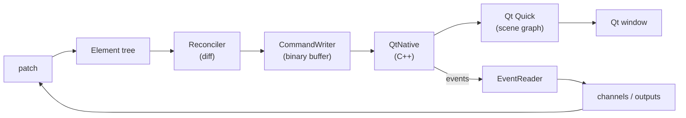

# Architecture

VL.Qt is a declarative element tree: your patch builds `Element` objects each frame, a reconciler diffs them against what Qt already has, and **QtNative** (the native C++ layer, project `src/VL.Qt.Native`, built as `vlqt.dll`) applies the changes to real Qt Quick items.



## Scene graph and data flow

- The patch creates immutable `Element` objects (Rectangle, Text, Group, ...) each frame
- The **Reconciler** compares the tree to the previous frame and emits minimal changes
- The **CommandWriter** encodes them into a compact binary buffer (no managed allocations after warmup)
- **QtNative** (C++) applies the commands to Qt objects
- Qt Quick renders directly into its own window (native swap chain; on Windows on a D3D11 device shared across windows)

## Timing and animation

vvvv's `IFrameClock` is the single time source:

```
per vvvv frame:
  0. frame start (clock tick): vlqt_app_deliver_input(): Qt delivers the queued input without rendering,
     each renderer polls it into its feedback
  1. Reconciler.Update(element tree)
  2. vlqt_app_advance_animations(clock.Time)
  3. vlqt_app_process_events_for(): Qt handles input and renders each changed window (at most once)
  4. events are polled back (vlqt_scene_poll)
```

- **Deterministic:** same tree and time, same output
- **Scrubbing and pause:** no Qt timers or system clocks interfere
- **Multiple windows:** the same clock drives all renderers
- **Exception:** a QML `Timer` in a user file (`QmlElement`) runs on wall time. QML animations follow the clock.

## C# ↔ C++ interop

- **CommandWriter (C#):** per frame `Reset()`, `Set…()`, `EndFrame()`, then a `ReadOnlySpan<byte>` goes to QtNative
- **Protocol:** shared type, property and event IDs in `protocol.h` / `Protocol.cs`; `ProtocolDriftTests`, `NativeLayoutTests` and `ApiDriftTests` in `VL.Qt.Tests` detect mismatches (constants, fixed wire sizes, struct layouts, exports against `[DllImport]`s). `VLQT_ABI_VERSION` / `Protocol.AbiVersion` number the protocol and the C ABI together: `QtApp` reads `vlqt_app_get_abi_version()` before the first window and refuses a `vlqt.dll` with another number or without the export (no window, one log error naming both versions and the path, every Renderer node fails with that message)
- **QtNative:** owns the `QGuiApplication` (one per process); per window a `QQuickWindow` and a `QQmlEngine`; exposed via P/Invoke (`vlqt_window_create`, `vlqt_scene_apply`, `vlqt_scene_poll`, ...)
- **Reconciler (C#):** tracks live Qt objects by ID and calls the command sink (`Create`, `Destroy`, `Reparent`, `Set*`) for each difference

## Rendering

1. Each `QQuickWindow` renders directly into its own swap chain: Direct3D 11 on Windows (one device shared by all windows and images), OpenGL on Linux
2. No `exec()` and no render thread: Qt's `basic` render loop, pumped once per vvvv frame (`vlqt_app_process_events_for`); each window renders at most once per pump
3. VSync on by default to avoid tearing, but vvvv's frame clock still controls timing: a frame may wait up to one refresh interval inside the pump (at the start of the frame, F5 segment "vsync wait"). The Renderer's `VSync` pin off gives swap interval 0 (never blocks, tearing allowed). See [Timing](decisions/timing.md)
4. Clear off (the `Clear` pin of `Renderer` and `QtTexture`) keeps the previous frame through a feedback layer, see [Feedback layer](#feedback-layer-clear-off)
5. Texture output to Stride is a separate path, see [Texture output for Stride](#texture-output-for-stride)

### Feedback layer (Clear off)

A swap chain discards its back buffer after `Present`, so a window cannot keep its previous frame. Instead of target-specific paths, `vlqt::Scene` (one per window or offscreen scene) owns a feedback layer that exists only while `Clear` is off: a recursive, live `QQuickShaderEffectSource` of the scene root, drawn under the content, so the previous frame is part of the scene graph and the elements are drawn over it with premultiplied alpha. It is the same code for windows and offscreen scenes, costs one full-size texture and one pass, and Qt renders every frame while it exists. Debug overlay, perf overlay and snapshots stay outside the root and are not accumulated. While `Clear` is off, the alpha of `Clear Color` is the fade strength: between the previous frame and the elements the layer draws a full-size fill with the clear colour (premultiplied "over", `out = C·a + prev·(1−a)`), only for 0 < alpha < 1. Alpha 0 adds no draw (pure accumulation; a Rectangle of the patch can still fade regions or gradients), alpha 1 equals `Clear` on, and the opaque default `Clear Color` of the `Renderer` therefore shows no trail. Limits: no fade to transparency, the fade speed depends on the frame rate, 8-bit targets keep a faint residue. Changing `Clear Color` or `Clear` at runtime does not recreate the layer. The layer starts from the clear colour when `Clear` goes off and after a resize. Switching `Clear` back on deletes it, so `Clear` on costs nothing extra. Command `SET_CLEAR`; details and measurements: [Render texture](decisions/render-texture.md#clear-pin-spike-2026-11-15-117-task-1).

### Texture output for Stride

`QtTexture` (companion package `VL.Qt.Stride`, Windows only, experimental) renders a scene without a window into a Stride `Texture`. Same element tree, reconciler and protocol as a window; the difference is the render target:

1. The node creates the `Texture` on Stride's device as a shared texture (SRgb: typeless, Stride samples the SRgb view; for SRgb and Float QtNative renders into a texture of its own and converts it to linear premultiplied values) and hands QtNative Stride's device, context and the shared handle. QtNative opens it and owns an offscreen scene (`vlqt_offscreen_*`, no `QQuickWindow` on a swap chain) with two shared `ID3D11Fence`s (Qt write complete, Stride read complete). Qt renders on the QtNative device, which moves to Stride's adapter while no window renders on it.
2. In its `Update` the node applies its scene through the reconciler and schedules itself. A game system with the lowest `DrawOrder` renders all scheduled nodes at the start of Stride's draw, before any other system draws: per changed scene polish, sync, render into the texture, signal the write fence. Stride waits for that fence on the GPU, so the texture is current in the same frame without a CPU wait; a scene that did not change is not rendered again.
3. Rendering runs on the main thread for now; a Qt render thread is planned as a separate step. The output texture is the same instance until `Size` or `Format` change. Device loss on either side unbinds and binds again in the next `Update`.

`QtRenderer` (category `Stride.Rendering`) is the layer variant: it renders into the same kind of shared texture, sized to its viewport, and draws it into the current Stride render target with premultiplied blending, so half-transparent content blends like a Qt window.

Details and rejected alternatives: [Render texture](decisions/render-texture.md), [Device sharing](decisions/device-sharing.md). The offscreen textures inside a scene (Effect layers, ShaderEffect sources, Snapshot) are a different mechanism and stay inside Qt.

## Events

1. Qt writes events (hover, tap, pointer move) into a buffer
2. Each frame `vlqt_scene_poll()` returns them
3. `EventReader` parses the buffer
4. `FeedbackRouter` maps feedback ids to `ElementFeedback` slots
5. The channels of the interaction nodes (e.g. Hover: Is Hovered, Position; Button: Is Clicked) and the element outputs (Measured Size, Scene Bounds) update

Input reaches the patch in the frame after it arrived, not one later: at the frame start (`IFrameClock` tick) QtNative delivers the window system events Qt has queued since the last pump (`vlqt_app_deliver_input`), and every renderer polls before the node updates. Nothing renders there: update requests stay with the update gate, an Expose waits for the pump, and touch moves that Qt Quick holds back until the next render are handed over. The poll at the frame end still collects what the pump itself produces (layout: Measured Size, Scene Bounds; input that arrived during the frame), which the patch reads in the next frame.

On Windows vvvv's message loop hands mouse, touch and pen messages to Qt between two frames. On Linux Qt reads the X11 or Wayland events inside the pump, so there input still arrives one frame later.

## Reusing elements

The same element instance can hang at several places of the tree; each place gets its own Qt object, events from all places are merged. Interaction per place goes on a Group around it (see the help patch `HowTo Reuse an Element`). This holds across renderers too (a window and a `QtTexture`): state values come from the first renderer that shows the element. Exception: a Video (would decode twice) is shown once only, app-wide; the first owner wins, the others get a warning.

## User QML

`QmlElement` (`src/VL.Qt/Elements/Qml*.cs`, native side `src/VL.Qt.Native/qmlitem.{h,cpp}`) is the one place where Qt Quick content that VL.Qt did not build enters the tree. It follows the same path as every element (CREATE, properties, apply) with two additions: `SET_QML_PROPERTIES` sends the entries of the `Properties` dictionary by name (diffed in C#, converted through `QVariant` in QtNative), and the events `EVENT_QML_PROPERTY` / `EVENT_QML_SIGNAL` carry the declared properties and signals of the file's root back to the node's feedback. The node also owns the file watcher for hot reload (it bumps `QML_RELOAD`). The file is compiled on the per-window `QQmlEngine` from a `file:` URL, the instance lives as a child of the element's item. See [QML files as elements](user-qml.md) and [decisions/user-qml.md](decisions/user-qml.md).

## Performance

Typical costs measured by the smoke tests; limits are enforced in `src/VL.Qt.SmokeTest/PerfLimits.cs`.

- CommandWriter: ~0.16 ms per 1000 commands
- Reconciler: ~0.04 ms per 1000 steady-state updates
- Apply: <0.001 ms per 10,000 SET operations
- Qt pump: ~0.6–0.8 ms per frame (1–2 windows)
