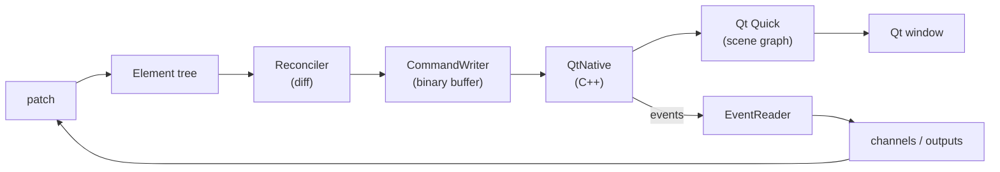

# Architecture

VL.Qt is a declarative element tree: your patch builds `Element` objects each frame, a reconciler diffs them against what Qt already has, and **QtNative** (the native C++ layer, project `src/VL.Qt.Native`, built as `vlqt.dll`) applies the changes to real Qt Quick items.



## Scene graph and data flow

- The patch creates immutable `Element` objects (Rectangle, Text, Group, ...) each frame
- The **Reconciler** compares the tree to the previous frame and emits minimal changes
- The **CommandWriter** encodes them into a compact binary buffer (no managed allocations after warmup)
- **QtNative** (C++) applies the commands to Qt objects
- Qt Quick renders directly into its own window (native swap chain; on Windows on a D3D11 device shared across windows)

## Timing and animation

vvvv's `IFrameClock` is the single time source:

```
per vvvv frame:
  0. frame start (clock tick): vlqt_app_deliver_input(): Qt delivers the queued input without rendering,
     each renderer polls it into its sinks
  1. Reconciler.Update(element tree)
  2. vlqt_driver_advance(clock.Time)
  3. vlqt_app_process_events(): Qt handles input and renders each changed window (at most once)
  4. events are polled back (vlqt_window_poll)
```

- **Deterministic:** same tree and time, same output
- **Scrubbing and pause:** no Qt timers or system clocks interfere
- **Multiple windows:** the same clock drives all renderers

## C# ↔ C++ interop

- **CommandWriter (C#):** per frame `Reset()`, `Set…()`, `EndFrame()`, then a `ReadOnlySpan<byte>` goes to QtNative
- **Protocol:** shared type, property and event IDs in `protocol.h` / `Protocol.cs`; the smoke test's `--drift` mode detects mismatches
- **QtNative:** owns the `QGuiApplication` (one per process); per window a `QQuickWindow` and a `QQmlEngine`; exposed via P/Invoke (`vlqt_window_create`, `vlqt_window_apply`, `vlqt_window_poll`, ...)
- **Reconciler (C#):** tracks live Qt objects by ID and calls the command sink (`Create`, `Destroy`, `Reparent`, `Set*`) for each difference

## Rendering

1. Each `QQuickWindow` renders directly into its own swap chain: Direct3D 11 on Windows (one device shared by all windows and images), OpenGL on Linux
2. No `exec()` and no render thread: Qt's `basic` render loop, pumped once per vvvv frame (`vlqt_app_process_events`); each window renders at most once per pump
3. VSync off by default: vvvv's frame clock controls timing (the Renderer's `VSync` pin syncs the window to the display instead)
4. Offscreen textures are only used inside the scene: Effect layers, ShaderEffect sources and Snapshot. There is no texture output to Stride or Skia layers

## Events

1. Qt writes events (hover, tap, pointer move) into a buffer
2. Each frame `vlqt_window_poll()` returns them
3. `EventReader` parses the buffer
4. `SinkRegistry` maps handles to `ElementSink` slots
5. The channels of the interaction nodes (e.g. Hover: Is Hovered, Position; Button: Is Clicked) and the element outputs (Measured Size, Scene Bounds) update

Input reaches the patch in the frame after it arrived, not one later: at the frame start (`IFrameClock` tick) QtNative delivers the window system events Qt has queued since the last pump (`vlqt_app_deliver_input`), and every renderer polls before the node updates. Nothing renders there: update requests stay with the update gate, an Expose waits for the pump, and touch moves that Qt Quick holds back until the next render are handed over. The poll at the frame end still collects what the pump itself produces (layout: Measured Size, Scene Bounds; input that arrived during the frame), which the patch reads in the next frame.

On Windows vvvv's message loop hands mouse, touch and pen messages to Qt between two frames. On Linux Qt reads the X11 or Wayland events inside the pump, so there input still arrives one frame later.

## Reusing elements

The same element instance can hang at several places of the tree; each place gets its own Qt object, events from all places are merged. Interaction per place goes on a Group around it (see the help patch `HowTo Reuse an Element`). Exceptions: across several renderers and for Video (would decode twice) the first owner wins, with a warning.

## Performance

Typical costs measured by the smoke tests; limits are enforced in `src/VL.Qt.SmokeTest/PerfLimits.cs`.

- CommandWriter: ~0.16 ms per 1000 commands
- Reconciler: ~0.04 ms per 1000 steady-state updates
- Apply: <0.001 ms per 10,000 SET operations
- Qt pump: ~0.6–0.8 ms per frame (1–2 windows)
