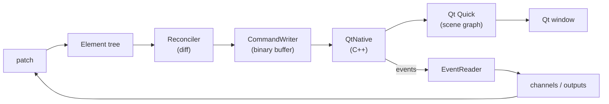

# Architecture

VL.Qt is a declarative element tree: your patch builds `Element` objects each frame, a reconciler diffs them against what Qt already has, and **QtNative** (the native C++ layer, project `src/VL.Qt.Native`, built as `vlqt.dll`) applies the changes to real Qt Quick items.



## Scene graph and data flow

- The patch creates immutable `Element` objects (Rectangle, Text, Group, ...) each frame
- The **Reconciler** compares the tree to the previous frame and emits minimal changes
- The **CommandWriter** encodes them into a compact binary buffer (no managed allocations after warmup)
- **QtNative** (C++) applies the commands to Qt objects
- Qt Quick renders directly into its own window (native swap chain; on Windows on a D3D11 device shared across windows)

## Timing and animation

vvvv's `IFrameClock` is the single time source:

```
per vvvv frame:
  0. frame start (clock tick): vlqt_app_deliver_input(): Qt delivers the queued input without rendering,
     each renderer polls it into its feedback
  1. Reconciler.Update(element tree): the node update writes the commands
  2. frame end, one pump per app (QtApp.PumpFrame): every renderer applies its commands (vlqt_scene_apply),
     the image resource queues run
  3. QtApp.AdvanceDriver(clock.Time) -> vlqt_app_advance_animations
  4. vlqt_app_process_events_for(windows of this app): Qt handles input and renders each changed window (at most once)
  5. resource queues, then the events are polled back (vlqt_scene_poll)
```

- **Deterministic:** same tree and time, same output for everything vvvv computes from the time
- **Pause:** no Qt timers or system clocks interfere; when the clock stands, QML animations stand
- **Scrubbing:** only values from vvvv scrub. QML animations follow the clock forward and hold with it, and the animation driver never runs backwards (QtApp owns its time, QtNative ignores a time below the current one): after the clock has jumped back, a running animation holds its value until the clock passes the old time again, then goes on forward
- **Multiple windows:** the same clock drives all renderers
- **Input:** `vlqt_app_advance_animations` refuses a time that is NaN, infinite or out of range (`VLQT_ERR_BAD_ARGUMENT`)
- **Exception:** a QML `Timer` in a user file (`QmlElement`) runs on wall time. QML animations follow the clock.

## C# ↔ C++ interop

- **CommandWriter (C#):** per frame `Reset()`, `Set…()`, `EndFrame()`, then a `ReadOnlySpan<byte>` goes to QtNative
- **Protocol:** shared type, property and event IDs in `protocol.h` / `Protocol.cs`; `ProtocolDriftTests`, `NativeLayoutTests` and `ApiDriftTests` in `VL.Qt.Tests` detect mismatches (constants, fixed wire sizes, struct layouts, exports against `[DllImport]`s). `VLQT_ABI_VERSION` / `Protocol.AbiVersion` number the protocol and the C ABI together: `QtApp` reads `vlqt_app_get_abi_version()` before the first window and refuses a `vlqt.dll` with another number or without the export (no window, one log error naming both versions and the path, every Renderer node fails with that message)
- **QtNative:** owns the `QGuiApplication` (one per process); per window a `QQuickWindow` and a `QQmlEngine`; exposed via P/Invoke (`vlqt_window_create`, `vlqt_scene_apply`, `vlqt_scene_poll`, ...), declared in `src/VL.Qt/Interop/` (`Native.*.cs` one file per group of `vlqt.h`, `QtNativeLibrary.cs` finds and loads `vlqt.dll`)
- **Reconciler (C#):** tracks live Qt objects by ID and calls the command sink (`Create`, `Destroy`, `Reparent`, `Set*`) for each difference

### Adding a command

A command is one opcode of the command buffer that `vlqt_scene_apply` decodes. A new one touches:

1. `src/VL.Qt.Native/protocol.h`: the opcode in `VLQT_OP_*`, its payload layout in the head comment and, for a fixed payload, its size constant.
2. `src/VL.Qt/Wire/Protocol.cs`: the same opcode in `Protocol.Op` (and the size), plus the writer method in `Wire/CommandWriter.cs`.
3. `src/VL.Qt.Native/scene/commands.cpp`: one row in the op table (`Scene::findOp`: name for the error text, whether the payload starts with an id and a property, exact or minimum payload length, decoder) and its decoder `Scene::op<Name>`, declared in `scene/scene.h`. `Scene::apply` checks the length against the row and reports the id of a failing command from it; the decoder reads the payload through `WireReader` (`wire.h`) and checks only what goes beyond the row.
4. The drift tests and the version bump of the protocol change ([development.md](development.md), "Change the protocol").

An input-handler property is one row in `kHandlerProps` (`scene/handlers.cpp`: the handler types that take it and its value type) and its case in `setHandler`.

## Element nodes

An element node is a public `[ProcessNode]` class that holds an `ElementNodeCore<TElement, TProps>` (`src/VL.Qt/Nodes/ElementNodeCore.cs`) as a field. Its `Update` packs the common pins into `CommonInputs` (`Nodes/CommonInputs.cs`) and its own pins into a `readonly record struct Props`, and returns `Describe(common, props, out measuredSize, out sceneBounds)`. The core returns the previous description as long as both values are equal, so an unchanged node hands the reconciler the same instance, which it skips. It also shows the warnings and errors the feedback reports at the node and reads the outputs.

### Adding an element node

Copy `src/VL.Qt/Nodes/Elements/RectangleNode.cs`, the template, and change only the element-specific part:

1. The element class in `src/VL.Qt/Elements/` (internal, sealed, `init` properties), with the one-line constructor that takes the common part: `internal Rectangle(in CommonInputs common, FeedbackSlot feedback) : base(ElementType.Rectangle, common, feedback) { }`. A new element type also needs its `ElementType`, its reconciler properties and its QtNative item; see "Adding a command".
2. `Props`: one field per element-specific pin. A spread is compared by content (see `ShapeNodeCore.Props.Equals`), since vvvv often hands a new spread with equal content each frame.
3. `Create`: a static lambda without captures that sets only the element-specific properties, `static (c, p, slot) => new Rectangle(c, slot) { Fill = p.Color, … }`. It is `private static readonly … s_create`, or `internal static readonly … Create` when another node shares it (Circle uses Rectangle's, the Spectral nodes those of Group, Row and Column). A node that fixes a common value states it with `with`: `c with { Anchor = RectangleAnchor.TopLeft }`.
4. The pins of `Update`, with defaults and docs (AGENTS.md "Nodes"); a children pin goes through `ChildrenInput`, a single element pin through `ElementInput`.
5. A help patch `help/Qt/HowTo ….vl`, its line in `help/Help.xml`, then `python tools/vl-patch-check.py` (its pin catalog reads the new node from the C# sources) and `tools/vvvvc.ps1 -File` on the patch.
6. Regenerate `src/VL.Qt.Tests/Api/node-api.txt` (`VLQT_UPDATE_SNAPSHOT=1`) and add a test that two `Update`s with equal inputs return the same instance.

## Lifetime

QtNative lives as long as the process: unloading it (`FreeLibrary`, `dlclose`) is not supported, and .NET never unloads a native library.

- **Until the process ends:** the `QGuiApplication` (one per process, never deleted), the animation driver and its keep-alive timer, the shared D3D11 device and its upload QRhi, the test devices of `vlqt_test.h`, and the app fonts still registered. Nothing of them is destroyed at exit, so nothing is torn down out of order.
- **What C# ends:** every window and offscreen scene it created (`vlqt_scene_destroy`; a window not destroyed stays open until the process ends), every font it added (`vlqt_font_release`), and the resource workers once nothing is referenced (`vlqt_res_shutdown`).
- **At unload** (`DllMain` on Windows, an ELF destructor on Linux, both in `platform/`): the log callback into .NET is cut, because at process exit the CLR is gone before Qt's static destructors log. At process exit on Windows the Qt message handler of QtNative stays (the DLL stays mapped); on `FreeLibrary`, and always on Linux (a destructor cannot tell `dlclose` from exit), Qt's default handler replaces it. Exported apps on Linux end with `_exit` (`ExportedApp.cs`) and run no destructors.

## Threads

QtNative runs on the thread that calls `vlqt_app_init`, the Qt GUI thread (in vvvv its main thread). Every export of `vlqt.h` belongs to it, except six that run on any thread: `vlqt_app_get_abi_version`, `vlqt_last_error`, `vlqt_image_write_file` (FileWriter tasks), `vlqt_shader_reflect` (shader node factory), `vlqt_audio_tap_read` (VL.Audio's audio thread) and `vlqt_audio_tap_now_ns`. Each export states its thread by the helper of `app/exports.h` its body runs in (`guarded` for any thread, `guardedGui`, `withScene`, `withWindow`, `withOffscreen` for the GUI thread); on another thread a GUI-thread export does nothing and returns `VLQT_ERR_WRONG_THREAD`. There is no mutex in the app and window code; what other threads touch:

| State | Threads | Why it is safe |
|---|---|---|
| Log callback (`app/log.cpp`) | set by `vlqt_app_init`, called from any thread (Qt messages of render threads and workers) | atomic pointer; the C# callback is thread-safe |
| Last error (`app/last_error.cpp`) | any thread | one text per thread |
| Pump state (`RenderGate`, the window lists of `vlqt_app_process_events_for`) | GUI thread | a nested pump (a host callback inside `processEvents`) is refused with `VLQT_ERR_UNSUPPORTED` |
| Change counter of a scene (`app/scene_change.cpp`) | its sync hook runs on the scene's render thread in the threaded mode | the GUI thread waits in the blocking sync job of the batch; a counter shares no state with another |
| Resources, offscreen render threads | own workers and render threads | their own locks and queues (`resources/`, `device/render_thread.cpp`) |

## Rendering

1. Each `QQuickWindow` renders directly into its own swap chain: Direct3D 11 on Windows (one device shared by all windows and images), OpenGL on Linux
2. Windows: no `exec()` and no render thread. Qt's `basic` render loop, pumped once per vvvv frame (`vlqt_app_process_events_for`) on the GUI thread; each window renders at most once per pump. Offscreen scenes (`QtTexture`, `QtRenderer`) render on Qt render threads instead, see [Texture output for Stride](#texture-output-for-stride)
3. VSync on by default to avoid tearing, but vvvv's frame clock still controls timing: a frame may wait up to one refresh interval inside the pump (at the start of the frame, F5 segment "vsync wait"). The Renderer's `VSync` pin off gives swap interval 0 (never blocks, tearing allowed). See [Timing](decisions/timing.md)
4. Clear off (the `Clear` pin of `Renderer` and `QtTexture`) keeps the previous frame through a feedback layer, see [Feedback layer](#feedback-layer-clear-off)
5. Texture output to Stride is a separate path, see [Texture output for Stride](#texture-output-for-stride)

### Feedback layer (Clear off)

A swap chain discards its back buffer after `Present`, so a window cannot keep its previous frame. Instead of target-specific paths, `vlqt::Scene` (one per window or offscreen scene) owns a feedback layer that exists only while `Clear` is off: a recursive, live `QQuickShaderEffectSource` of the scene root, drawn under the content, so the previous frame is part of the scene graph and the elements are drawn over it with premultiplied alpha. It is the same code for windows and offscreen scenes, costs one full-size texture and one pass, and Qt renders every frame while it exists. Debug overlay, perf overlay and snapshots stay outside the root and are not accumulated. While `Clear` is off, the alpha of `Clear Color` is the fade strength: between the previous frame and the elements the layer draws a full-size fill with the clear colour (premultiplied "over", `out = C·a + prev·(1−a)`), only for 0 < alpha < 1. Alpha 0 adds no draw (pure accumulation; a Rectangle of the patch can still fade regions or gradients), alpha 1 equals `Clear` on, and the opaque default `Clear Color` of the `Renderer` therefore shows no trail. Limits: no fade to transparency, the fade speed depends on the frame rate, 8-bit targets keep a faint residue. Changing `Clear Color` or `Clear` at runtime does not recreate the layer. The layer starts from the clear colour when `Clear` goes off and after a resize. Switching `Clear` back on deletes it, so `Clear` on costs nothing extra. Command `SET_CLEAR`; details and measurements: [Render texture](decisions/render-texture.md#clear-pin-spike-2026-11-15-117-task-1).

### Texture output for Stride

`QtTexture` (companion package `VL.Qt.Stride`, Windows only, experimental) renders a scene without a window into a Stride `Texture`. Same element tree, reconciler and protocol as a window; the difference is the render target:

1. The node creates the `Texture` on Stride's device as a shared texture (SRgb: typeless, Stride samples the SRgb view; for SRgb and Float QtNative renders into a texture of its own and converts it to linear premultiplied values) and hands QtNative Stride's device, context and the shared handle. QtNative opens it and owns an offscreen scene (`vlqt_offscreen_*`, no `QQuickWindow` on a swap chain) with two shared `ID3D11Fence`s (Qt write complete, Stride read complete). Qt renders on the QtNative device, which moves to Stride's adapter while no window renders on it.
2. In its `Update` the node applies its scene through the reconciler and schedules itself. A game system with the lowest `DrawOrder` renders all scheduled nodes at the start of Stride's draw, before any other system draws: per changed scene polish, sync, render into the texture, signal the write fence. Stride waits for that fence on the GPU, so the texture is current in the same frame without a CPU wait; a scene that did not change is not rendered again.
3. Scenes render on a pool of Qt render threads (by default one thread shared by all scenes): per changed scene the main thread polishes and hands over, the render thread syncs while that call waits and renders after it returned, and the Stride GPU waits for the write fence. The size of the pool is the pin `Render Threads` of `QtTexture` and `QtRenderer` (0 = main-thread mode, through the same batch code; [Diagnostics](diagnostics.md#qttexture-render-thread)). Details and measurements: [Render texture](decisions/render-texture.md). The output texture is the same instance until `Size` or `Format` change. Device loss on either side unbinds and binds again in the next `Update`.

`QtRenderer` (category `Stride.Rendering`) is the layer variant: it renders into the same kind of shared texture, sized to its viewport, and draws it into the current Stride render target with premultiplied blending, so half-transparent content blends like a Qt window.

Details and rejected alternatives: [Render texture](decisions/render-texture.md), [Device sharing](decisions/device-sharing.md). The offscreen textures inside a scene (Effect layers, ShaderEffect sources, Snapshot) are a different mechanism and stay inside Qt.

## Events

1. Qt writes events (hover, tap, pointer move) into a buffer
2. Each frame `vlqt_scene_poll()` returns them
3. `EventReader` parses the buffer
4. `FeedbackRouter` maps feedback ids to `ElementFeedback` slots
5. The channels of the interaction nodes (e.g. Hover: Is Hovered, Position; Button: Is Clicked) and the element outputs (Measured Size, Scene Bounds) update

Input reaches the patch in the frame after it arrived, not one later: at the frame start (`IFrameClock` tick) QtNative delivers the window system events Qt has queued since the last pump (`vlqt_app_deliver_input`), and every renderer polls before the node updates. Nothing renders there: update requests stay with the render gate, an Expose waits for the pump, and touch moves that Qt Quick holds back until the next render are handed over. The poll at the frame end still collects what the pump itself produces (layout: Measured Size, Scene Bounds; input that arrived during the frame), which the patch reads in the next frame.

On Windows vvvv's message loop hands mouse, touch and pen messages to Qt between two frames. On Linux Qt reads the X11 or Wayland events inside the pump, so there input still arrives one frame later.

## Reusing elements

The same element instance can hang at several places of the tree; each place gets its own Qt object, events from all places are merged. Interaction per place goes on a Group around it (see the help patch `HowTo Reuse an Element`). This holds across renderers too (a window and a `QtTexture`): state values come from the first renderer that shows the element. Exception: a Video (would decode twice) is shown once only, app-wide; the first owner wins, the others get a warning.

## User QML

`QmlElement` (`src/VL.Qt/Elements/Qml/`, native side `src/VL.Qt.Native/user_qml/`) is the one place where Qt Quick content that VL.Qt did not build enters the tree. It follows the same path as every element (CREATE, properties, apply) with two additions: `SET_QML_PROPERTIES` sends the entries of the `Properties` dictionary by name (diffed in C#, converted through `QVariant` in QtNative), and the events `EVENT_QML_PROPERTY` / `EVENT_QML_SIGNAL` carry the declared properties and signals of the file's root back to the node's feedback. The node also owns the file watcher for hot reload (it bumps `QML_RELOAD`). The file is compiled on the per-window `QQmlEngine` from a `file:` URL, the instance lives as a child of the element's item. See [QML files as elements](user-qml.md) and [decisions/user-qml.md](decisions/user-qml.md).

## Companion packages

`VL.Qt.Stride` and `VL.Qt.Audio` are separate assemblies built from the same repository and released with `VL.Qt`. They see the `internal` types of `VL.Qt` through `InternalsVisibleTo` (`src/VL.Qt/VL.Qt.csproj`); there is no public API for them until a third party builds a companion. The rule: **a companion uses only the types and members below**, nothing else of `VL.Qt`. In particular `VL.Qt.Stride` uses no `Native` and no `Protocol`: what it needs from QtNative is a method of a type below. A new need adds a member to one of these types (and a line here), not a direct call into `Interop/` or `Wire/`.

Both companions:

- `NodeErrors`: the messages at a node (shown at the node, logged once per distinct text); `NodeMessage` is the handle of one message source on it.
- `Multisample.ClampWarning`: the warning when QtNative used fewer MSAA samples than requested.

`VL.Qt.Stride` (`QtTexture`, `QtRenderer`):

- `OffscreenScene` (`Scene/`): the offscreen scene and everything the texture path asks of QtNative: `Bind`, `Unbind`, `Update`, `ApplyCommands`, `PollEvents`, `Handle`, `IsBound`, `UsedSamples`, `Error`, `Input`, `Debug`, `LastBindSucceeded`, `ShouldRetryBind` (the rebind throttle), `Reconciler.RootBuildError`, and the static `RenderBatchError` (one native call for all scenes of a frame) and `SetRenderThreads` (size of the render thread pool).
- `SceneHandle` (`Interop/`): the handle of a scene in a batch; the companion only passes it on.
- `NotificationQueue` (`Scene/`): takes the notifications of an `Input Notifications` pin from any thread and hands them to the main thread.
- `OccurrenceRegistry.ForApp` (`Reconciliation/`): the registry of duplicate elements of the app, which a scene needs.
- `ElementInput` (`Nodes/`): converts the value of the Input pin to the element the scene gets and warns at the node about a foreign `IElement`.
- `QtApp.Get` and `QtPump.ForApp` (`Runtime/`): start the Qt app and its per-frame pump, which also serves the offscreen scenes; `QtApp.DriverSeconds` is the animation driver time.

`VL.Qt.Audio` (`Video (VL.Audio)`):

- `ElementNodeCore<TElement, TProps>`, `CommonInputs`, `VideoNode.Props` and `VideoNode.Create` (`Nodes/`): the element node of `Video` that the audio variant extends with the tap.
- `Categories` (`VL.Qt`): the node category names.
- `ResourceClient.ForApp` and `ResourceClient.CreateAudioTap` with `ImageResource` (`Images/`): create and release the audio tap of a video.
- `Native.vlqt_audio_tap_*` (`vlqt_audio_tap_now_ns`, `AudioTapRead`, `AudioTapDrop`, `vlqt_audio_tap_state`) and the flags `Protocol.AudioTap` (`Interop/`, `Wire/`): the reader of the tap ring, behind `IAudioTapReader` in the companion. This is the one place where a companion calls `Native`; it is the audio tap group of the C API.

Public types that the pins of the companion nodes carry (`IElement`, `Space`, `MultisampleCount`, `Video`) are part of the public API, not of this list.

## Performance

Typical costs measured by the smoke tests; limits are enforced in `src/VL.Qt.SmokeTest/PerfLimits.cs`.

- CommandWriter: ~0.16 ms per 1000 commands
- Reconciler: ~0.04 ms per 1000 steady-state updates
- Apply: <0.001 ms per 10,000 SET operations
- Qt pump: ~0.6–0.8 ms per frame (1–2 windows)