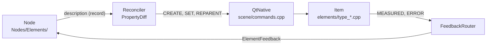

# Add an element

This page follows one small element, `Rectangle`, through every layer, in the order the work goes. `Circle` is a second node on the same element and shows how a node reuses one. Follow it with your own element in place of `Rectangle`.

The conventions of an element node (pin order, `Props`, `Create`) are in [Architecture, Adding an element node](architecture.md#adding-an-element-node); this page does not repeat them. The meaning of the commands is in [protocol.md](protocol.md), the reasons are in the notes [element-model](../design/element-model.md), [reconciler](../design/reconciler.md), [reconciler-identity](../design/reconciler-identity.md) and [events-and-interaction](../design/events-and-interaction.md). The words (element, feedback, item) are in the [glossary](../glossary.md).

How the pieces connect for one element:



## 1 The protocol entry

Type and property ids are the contract between C# and QtNative. `protocol.h` is the source, `Protocol.cs` its hand-written mirror.

- The type id is one line in `enum vlqt_element_type`: `VLQT_ELEMENT_TYPE_RECTANGLE = 3` ([protocol.h:123](../../src/VL.Qt.Native/protocol.h#L123)). Take the next free number; removed numbers stay unused (the comment above the enum lists them).
- The property ids are a block of the enum `vlqt_property`: `VLQT_PROPERTY_COLOR = 256` to `VLQT_PROPERTY_BORDER_WIDTH = 259` ([protocol.h:161](../../src/VL.Qt.Native/protocol.h#L161)). Common properties are `1..255` and need nothing from you. Type-specific ones sit in a block of their own; the block list is in the comment above the enum, and one id may serve several types (`COLOR` is also Text's). Take a free block, add it to that comment and to the table in [protocol.md](protocol.md#property-blocks).
- Describe the meaning of the properties in [protocol.md](protocol.md), not in the header; the header gets the value type in a comment where it is not obvious.
- Mirror both in `Protocol.cs` by the naming rule in the head of `protocol.h`: `Protocol.ElementType.Rectangle` ([Protocol.cs:120](../../src/VL.Qt/Wire/Protocol.cs#L120)) and `Protocol.PropertyId.Color` ([Protocol.cs:180](../../src/VL.Qt/Wire/Protocol.cs#L180)).
- Bump the ABI version on both sides: `VLQT_ABI_VERSION` ([protocol.h:60](../../src/VL.Qt.Native/protocol.h#L60)) and `Protocol.AbiVersion` ([Protocol.cs:14](../../src/VL.Qt/Wire/Protocol.cs#L14)). `QtApp` refuses a `vlqt.dll` with another number.
- Check header and mirror: `dotnet test src/VL.Qt.Tests --filter "FullyQualifiedName~DriftTests|FullyQualifiedName~NativeLayoutTests"` (`ProtocolDriftTests` compares names and values, [ProtocolDriftTests.cs](../../src/VL.Qt.Tests/Wire/ProtocolDriftTests.cs)). `ProtocolNamesTests` fails when two names share a value.

A new element needs no new command: `CREATE` takes the type id and `SET` takes the property ids. The steps of a protocol change in general are in [development.md](development.md#typical-workflows).

## 2 The element record

An element is an immutable description: an `internal sealed class` under `src/VL.Qt/Elements/` that derives from `Element`, which implements the public marker `IElement` ([IElement.cs](../../src/VL.Qt/Elements/IElement.cs)). The element model knows nothing of the protocol.

- Add the kind to `enum ElementType`: `Rectangle = Protocol.ElementType.Rectangle` ([ElementType.cs:11](../../src/VL.Qt/Elements/ElementType.cs#L11)). The compiler keeps the enum and the mirror in step.
- Write the record ([Rectangle.cs](../../src/VL.Qt/Elements/Rectangle.cs)):

```csharp
internal sealed class Rectangle : Element
{
    public Rectangle() : base(ElementType.Rectangle) { }
    internal Rectangle(in CommonInputs common, FeedbackSlot feedback) : base(ElementType.Rectangle, common, feedback) { }

    public Color4 Fill { get; init; } = Color4.White;   // Qt default: white
    public float Radius { get; init; }
    public Color4 StrokeColor { get; init; } = Color4.Black;
    public float StrokeWidth { get; init; }             // 0 = no stroke
}
```

- The parameterless constructor makes the default instance that the diff compares a new object against ([section 3](#3-the-diff)). Every default of a property is therefore the default of the Qt item, or QtNative sets it when it makes the item ([section 5](#5-qtnative)). `ReconcilerPropertyTests.DefaultElements_SendNoSets_ExceptTextFontSize` ([ReconcilerPropertyTests.cs:87](../../src/VL.Qt.Tests/Reconciliation/ReconcilerPropertyTests.cs#L87)) fails if a default element sends a `SET`.
- `ElementTypeTests` ([ElementTypeTests.cs:17](../../src/VL.Qt.Tests/Elements/ElementTypeTests.cs#L17)) finds every concrete element type by reflection and checks that it is sealed and has `init` properties only. There is nothing to register.
- Lengths are in units; the diff converts them. Angles, ratios and opacity stay as they are.

## 3 The diff

`PropertyDiff` ([PropertyDiff.cs](../../src/VL.Qt/Reconciliation/PropertyDiff.cs)) has one hand-written method per element type. It compares the previous description with the new one and writes a `SET` only for what changed. A new object is compared with the default instance of its type, so only non-default values go out. Four places for a new type:

1. A static default instance: `s_rectangle = new()` ([PropertyDiff.cs:26](../../src/VL.Qt/Reconciliation/PropertyDiff.cs#L26)).
2. Its row in `DefaultOf` ([PropertyDiff.cs:44](../../src/VL.Qt/Reconciliation/PropertyDiff.cs#L44)).
3. Its case in `Write` ([PropertyDiff.cs:90](../../src/VL.Qt/Reconciliation/PropertyDiff.cs#L90)).
4. The method ([PropertyDiff.cs:193](../../src/VL.Qt/Reconciliation/PropertyDiff.cs#L193)):

```csharp
private void DiffRectangle(uint id, Rectangle p, Rectangle n)
{
    if (p.Fill != n.Fill)
        _sink.SetColor(id, P.Color, n.Fill);
    if (_rescale || p.Radius != n.Radius)
        _sink.SetF32(id, P.Radius, _mapping.ToQt(n.Radius));
    ...
}
```

A length is written again when `_rescale` is set (the unit scale changed), whether or not its value did. The common properties (size, transform, opacity, ...) are `DiffCommon` ([PropertyDiff.cs:164](../../src/VL.Qt/Reconciliation/PropertyDiff.cs#L164)); the type method adds the specific ones. A property with a value type that the sink cannot write yet needs a method in `ICommandSink` ([ICommandSink.cs](../../src/VL.Qt/Wire/ICommandSink.cs)) and its writer; that is a protocol change, not part of an element.

What the reconciler does with the diff (positions, creation, reuse, several places of one element) is in [reconciler](../design/reconciler.md) and [reconciler-identity](../design/reconciler-identity.md). An element does nothing for it: the node hands the reconciler a new instance when an input changed and always the same feedback slot.

## 4 The node

The node is a public `[ProcessNode]` class in `src/VL.Qt/Nodes/Elements/` that holds an `ElementNodeCore` ([RectangleNode.cs](../../src/VL.Qt/Nodes/Elements/RectangleNode.cs)). The pins, `Props`, `Create`, the order of the pins and the docs follow [Architecture, Adding an element node](architecture.md#adding-an-element-node) and the node rules in [AGENTS.md](../../AGENTS.md). In short:

```csharp
[ProcessNode(Name = "Rectangle", Category = Categories.Elements)]
public sealed class RectangleNode : IDisposable
{
    internal readonly record struct Props(Color4 Color, float Radius, Color4 StrokeColor, float StrokeWidth);
    private readonly ElementNodeCore<Rectangle, Props> _node;
    ...
    return _node.Describe(new CommonInputs(...), new Props(...), out measuredSize, out sceneBounds);
}
```

- The category comes from `Categories` ([Categories.cs](../../src/VL.Qt/Categories.cs)): `Categories.Elements` for a visual element. A new category is one constant there.
- The pin texts shared by all element nodes are `<include>`s of [CommonPins.xml](../../src/VL.Qt/Nodes/CommonPins.xml); the pins of the element itself are documented at the node.
- The node does not mention the protocol. It builds the record in `Create` ([RectangleNode.cs:31](../../src/VL.Qt/Nodes/Elements/RectangleNode.cs#L31)); `Describe` ([ElementNodeCore.cs:89](../../src/VL.Qt/Nodes/ElementNodeCore.cs#L89)) returns the last description while `CommonInputs` and `Props` are equal.
- A second node on the same element passes the first node's `Create` and `Props` to its own core: [CircleNode.cs](../../src/VL.Qt/Nodes/Elements/CircleNode.cs) turns its `Radius` into the size and the radius of the `Rectangle`.
- The assembly imports its public types with `ImportAsIs` ([AssemblyInfo.cs](../../src/VL.Qt/Properties/AssemblyInfo.cs)); there is no list of nodes to extend.

## 5 QtNative

Three places: the item with its property table, the table of types, the build file. The command decoder is already there.

**How a command reaches the item.** `Scene::apply` looks up the opcode in `Scene::findOp` ([commands.cpp:95](../../src/VL.Qt.Native/scene/commands.cpp#L95), the row of `SET`) and calls its decoder. `Scene::opSet` ([commands.cpp:238](../../src/VL.Qt.Native/scene/commands.cpp#L238)) checks the value length, reads the value and calls `Elements::set` ([commands.cpp:339](../../src/VL.Qt.Native/scene/commands.cpp#L339)). `Elements::set` ([elements.cpp:177](../../src/VL.Qt.Native/elements/elements.cpp#L177)) finds the property in the table of the type, checks the value type and that the floats are finite, and calls the setter ([elements.cpp:211](../../src/VL.Qt.Native/elements/elements.cpp#L211)). `CREATE` ends in `Elements::create` ([elements.cpp:54](../../src/VL.Qt.Native/elements/elements.cpp#L54)).

**The type file** `elements/type_<name>.cpp` ([type_rectangle.cpp](../../src/VL.Qt.Native/elements/type_rectangle.cpp)) holds three things:

```cpp
QQuickItem* makeRectangle() { ... r->border()->setWidth(0); ... }   // the item, built in C++

bool setBorderWidth(Elements&, ElementEntry& n, const ResolvedProp&, const Value& v, std::string&)
{
    rect(n)->border()->setWidth(v.f[0]);
    return true;
}

std::vector<PropDef> rectangleProps()
{
    return { {VLQT_PROPERTY_COLOR, VLQT_VALUE_TYPE_COLOR, setColor, nullptr}, ... };
}

TypeDef rectangleType()
{
    return {VLQT_ELEMENT_TYPE_RECTANGLE, "RECTANGLE", nullptr, rectangleProps(), makeRectangle};
}
```

- `PropDef` and `TypeDef` ([element_types.h:70](../../src/VL.Qt.Native/elements/element_types.h#L70) and [element_types.h:87](../../src/VL.Qt.Native/elements/element_types.h#L87)) say what each field means: the expected value type, the setter, the QML name (`nullptr` for a typed C++ setter) and the flags of the type (auto size, layout, container, styled).
- `makeRectangle` sets Qt's defaults to the defaults of the C# record: Qt's border width is 1, the `StrokeWidth` of the record is 0.
- An element that is easier to write in QML has a `qmlUrl` and QML properties by name (`qml/elements/`, see the controls in `type_controls.cpp`) instead of `make`. The Rectangle is built in C++ because scenes hold it by the thousand.

**The table:** the declaration `TypeDef rectangleType();` ([element_types.h:136](../../src/VL.Qt.Native/elements/element_types.h#L136)), its row in `typeTable()` ([element_types.cpp:48](../../src/VL.Qt.Native/elements/element_types.cpp#L48)) and the file in `CMakeLists.txt` ([CMakeLists.txt:108](../../src/VL.Qt.Native/CMakeLists.txt#L108)). Nothing else asks for the id of the type.

**Errors back.** A setter returns `false` and a reason; `Elements::set` turns it into `ApplyBadValue`, an unknown property into `ApplyUnknownProperty`. The apply stops with that code and QtNative remembers the id of the failing object. On the C# side `Scene.ReportApplyError` ([Scene.cs:199](../../src/VL.Qt/Scene/Scene.cs#L199)) resolves the id to the feedback slot of the node and shows the text at the node (`ApplyError`); see [reconciler, Errors and resync](../design/reconciler.md#errors-and-resync). An item that reports a problem of its own later (a missing file, a QML error) sends `EVENT_ERROR`, see the next section.

After a change here, rebuild QtNative (`tools/build-native.ps1`) and restart vvvv.

## 6 Back to the node: feedback

Everything that goes from QtNative to the node is feedback: the measured size and the scene bounds that every element has, errors, and the events of the elements that have them (`Button` clicks, `Slider` values; the list is in [protocol.md](protocol.md#events)).

- The reconciler binds the id of the item to the feedback slot of the node (`ICommandSink.Bind`, [ICommandSink.cs:21](../../src/VL.Qt/Wire/ICommandSink.cs#L21)). A `FeedbackSlot` ([FeedbackSlot.cs](../../src/VL.Qt/Elements/Feedback/FeedbackSlot.cs)) points into the `ElementFeedback` of the node ([ElementFeedback.cs](../../src/VL.Qt/Elements/Feedback/ElementFeedback.cs)). The record carries the slot in its constructor, so the same node always receives the same feedback.
- QtNative collects the events after each frame. For every bound item `measureGeometry` ([measure.cpp:82](../../src/VL.Qt.Native/scene/measure.cpp#L82)) pushes `EVENT_MEASURED` and `EVENT_SCENE_BOUNDS` when the values changed. Errors of an item are pushed as `EVENT_ERROR` ([measure.cpp:235](../../src/VL.Qt.Native/scene/measure.cpp#L235)).
- `FeedbackRouter.Dispatch` ([FeedbackRouter.cs:153](../../src/VL.Qt/Reconciliation/FeedbackRouter.cs#L153)) reads the records of one poll with the `EventReader` ([EventReader.cs:13](../../src/VL.Qt/Wire/EventReader.cs#L13)). `EventReader.FeedbackId` ([EventReader.cs:32](../../src/VL.Qt/Wire/EventReader.cs#L32)) is the id of the binding; the router resolves it to the slot, and `Apply` writes the state ([FeedbackRouter.cs:259](../../src/VL.Qt/Reconciliation/FeedbackRouter.cs#L259) for `Measured`, [FeedbackRouter.cs:353](../../src/VL.Qt/Reconciliation/FeedbackRouter.cs#L353) for `Error`). Lengths are converted from logical pixels to units there.
- The node reads the state in `Describe`: `Feedback.MeasuredSize()`, `Feedback.SceneBounds()`, and the warning and the error as messages at the node ([ElementNodeCore.cs:97](../../src/VL.Qt/Nodes/ElementNodeCore.cs#L97)). The state is the one of the last poll: one frame late.

An element with a new kind of event adds the event id to `protocol.h` and `Protocol.cs` (as in section 1), the code that pushes it in QtNative, a case in `FeedbackRouter.Apply`, a field in `FeedbackState` and an accessor in `ElementFeedback` for the node. The Rectangle needs none of this: it only has the measured outputs. The way back as a whole is in [events-and-interaction](../design/events-and-interaction.md).

## 7 Tests and the help patch

| What | Where | For the Rectangle |
|---|---|---|
| The diff writes the right `SET`s, converted | `src/VL.Qt.Tests/Reconciliation/ReconcilerPropertyTests.cs` | `FirstFrame_SendsOnlyNonDefaultValues_Converted` ([:73](../../src/VL.Qt.Tests/Reconciliation/ReconcilerPropertyTests.cs#L73)) |
| The node: defaults, change detection, outputs | `src/VL.Qt.Tests/Nodes/Elements/` | `UnchangedInputs_SameInstance_NoAllocation` ([RectangleNodeTests.cs:86](../../src/VL.Qt.Tests/Nodes/Elements/RectangleNodeTests.cs#L86)): two `Update`s with equal inputs return the same instance |
| Every property of the type resolves in QtNative | `src/VL.Qt.SmokeTest/ElementTableTest.cs` | a row per type in `s_typeProps` ([:25](../../src/VL.Qt.SmokeTest/ElementTableTest.cs#L25)); the test reads the ids from `Protocol.cs` and fails for a type or property without a row |
| The item renders what the properties say | `src/VL.Qt.SmokeTest/<Name>Test.cs` | `RectangleTest.Rectangle` ([RectangleTest.cs:18](../../src/VL.Qt.SmokeTest/RectangleTest.cs#L18)) |
| The node API is the intended one | `src/VL.Qt.Tests/Api/node-api.txt` | regenerate, see below |

- A SmokeTest scenario is an NUnit test with a `Category` (one scenario, one category). It creates a window, writes commands with `CommandWriter`, applies them, pumps and checks pixels of a grab (`s.Grab`, `Near(Px(...))`); the grab goes to `build/smoke/`, look at it. Run one with `tools/build.ps1 -Test -Only rectangle` or `dotnet test src/VL.Qt.SmokeTest -c Release --filter TestCategory=rectangle`; more in [development.md](development.md#build-and-test-step-by-step).
- The node-API snapshot lists every public type with its pins. After a C# change that adds a node or a pin, run `VLQT_UPDATE_SNAPSHOT=1 dotnet test src/VL.Qt.Tests --filter FullyQualifiedName~NodeApiSnapshotTests` and commit `src/VL.Qt.Tests/Api/node-api.txt`. `tools/vl-patch-check.py` reads the pins from that file, so regenerate it before checking patches.
- The help patch is `help/Qt/HowTo <Verb> a <Name>.vl` ([HowTo Draw a Rectangle.vl](../../help/Qt/HowTo%20Draw%20a%20Rectangle.vl)). The rules (text scheme, layout, IOBoxes) are in [help-patches.md](help-patches.md). Add its line to [help/Help.xml](../../help/Help.xml) in the same change and list it in [help-patches.md](../help-patches.md).
- Check the patch: `python tools/vl-patch-check.py "help/Qt/HowTo Draw a Rectangle.vl"`, then `tools/vvvvc.ps1 -File "help/Qt/HowTo Draw a Rectangle.vl"` (run `dotnet build src/VL.Qt -c Release` first). A patch written by hand gets the label `manual-check` until someone has looked at it in vvvv.
- The command traces in `src/VL.Qt.SmokeTest/traces/` are bound to the protocol. A new element changes none of them; after a change to an existing id, re-record them with `tools/record-traces.ps1`.
- The full run: `tools/build.ps1 -Test`.

## 8 Documentation

- The help patch is the first documentation of an element: its feature field says what the node does.
- A property or behavior that a user must know (units, limits, what is not sent) goes into the user page of the family: [shapes.md](../shapes.md) for the shape nodes, [images.md](../images.md), [styles.md](../styles.md), [effects-and-shaders.md](../effects-and-shaders.md), [user-qml.md](../user-qml.md). A basic element such as the Rectangle has no page of its own and needs none.
- The element list in the [README](../../README.md) names the node when it is new to the user.
- [protocol.md](protocol.md) gets the meaning of the new properties and the row of the block; [glossary.md](../glossary.md) gets a word only if it is new to the project.
- A change to a rule of the element model goes into the design note it belongs to, with the decision, not into this page.
