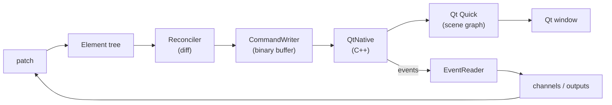

# Architecture

The contributor's map of VL.Qt: the layers, one frame, the threads, the protocol and where each subsystem lives. VL.Qt is a declarative element tree: your patch builds `Element` objects each frame, a reconciler diffs them against what Qt already has, and **QtNative** (the native C++ layer, project `src/VL.Qt.Native`, built as `vlqt.dll` and `libvlqt.so`) applies the changes to real Qt Quick items. The terms are in the [glossary](../glossary.md); the reasons behind each subsystem are in the [design notes](../design/README.md).



## Layers and packages

| Package | Folder | What it holds |
|---|---|---|
| `VL.Qt` | `src/VL.Qt/` | the C# library: elements, vvvv nodes, reconciler, wire, interop, runtime (pump) |
| QtNative | `src/VL.Qt.Native/` | the C++ layer that owns Qt, the scene and the threads; packed into `VL.Qt` |
| `VL.Qt.Stride` | `src/VL.Qt.Stride/` | `QtTexture`, `QtRenderer`: a scene as a Stride texture (Windows only, experimental) |
| `VL.Qt.Audio` | `src/VL.Qt.Audio/` | `Video (VL.Audio)`: the audio of a `Video` as a VL.Audio signal |

The folders of `VL.Qt` by responsibility:

| Folder | Responsibility |
|---|---|
| `Elements/` | the immutable element descriptions, their enums, the feedback slots, the interaction and effect chain links |
| `Nodes/` | the vvvv nodes: `ElementNodeCore`, `ChainMemo`, one folder per family (elements, widgets, effects, interaction, paths, style, shaders, images, QML, editor helpers) |
| `Reconciliation/` | `Reconciler`, the mirrors of what was sent, the occurrence registries, the property diff, `FeedbackRouter` |
| `Wire/` | `CommandWriter`, `EventReader`, `Protocol` (the C# mirror of `protocol.h`) |
| `Interop/` | the P/Invoke surface (`Native.*.cs`, one file per group of `vlqt.h`), the library loader, the ABI check |
| `Runtime/` | `QtApp`, `QtPump` (the per-frame pump), `NodeErrors`, logging, `ExportedApp` |
| `Scene/` | `WindowScene`, `OffscreenScene`, `Space`, multisampling, input mapping |
| `Images/`, `Shaders/`, `Paths/`, `Qml/`, `Styles/`, `Window/`, `NodeFactories/` | the C# side of the subsystems below, and window settings and perf stats |

The folders of QtNative: `app/` (process, pump, animation clock, log, exports helpers), `scene/` (commands, handlers, previous-frame layer, event queue), `elements/` (the item per element type), `window/`, `offscreen/`, `device/` (the shared GPU device, render threads), `resources/`, `effects/`, `style/`, `user_qml/`, `diagnostics/`, `platform/`, `qml/` and `shaders/` (the QML and shader files it ships); `protocol.h`, `vlqt.h` and `wire.h` sit at the root.

## Data flow

- The patch creates immutable `Element` objects (Rectangle, Text, Group, ...) each frame; the elements linked to one renderer are its **element tree**
- The **Reconciler** compares the tree to the previous frame and emits minimal changes ([design/reconciler.md](../design/reconciler.md), [design/reconciler-identity.md](../design/reconciler-identity.md))
- The **CommandWriter** encodes them into a compact binary buffer (no managed allocations after warmup)
- **QtNative** applies the commands to Qt objects
- Qt Quick renders the **scene** of the renderer: into a window of its own (native swap chain; on Windows on a D3D11 device shared across windows) or into a texture of Stride

```
patch ──► Element tree ──► Reconciler ──► CommandWriter ──► QtNative ──► Qt Quick ──► Qt window
                              (diff)        (binary buffer)    (C++)     (scene graph)
                                                                  │
patch ◄── channels / outputs ◄── EventReader ◄─────── events ◄────┘
```

## Timing and animation

vvvv's `IFrameClock` is the single time source:

```
per vvvv frame:
  0. frame start (clock tick): vlqt_app_deliver_input(): Qt delivers the queued input without rendering,
     each renderer polls it into its feedback
  1. Reconciler.Update(element tree): the node update writes the commands
  2. frame end, one pump per app (QtApp.PumpFrame): every renderer applies its commands (vlqt_scene_apply),
     the image resource queues run
  3. QtApp.AdvanceDriver(clock.Time) -> vlqt_app_advance_animations
  4. vlqt_app_process_events_for(windows of this app): Qt handles input and renders each changed window (at most once)
  5. resource queues, then the events are polled back (vlqt_scene_poll)
```

- **Deterministic:** same tree and time, same output for everything vvvv computes from the time
- **Pause:** no Qt timers or system clocks interfere; when the clock stands, QML animations stand
- **Scrubbing:** only values from vvvv scrub. QML animations follow the clock forward and hold with it, and the animation driver never runs backwards (`QtApp` owns its time, QtNative ignores a time below the current one): after the clock has jumped back, a running animation holds its value until the clock passes the old time again, then goes on forward
- **Multiple windows:** the same clock drives all renderers
- **Input:** `vlqt_app_advance_animations` refuses a time that is NaN, infinite or out of range (`VLQT_ERR_BAD_ARGUMENT`)
- **Exception:** a QML `Timer` in a user file (`QmlElement`) runs on wall time. QML animations follow the clock.

The pump and the perf segments are in [design/timing.md](../design/timing.md).

## Threads

QtNative runs on the thread that calls `vlqt_app_init`: the Qt GUI thread, in vvvv its main thread. Qt has no `exec()` here; the main thread pumps Qt once per frame (step 4 above).

| Thread | Name | Runs | Owner |
|---|---|---|---|
| Qt GUI thread = vvvv main thread | `vlqt-gui` | the pump, items, polish, input, `vlqt_scene_apply`, the reconciler, all windows (sync and render too) | [design/render-loop.md](../design/render-loop.md) |
| Render threads | `vlqt-render-0` … | the scene graph and `QRhi` of the offscreen scenes (`QtTexture`, `QtRenderer`): sync, render, end of frame | [design/render-thread.md](../design/render-thread.md) |
| Resource workers | `vlqt-res-0` … | decoding of images and shader work for the resource manager; their number is `VLQT_RES_WORKERS` (at most 16) | [design/resources.md](../design/resources.md#threads) |
| The audio thread of VL.Audio | (VL.Audio's) | `vlqt_audio_tap_read` and `vlqt_audio_tap_now_ns` | [video-audio.md](../video-audio.md) |

- **Windows render on the GUI thread, on purpose.** QtNative sets Qt's `basic` render loop: a window renders inside the pump, at most once per pump, in step with vvvv. A threaded loop for windows is rejected in [design/render-loop.md](../design/render-loop.md), which also lists the code that relies on `basic`.
- **Offscreen scenes render on Qt render threads.** A `QtTexture` or `QtRenderer` is rendered by a thread of a pool that is shared by all offscreen scenes of the process. Per changed scene the main thread polishes the items and hands over; the render thread syncs while that call waits and renders after it returned; Stride's GPU waits for the write fence, its CPU does not wait. The size of the pool is the pin `Render Threads` of `QtTexture` and `QtRenderer` (default 1, 0 = main-thread mode, which runs the same code inline; the largest value of all nodes counts). Users: [diagnostics.md](../diagnostics.md#qttexture-render-thread).
- **Elements, reconciler, input and `apply` never leave the main thread.** A render thread touches items only while the main thread waits in the sync.
- **Engines.** Windows and offscreen scenes each have their own `QQmlEngine`; user QML is compiled on the engine of its scene.

Every export of `vlqt.h` belongs to the GUI thread, except six that run on any thread: `vlqt_app_get_abi_version`, `vlqt_last_error`, `vlqt_image_write_file` (FileWriter tasks), `vlqt_shader_reflect` (shader node factory), `vlqt_audio_tap_read` (VL.Audio's audio thread) and `vlqt_audio_tap_now_ns`. Each export states its thread by the helper of `app/exports.h` its body runs in (`guarded` for any thread, `guardedGui`, `withScene`, `withWindow`, `withOffscreen` for the GUI thread); on another thread a GUI-thread export does nothing and returns `VLQT_ERR_WRONG_THREAD`. There is no mutex in the app and window code; what other threads touch:

| State | Threads | Why it is safe |
|---|---|---|
| Log callback (`app/log.cpp`) | set by `vlqt_app_init`, called from any thread (Qt messages of render threads and workers) | atomic pointer; the C# callback is thread-safe |
| Last error (`app/last_error.cpp`) | any thread | one text per thread |
| Pump state (`RenderGate`, the window lists of `vlqt_app_process_events_for`) | GUI thread | a nested pump (a host callback inside `processEvents`) is refused with `VLQT_ERR_UNSUPPORTED` |
| Change counter of a scene (`app/scene_change.cpp`) | its sync hook runs on the scene's render thread in the threaded mode | the GUI thread waits in the blocking sync job of the batch; a counter shares no state with another |
| Resources, offscreen render threads | own workers and render threads | their own locks and queues (`resources/`, `device/render_thread.cpp`) |

The shared device and its context lock are in [design/gpu-device.md](../design/gpu-device.md).

## Protocol and interop

- **CommandWriter (C#):** per frame `Clear()`, `Set…()`, `EndFrame()`, then a `ReadOnlySpan<byte>` goes to QtNative with one call. The way back is one event buffer per scene ([design/native-boundary.md](../design/native-boundary.md); the meaning of every command and event is in [protocol.md](protocol.md))
- **Protocol:** shared type, property and event IDs in `protocol.h` / `Protocol.cs`; `ProtocolDriftTests`, `NativeLayoutTests` and `ApiDriftTests` in `VL.Qt.Tests` detect mismatches (constants, fixed wire sizes, struct layouts, exports against `[DllImport]`s). `VLQT_ABI_VERSION` / `Protocol.AbiVersion` number the protocol and the C ABI together: `QtApp` reads `vlqt_app_get_abi_version()` before the first window and refuses a `vlqt.dll` with another number or without the export (no window, one log error naming both versions and the path, every Renderer node fails with that message)
- **QtNative:** owns the `QGuiApplication` (one per process); per scene a `QQuickWindow` and a `QQmlEngine`; exposed via P/Invoke (`vlqt_window_create`, `vlqt_offscreen_create`, `vlqt_scene_apply`, `vlqt_scene_poll`, ...), declared in `src/VL.Qt/Interop/` (`Native.*.cs` one file per group of `vlqt.h`, `QtNativeLibrary.cs` finds and loads `vlqt.dll`)
- **Reconciler (C#):** tracks live Qt objects by ID and calls the command sink (`Create`, `Destroy`, `Reparent`, `Set*`) for each difference

### Adding a command

A command is one opcode of the command buffer that `vlqt_scene_apply` decodes. A new one touches:

1. `src/VL.Qt.Native/protocol.h`: the opcode in `VLQT_OP_*`, its payload layout in the head comment and, for a fixed payload, its size constant.
2. `src/VL.Qt/Wire/Protocol.cs`: the same opcode in `Protocol.Op` (and the size), plus the writer method in `Wire/CommandWriter.cs`.
3. `src/VL.Qt.Native/scene/commands.cpp`: one row in the op table (`Scene::findOp`: name for the error text, whether the payload starts with an id and a property, exact or minimum payload length, decoder) and its decoder `Scene::op<Name>`, declared in `scene/scene.h`. `Scene::apply` checks the length against the row and reports the id of a failing command from it; the decoder reads the payload through `WireReader` (`wire.h`) and checks only what goes beyond the row.
4. The drift tests and the version bump of the protocol change ([development.md](development.md), "Change the protocol").

An input-handler property is one row in `kHandlerProps` (`scene/handlers.cpp`: the handler types that take it and its value type) and its case in `setHandler`.

## Subsystems

Each has a design note; this is where its code lives.

| Subsystem | C# | QtNative | Note |
|---|---|---|---|
| Elements and items | `Elements/`, `Nodes/Elements/`, `Nodes/Widgets/` | `elements/` (`element_types.cpp`, `type_*.cpp`), `qml/elements/` | [element-model](../design/element-model.md) |
| Reconciler | `Reconciliation/` | `scene/commands.cpp` | [reconciler](../design/reconciler.md), [reconciler-identity](../design/reconciler-identity.md) |
| Events and interaction | `Elements/Feedback/`, `Nodes/Interaction/`, `Reconciliation/FeedbackRouter.cs` | `scene/handlers.*`, `scene/touch_handler.*`, `scene/event_queue.*`, `qml/handlers/` | [events-and-interaction](../design/events-and-interaction.md), [input](../design/input.md) |
| Resources: images, snapshots, shaders, audio tap | `Images/`, `Nodes/Images/` | `resources/`, `shader_resource.*`, `snapshot_resource.*`, `image_writer.*` | [resources](../design/resources.md) |
| Effects and the Shader element | `Elements/Effects/`, `Elements/Shaders/`, `Shaders/`, `Nodes/Effects/`, `Nodes/Shaders/` | `effects/`, `qml/effects/`, `shaders/` | [effects](../design/effects.md) |
| Styles | `Styles/`, `Nodes/Style/` | `style/` (`vl_style.*`, the QML style `VLQt`) | [styles](../design/styles.md) |
| Paths | `Paths/`, `Nodes/Paths/` | `elements/shape_path_element.cpp`, `type_shape.cpp` | [paths](../design/paths.md) |
| User QML | `Qml/`, `Nodes/Qml/`, `NodeFactories/` | `user_qml/` | [user-qml](../design/user-qml.md) |
| Previous frame, MSAA | `Scene/Multisample.cs` | `scene/previous_frame_layer.*`, `scene/clear_state.*` | [clear-and-msaa](../design/clear-and-msaa.md) |
| GPU device, offscreen scenes, Stride output | `Scene/OffscreenScene.cs`, `src/VL.Qt.Stride/` | `device/`, `offscreen/` | [gpu-device](../design/gpu-device.md), [render-thread](../design/render-thread.md), [stride-output](../design/stride-output.md), [offscreen-input](../design/offscreen-input.md) |
| Audio tap | `src/VL.Qt.Audio/` | `resources/audio_tap.*` | [video-audio.md](../video-audio.md), [resources](../design/resources.md) |
| Diagnostics, perf | `Window/`, `Runtime/PumpDiagnostics.cs` | `diagnostics/` | [timing](../design/timing.md), [diagnostics.md](../diagnostics.md) |
| Packaging and loading | `Interop/QtNativeLibrary.cs`, `buildTransitive/` | `platform/` | [deployment](../design/deployment.md) |

## Rendering

1. Each `QQuickWindow` renders directly into its own swap chain: Direct3D 11 on Windows (one device shared by all windows and images), OpenGL on Linux
2. Windows: no `exec()` and no render thread. Qt's `basic` render loop, pumped once per vvvv frame (`vlqt_app_process_events_for`) on the GUI thread; each window renders at most once per pump. Offscreen scenes render on render threads, see [Threads](#threads)
3. VSync on by default to avoid tearing, but vvvv's frame clock still controls timing: a frame may wait up to one refresh interval inside the pump (at the start of the frame, F5 segment "vsync wait"). The Renderer's `VSync` pin off gives swap interval 0 (never blocks, tearing allowed). See [Timing](../design/timing.md)
4. Clear off (the `Clear` pin of `Renderer` and `QtTexture`) keeps the previous frame: a swap chain discards its back buffer after `Present`, so `vlqt::Scene` keeps a `PreviousFrameLayer` (through its `ClearState`) under the content while `Clear` is off. Same code for windows and offscreen scenes; details in [Clear and MSAA](../design/clear-and-msaa.md)
5. `QtTexture` and `QtRenderer` render a scene without a window into a shared Stride texture, see [Stride output](../design/stride-output.md)

The offscreen textures inside a scene (Effect layers, ShaderEffect sources, Snapshot) are a different mechanism and stay inside Qt.

## Events

1. Qt writes events (hover, tap, pointer move) into a buffer
2. Each frame `vlqt_scene_poll()` returns them
3. `EventReader` parses the buffer
4. `FeedbackRouter` maps feedback ids to `ElementFeedback` slots
5. The channels of the interaction nodes (e.g. Hover: Is Hovered, Position; Button: On Click) and the element outputs (Measured Size, Scene Bounds) update

Input reaches the patch in the frame after it arrived, not one later: at the frame start (`IFrameClock` tick) QtNative delivers the window system events Qt has queued since the last pump (`vlqt_app_deliver_input`), and every renderer polls before the node updates. Nothing renders there: update requests stay with the render gate, an Expose waits for the pump, and touch moves that Qt Quick holds back until the next render are handed over. The poll at the frame end still collects what the pump itself produces (layout: Measured Size, Scene Bounds; input that arrived during the frame), which the patch reads in the next frame.

On Windows vvvv's message loop hands mouse, touch and pen messages to Qt between two frames. On Linux Qt reads the X11 or Wayland events inside the pump, so there input still arrives one frame later.

## Reusing elements

The same element instance can hang at several places of the tree; each place (occurrence) gets its own Qt object, events from all places are merged. Interaction per place goes on a Group around it (see the help patch `HowTo Reuse an Element`). This holds across renderers too (a window and a `QtTexture`): state values come from the first renderer that shows the element. Exception: a Video (would decode twice) is shown once only, app-wide; the first owner wins, the others get a warning.

## Element nodes

An element node is a public `[ProcessNode]` class that holds an `ElementNodeCore<TElement, TProps>` (`src/VL.Qt/Nodes/ElementNodeCore.cs`) as a field. Its `Update` packs the common pins into `CommonInputs` (`Nodes/CommonInputs.cs`) and its own pins into a `readonly record struct Props`, and returns `Describe(common, props, out measuredSize, out sceneBounds)`. The core returns the previous description as long as both values are equal, so an unchanged node hands the reconciler the same instance, which it skips. It also shows the warnings and errors the feedback reports at the node and reads the outputs.

### Adding an element node

Copy `src/VL.Qt/Nodes/Elements/RectangleNode.cs`, the template, and change only the element-specific part:

1. The element class in `src/VL.Qt/Elements/` (internal, sealed, `init` properties), with the one-line constructor that takes the common part: `internal Rectangle(in CommonInputs common, FeedbackSlot feedback) : base(ElementType.Rectangle, common, feedback) { }`. A new element type also needs its `ElementType`, its reconciler properties and its QtNative item; see "Adding a command".
2. `Props`: one field per element-specific pin. A spread is compared by content (see `ShapeNodeCore.Props.Equals`), since vvvv often hands a new spread with equal content each frame.
3. `Create`: a static lambda without captures that sets only the element-specific properties, `static (c, p, slot) => new Rectangle(c, slot) { Fill = p.Color, … }`. It is `private static readonly … s_create`, or `internal static readonly … Create` when another node shares it (Circle uses Rectangle's, the Spectral nodes those of Group, Row and Column). A node that fixes a common value states it with `with`: `c with { Anchor = RectangleAnchor.TopLeft }`.
4. The pins of `Update`, with defaults and docs (AGENTS.md "Nodes"); a children pin goes through `ChildrenInput`, a single element pin through `ElementInput`.
   The order of the pins is the order of the parameters, and the same on every element node: the pins that define the geometry first (`Size`, `Radius`, `Points`, `Path`; a container starts with its `Input`), then `Transform` and `Anchor`, then the content and look of the node, then the common tail `Opacity`, `Clip`, `Debug`, `Interaction`, `Effect`, `Style` (where the element passes one on: widgets, Group, Row, Column) and `Enabled` as the very last input; the outputs `Measured Size` and `Scene Bounds` last. Where `Auto Size` is on by default (the containers and their Spectral nodes, the widgets, QmlElement, Shader), `Auto Size` is optional and comes first, `Size` is optional directly after it. The one element a node wraps or the children of a container are the pin `Input`.
5. A help patch `help/Qt/HowTo ….vl`, its line in `help/Help.xml`, then `python tools/vl-patch-check.py` (it reads the new node from `node-api.txt`: regenerate the snapshot first) and `tools/vvvvc.ps1 -File` on the patch.
6. Regenerate `src/VL.Qt.Tests/Api/node-api.txt` (`VLQT_UPDATE_SNAPSHOT=1`) and add a test that two `Update`s with equal inputs return the same instance.

### Chain nodes

The nodes of a chain (effects, interactions, paths) return a link that extends the link at their `Input`. Each holds a `ChainMemo<TEffect, TProps>` (`src/VL.Qt/Nodes/ChainMemo.cs`) in a non-readonly field: its `Get` returns the previous link while the input link (by reference) and the node's `readonly record struct Props` are equal, so an unchanged chain stays the same instance between frames. The create delegate is a `static` lambda (`s_create`); state it needs but that does not count as change (the feedback slot of an interaction) goes in as `TState`. A `Props` with a spread compares its content with `SpreadEquality.SameContent` (`src/VL.Qt/SpreadEquality.cs`), the one comparison of spreads in nodes and reconciler. Test: two `Update`s with equal inputs return the same instance (`Is.SameAs`).

## Lifetime

QtNative lives as long as the process: unloading it (`FreeLibrary`, `dlclose`) is not supported, and .NET never unloads a native library.

- **Until the process ends:** the `QGuiApplication` (one per process, never deleted), the animation driver and its keep-alive timer, the shared D3D11 device and its upload QRhi, the render threads, the test devices of `vlqt_test.h`, and the app fonts still registered. Nothing of them is destroyed at exit, so nothing is torn down out of order.
- **What C# ends:** every window and offscreen scene it created (`vlqt_scene_destroy`; a window not destroyed stays open until the process ends), every font it added (`vlqt_font_release`), and the resource workers once nothing is referenced (`vlqt_res_shutdown`).
- **At unload** (`DllMain` on Windows, an ELF destructor on Linux, both in `platform/`): the log callback into .NET is cut, because at process exit the CLR is gone before Qt's static destructors log. At process exit on Windows the Qt message handler of QtNative stays (the DLL stays mapped); on `FreeLibrary`, and always on Linux (a destructor cannot tell `dlclose` from exit), Qt's default handler replaces it. Exported apps on Linux end with `_exit` (`ExportedApp.cs`) and run no destructors.

## Companion packages

`VL.Qt.Stride` and `VL.Qt.Audio` are separate assemblies built from the same repository and released with `VL.Qt`. They see the `internal` types of `VL.Qt` through `InternalsVisibleTo` (`src/VL.Qt/VL.Qt.csproj`); there is no public API for them until a third party builds a companion. The rule: **a companion uses only the types and members below**, nothing else of `VL.Qt`. In particular `VL.Qt.Stride` uses no `Native` and no `Protocol`: what it needs from QtNative is a method of a type below. A new need adds a member to one of these types (and a line here), not a direct call into `Interop/` or `Wire/`.

Both companions:

- `NodeErrors`: the messages at a node (shown at the node, logged once per distinct text); `NodeMessage` is the handle of one message source on it.
- `Multisample.ClampWarning`: the warning when QtNative used fewer MSAA samples than requested.

`VL.Qt.Stride` (`QtTexture`, `QtRenderer`):

- `OffscreenScene` (`Scene/`): the offscreen scene and everything the texture path asks of QtNative: `Bind`, `Unbind`, `Update`, `ApplyCommands`, `PollEvents`, `Handle`, `IsBound`, `UsedSamples`, `Error`, `Input`, `Debug`, `LastBindSucceeded`, `ShouldRetryBind` (the rebind throttle), `Reconciler.RootBuildError`, and the static `RenderBatchError` (one native call for all scenes of a frame) and `SetRenderThreads` (size of the render thread pool).
- `SceneHandle` (`Interop/`): the handle of a scene in a batch; the companion only passes it on.
- `NotificationQueue` (`Scene/`): takes the notifications of an `Input Notifications` pin from any thread and hands them to the main thread.
- `OccurrenceRegistry.ForApp` and `InteractionRegistry.ForApp` (`Reconciliation/`): where the elements and the interactions of the app are shown, across all its renderers, which a scene needs.
- `ElementInput` (`Nodes/`): converts the value of the Input pin to the element the scene gets and warns at the node about a foreign `IElement`.
- `QtApp.Get` and `QtPump.ForApp` (`Runtime/`): start the Qt app and its per-frame pump, which also serves the offscreen scenes; `QtApp.DriverSeconds` is the animation driver time.

`VL.Qt.Audio` (`Video (VL.Audio)`):

- `ElementNodeCore<TElement, TProps>`, `CommonInputs`, `VideoNode.Props` and `VideoNode.Create` (`Nodes/`): the element node of `Video` that the audio variant extends with the tap.
- `Categories` (`VL.Qt`): the node category names.
- `ResourceClient.ForApp` and `ResourceClient.CreateAudioTap` with `QtResource` (`Images/`): create and release the audio tap of a video.
- `Native.vlqt_audio_tap_*` (`vlqt_audio_tap_now_ns`, `AudioTapRead`, `AudioTapDrop`, `vlqt_audio_tap_state`) and the flags `Protocol.AudioTap` (`Interop/`, `Wire/`): the reader of the tap ring, behind `IAudioTapReader` in the companion. This is the one place where a companion calls `Native`; it is the audio tap group of the C API.

Public types that the pins of the companion nodes carry (`IElement`, `Space`, `MultisampleCount`, `Video`) are part of the public API, not of this list.

## Where to read on

- [design/](../design/README.md): one note per subsystem with the reasons and the rejected alternatives; the table under [Subsystems](#subsystems) names each.
- [protocol.md](protocol.md): what every command and event means.
- [development.md](development.md): build, test, scripts.
- [profiling.md](profiling.md) and [research/](../research/render-texture-measurements.md): measurements. Limits that the SmokeTest enforces are in `src/VL.Qt.SmokeTest/PerfLimits.cs`.
