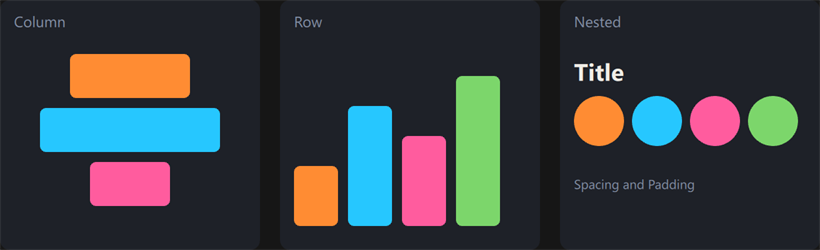

# Coordinates and layout

Lengths in the element tree are in units. The `Space` pin of the renderer sets the origin and the unit:

| `Space` | Origin | 1 unit |
|---|---|---|
| `DIPTopLeft` (default) | top left | 100 DIP, the device independent pixels of Qt |
| `DIP` | center | 100 DIP |
| `Normalized` | center | half the height of the renderer (height from -1 to 1) |
| `PixelTopLeft` | top left | 100 device pixels |

y points down in all of them, as in Skia. The help patch `HowTo Choose a Space` shows the four. `QtTexture` and `QtRenderer` have the same pin, see [Coordinates in Stride](stride.md#coordinates).

## Layout

`Row` and `Column` lay out their children with spacing, padding and alignment. Fed with a spread of elements they lay out the whole spread (`HowTo Layout a Spread with Row and Column (Spectral)`).

Help patches: [Layout](help-patches.md#layout).
