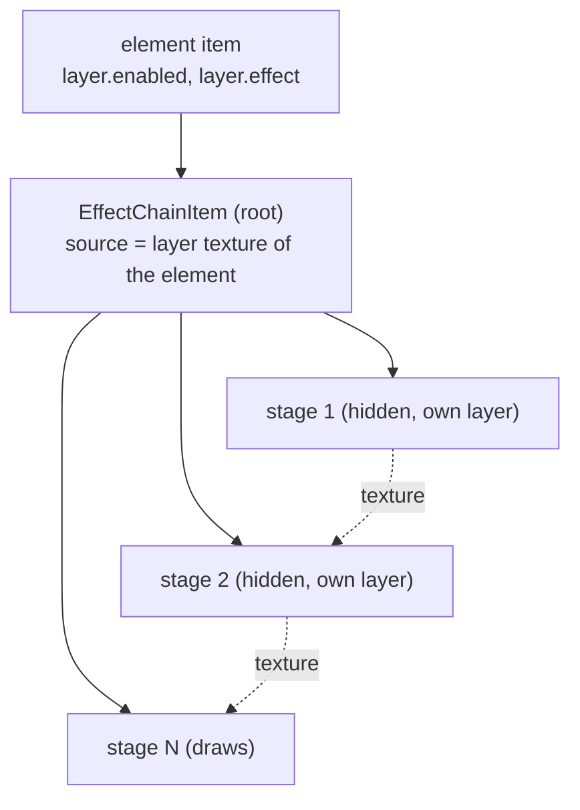
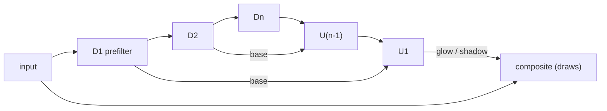

# Effects

How QtNative renders the Effect chain of an element and how the Shader item draws a fragment shader: the item tree of a chain, the passes of a shader link, the blur pyramid, the texture and alpha rules, and the runtime bake of shader code. Code: `src/VL.Qt.Native/effects/` (`effect_chain.*`, `shader_item.*`, `shader_material.*`, `layer_requests.*`), `shader_resource.*`, the stage QML in `src/VL.Qt.Native/qml/effects/` and the wire format in `protocol.h` ("Effect chain"). The user page, with the nodes, annotations and templates, is [effects-and-shaders.md](../effects-and-shaders.md).

## Context

The Effect pin of an element is a chain of links. A link is either a run of built-in effects (one Qt `MultiEffect`: blur, shadow, colour, mask) or one filter shader (`SHADER`) that reads the result of the link before it. C# sends the whole chain at once; QtNative keeps the desired state and builds the items.

Qt Quick has two things to draw an effect with: `MultiEffect` and `ShaderEffect`. `ShaderEffect` binds uniforms by QML property name, which cannot express the uniform table of a shader file that C# fills by name and type at runtime. So the shader link is drawn by an item of QtNative, the `ShaderItem`, which maps uniforms through the reflection of the shader. Terms (layer, DIP, premultiplied) are in [glossary.md](../glossary.md).

## Design

### Item tree of a chain

- The element's layer creates the root (`EffectChainItem`) through `layer.effect`; the root has the element's geometry and transform. The root finds the `EffectChain` object, a child of the element, and asks it to build one stage per link under the root, in application order.
- A stage is an item that covers the effect area of its link, in element coordinates. Its `fx` (the `MultiEffect` or the shader pass) reads the input: the layer texture of the element for the first link, the previous stage for the others.
- All stages but the last are hidden and have a layer of their own, which is the texture provider for the next link. The last stage draws. Size, transform, implicit size, layout and hit test stay those of the element's item.
- The effect area grows from link to link by the padding of the link, because a blur or a shadow draws beyond its input. A shader link has no automatic padding; the shader file declares it (`@padding`), otherwise the shader stays inside its input.
- The links are the desired state; the stages exist while the root exists. A send with the same structure (link count, kinds, templates) writes only changed values: no new item, no shader switch, no allocation and no repaint when nothing changed, because an animated pin sends every frame. Another structure retires the old stages (hidden, deleted by the caller after the next frame) and builds new ones.
- A mask of a `MULTI` run is an element of its own. The Elements layer holds it in a hidden frame item under the window root and binds `layer.sourceRect` of that frame to the effect area of the run, so the mask never counts for layout, auto size or hit test.

### Shader link stages

A `SHADER` stage covers its input plus the padding of the link. The input's layer texture covers the same area: the stage binds `layer.sourceRect` of the input (the element's layer source for the first link) to its own area, so the input arrives padded with transparent pixels and every pass maps it 1:1 over UV 0..1.

The binding always goes through `layer.sourceRect`, never to the layer's `ShaderEffectSource`: `QQuickItemLayer` caches the value and skips an equal write, and a later `MultiEffect` on the same layer sets its padded rect there, so writing to the source directly left the old rect (a hard edge).

| Template | Passes |
|---|---|
| `SINGLE` | one pass samples the input |
| `TWO_PASS` | pass 1 (hidden, own layer) samples the input with `passIndex` 0, pass 2 samples pass 1 with `passIndex` 1; same uniform table |
| `PYRAMID` | a composite pass draws; a prefilter, `pyramid_down` and `pyramid_up` passes sit hidden under the stage ([Blur pyramid](#blur-pyramid)) |

- **Two passes** exist because a blur with a fixed sample count shows single samples as copies. Pass 2 blurs the result again by a fraction of the length and fills the gaps; the shader derives its length from `passIndex`.
- **Automatic uniforms** are written only where the shader declares them. Item level, for every Shader item: `texelSize` (1 / pixel size of the sampled texture, read from the texture itself), `dpr`, `viewSize` (item size in DIP). Chain level: `passIndex`, `weight`, `elementRect`. `length * dpr * texelSize` is a length in texture coordinates, so lengths in DIP work at any device pixel ratio.
- **`elementRect`** (`SINGLE`, `TWO_PASS`) is the rectangle of the element in UV of the stage area, because earlier links grow the area and a texture that must sit on the element (the layer of `Blend`, the map of `Displace`) maps itself with it. It is written on a change of the stage geometry or the element size only.
- **Reserved names** (`kItemReservedUniforms`, `kItemAutomaticUniforms`, `kChainAutomaticUniforms`, `kChainReservedUniforms` in `effects/shader_item.h`, mirrored in C# by `ReservedUniforms`) cannot be set by C#; an entry of such a name is an error line of the element. A raw uniform of an item-automatic name wins over the automatic value.
- **Problems** of a link (reserved or unknown names, wrong types, refused shader ids, negative padding or strength) never fail the apply. They are joined into one text, one line per problem prefixed `link N:`, and sent as the error event of the element.
- A shader id of 0, or one that is not Ready, passes the input through unchanged; a Failed id keeps the last Ready shader of the link.

### Blur pyramid

Glow and InnerShadow need a blur whose cost does not grow with the radius. The `PYRAMID` template halves the stage down to a few pixels and blends the way back up.

- **Steps down.** Sizes in pixels: `p0` = stage size × dpr, `p(k) = ceil(p(k-1) / 2)`. The pyramid has `n` steps, the first `n` with the smaller side of `p(n)` under 4 px, at most 16 (`kMaxLevels`: 16 halvings take any texture below 4 px). A pass `Dk` is `p(k) / dpr` in DIP, so the layer has `p(k)` device pixels.
- **Passes.** `D1` is the prefilter shader from the node (it extracts the glow or the shadow from the input); `D2..Dn` are `builtin:pyramid_down` (a 4×4 tent, `[1 3 3 1] / 8` per axis at 2:1). `U(n-1)..U1` are `builtin:pyramid_up`: tent of the coarser step, mixed with the `Dk` of its size as `base` by a weight. The composite (the second shader of the link) draws with the original input and the top of the pyramid (`U1`, or `D1` when `n` is 1) as `glow` or `shadow`.
- **Radius to weights.** With `σ = radius × dpr / 2` (pixels), the blur level is

$$L = \tfrac12 \log_2\!\left(1 + \tfrac67\,\sigma^2\right), \qquad w_k = \operatorname{clamp}(L - k,\ 0,\ 1)$$

  `Uk` uses `w_k` for `k` = 1..n-1, the composite uses `clamp(L, 0, 1)`. A radius below one step blends the composite between the sharp `D1` and the first blur; every further step adds one level of blur.
- **Radius changes write weights only; the layout follows the stage size and dpr only** (`layoutPyramid` on a size or dpr change, `writePyramidWeights` on a radius change). Passes beyond `n` stay in the pool, unsampled, until the stage goes, because a stage that is resized by an animation must not create and delete layers.
- **Dither.** The layers are 8-bit. `pyramid_up` adds noise of ±0.5/255 (interleaved gradient noise) before the rounding, so a flat gradient does not step in rings. The noise keeps `rgb <= a`.
- The same table goes to the prefilter and the composite; each takes the names it declares, and the chain reports a name that neither declares.

### Shader item

`ShaderItem` is a `QQuickItem` with a `QSGGeometryNode`, a `QSGMaterial` per shader pair and an own `QSGMaterialShader`. It draws the Shader element and every pass of the chain.

- **Shaders.** Fragment and vertex shader are shader resource ids. The item holds an element reference on the shown id and on the one it waits for; the old shader stays until the new one is Ready. If a new id (or a replacement of the shown one) fails, the slot keeps drawing its last Ready content, so live editing never goes black. A Failed shader without an earlier Ready one draws nothing; the error comes by the resource event. Without a vertex shader Qt's own `ShaderEffect` vertex shader is used.
- **Pipelines.** One `QSGMaterialType` per shader pair, compared by content, so the renderer's shader cache never mixes programs.
- **Uniform block** is std140, with the members of both stages merged by name (same offset and type, else an error line). `qt_Matrix` and `qt_Opacity` come from the render state, everything else from the uniform table, by name; the table survives shader changes; a member without a value is 0. A `mat4` goes as sent: the row-major Stride matrix is the transposed Qt matrix in column-major memory.
- **Samplers** use bindings 1..15 (`kMaxBindings`). `source` is the input (the layer of the item). Others come from the table: a `REF` is an element (a hidden child, its layer enabled), a `U64` is an image resource (`resources/image_texture_cache.h`). A sampler without texture reads a 1×1 transparent texture. Layers are updated in the node's preprocess, like Qt's `ShaderEffect`. A sampler with a mip filter asks the layer of its element for mipmaps through `LayerRequests`; one registry per process, because several items can sample one element and the layer keeps its mipmaps while any asks.
- **Threads.** Everything is collected on the GUI thread. `updatePaintNode` runs with the GUI thread blocked and copies the state into the material; the material shader reads only the material. Which render loop runs, and the one place here that relies on it: [render-loop.md](render-loop.md#places-that-rely-on-the-basic-loop). No allocation per frame; buffers are sized on a layout change.

### Alpha and colour

- Qt Quick layers hold premultiplied colour. A shader reads premultiplied input and writes premultiplied output: it multiplies all four channels by `qt_Opacity`.
- A colour uniform is sent premultiplied. The built-in pyramid shaders are generic premultiplied RGBA, so Glow and InnerShadow need no per-colour code.

### Runtime bake

A shader resource is either a `.qsb` file (`builtin:<name>` resolves to `<QtNative dir>/shaders/<name>.frag.qsb`) or GLSL source that a worker bakes with `QShaderBaker`.

- **Load** (main thread) checks the arguments and notes the shader language the process backend needs (D3D11 HLSL, OpenGL GLSL, Vulkan SPIR-V, Metal MSL). A source notes the bake targets for that language only, plus GLSL 150 on a backend other than OpenGL, so that one bake also gives the rename check its GLSL code. A source that SPIRV-Cross cannot translate to GLSL 150 therefore fails the bake on every backend: a shader that runs on Windows must also run on the OpenGL path of Linux.
- **Decode** (worker): reads and deserializes the `.qsb`, or bakes. Bakes run one at a time (`s_bakeMutex`), because glslang's process init and pools are not documented as thread safe across bakes; bakes are rare, live edits only. Results (the shader or the error text) go to a process-wide cache of 64 entries, keyed by stage, backend and SHA-1 of the source, FIFO with a touch on a hit; a failing source is not baked again either.
- **Checks** for both: the stage, a variant for the backend, and the reflection the item relies on (at most one uniform block, at binding 0, `qt_Matrix` and `qt_Opacity` with the expected types). A problem ends in Failed with an error event; bake errors are one line per glslang message, `fragment code, line <n>: <text>`.
- **GLSL rename check.** SPIRV-Cross renames a uniform or sampler named like a GLSL builtin (`length`, `texture`, ...) in the GLSL code but not in the reflection, and QRhi looks uniforms up by the reflected name, so the OpenGL backend never sets it. The resource gets a warning event, checked on the GLSL variant of the `.qsb` or of the bake (cached with it).
- **Upload** does nothing: a shader has no GPU object, each Shader item builds its pipelines from the `QShader`. A device loss has nothing to restore. A new load on a Ready id keeps the old shader until the new one is Ready ([resources.md](resources.md#replacement)).

## Consequences

- A shader file that is valid on Direct3D but not translatable to GLSL 150 fails everywhere; the error text says so.
- A chain on the Qt Quick software backend is not drawn at all (`MultiEffect` and the shader links are `ShaderEffect`s, which that backend does not draw); layout and hit test stay.
- A pyramid costs layers by the step count, not by the radius; a very large stage costs up to 16 pairs of passes.
- Changing a reserved name list needs the C# mirror (`ReservedUniformsDriftTests` compares them).
- Protected by: the SmokeTest scenarios `EffectChainTest`, `EffectPassesTest`, `GlowTest`, `InnerShadowTest`, `EffectMaskTest`, the unit tests `EffectChainTests` and `ReservedUniformsDriftTests`, and the help patches `HowTo Chain Effects`, `HowTo Add a Glow`, `HowTo Blur An Element`.

## Alternatives considered

- **Qt's `ShaderEffect` for shader links:** binds by QML property, no uniform table by name, no reflection of the `.qsb`.
- **One pass for a wide blur:** a fixed sample count (64 in the built-in blurs) shows single samples as copies; the second pass fills the gaps.
- **A blur with a kernel per radius for Glow and InnerShadow:** its cost grows with the radius; the pyramid does not ([Blur pyramid](#blur-pyramid)).
- **Writing the padded rect to the layer's `ShaderEffectSource`:** see [Shader link stages](#shader-link-stages).

## Open questions

The constant 6/7 in the blur level is taken as the code has it; its derivation is not recorded anywhere in the repository.

## Evidence

The scenarios listed under Consequences in `src/VL.Qt.SmokeTest` (`dotnet test src/VL.Qt.SmokeTest -c Release`). Pass sizes and step counts are logged under the category `vlqt.effectchain` on debug level.
