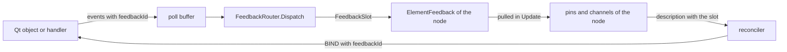

# Events and interaction

How input and values that only Qt knows (hover, press, clicks, drags, the text a user typed, the size of a text) come back from Qt to the patch, and what the Interaction nodes are. The code is `src/VL.Qt/Elements/Feedback/` (`ElementFeedback`, `FeedbackSlot`, `FeedbackState`), `src/VL.Qt/Reconciliation/` (`FeedbackRouter`), `src/VL.Qt/Nodes/Interaction/` (the Interaction nodes, `FeedbackChannels`), `src/VL.Qt/Nodes/ValueChannel.cs` (two-way values) and `src/VL.Qt/Scene/NotificationQueue.cs` (input of a `QtTexture`). The help patches `HowTo React to Hover and Click`, `HowTo Track the Pointer`, `HowTo Drag an Element`, `HowTo Use the Mouse Wheel`, `HowTo Pinch to Zoom and Rotate`, `HowTo Use Touch Points`, `HowTo Stack Interactive Elements`, `HowTo Use a Button` and the `HowTo Use Input …` patches show the nodes.

## Context

Descriptions are immutable data and the Qt objects belong to the reconciler ([element-model.md](element-model.md), [reconciler.md](reconciler.md)). A patch cannot ask a Qt object anything, and Qt must not call into a patch: patch code would run in the middle of QtNative's event handling. State that exists only in Qt therefore travels back on a path that fits both sides. Words as in the [glossary](../glossary.md): feedback (the way back from Qt to the node that made an element), occurrence, mirror.

## Design

### The way back: feedback

- **One `ElementFeedback` per node instance.** An element node and an Interaction node each create one, once, and put a `FeedbackSlot` (the feedback and a slot index) into every description they output. The description stays pure data; the state lives in the node.
- **The event header carries `feedbackId`.** The reconciler binds every Qt object and every handler to the slot of its description with a BIND that carries a `feedbackId` from the `FeedbackRouter`. QtNative writes the id into every event record, `Dispatch` finds the slot with it and writes into its `FeedbackState`. Records with an unknown id are dropped, so late events of a replaced binding are harmless; ids count up and are not reused. When the reconciler binds and unbinds is in [reconciler.md](reconciler.md#feedback-binding).
- **The node pulls.** In `Update` the node reads its feedback and writes its outputs. Nothing in a patch is called from `Dispatch`, so patch code never runs inside the poll.
- **A node that emits a spread of elements** has one slot per element (the slot index); its outputs are spreads.
- **Identity.** An item's identity stays position plus type ([reconciler-identity.md](reconciler-identity.md)); the slot is bound to it and is not its identity. The slot is the key of two other things: of an element, which the occurrence registry counts (one node is one element, [reconciler-identity.md](reconciler-identity.md#element-key)), and of an input handler (one Interaction node is one handler).

### What the elements give back

Every element node has two optional outputs: `Measured Size` (the size the element takes with `Auto Size`, mainly for text) and `Scene Bounds` (position and size in the scene). Both are state values. Pointer state and events are not outputs of the element; they belong to the Interaction nodes.

The input widgets carry a two-way value: `Slider`, `Toggle`, `InputInt` and `InputString` have the optional input `Channel` and the outputs `Value` and `Has Changed`. A change by the user arrives as one value event. `ValueChannel` takes it once per `Update`, writes it into the channel (author "Qt") and shows it at `Value`, with `Has Changed` true for that frame. A change in the patch goes the other way as a normal SET of the description; if both happen in one frame, the user's change wins. `Button` reports a click at the channel `On Click` and at `Bang` and needs no Interaction node.

### Interaction nodes

Pointer handling is opt-in: an element without an Interaction node gets no handler, costs no hit test and lets input through to the elements below it. An Interaction node takes a chain at `Input`, adds one link and outputs the chain at `Output`; the chain goes into the `Interaction` pin of an element (the chain mechanism is in [architecture.md](../contributing/architecture.md)). Each link becomes one Qt input handler at the item of the element, with a feedback slot of its own. The order of the chain has no meaning; Qt decides by its grab rules: of overlapping elements the topmost one with a `Click` node takes the click, while `Hover` goes to all elements under the pointer.

The state and event pins are optional channels that Qt writes into (author "Qt"). The node pulls them in `Update`, writes a state only on change and forgets a channel that is unconnected (`FeedbackChannels`), so a later connection counts as new. A channel can belong to the patch or be a public one: distribution inside a patch is done with vvvv channels and bindings, one place and idiomatic for vvvv.

| Node | Channels, written by Qt | Other pins |
|---|---|---|
| `Hover` | `Is Hovered` | |
| `Click` | `Is Pressed`, `On Click`, `Tap Count`, `On Long Press` | `Buttons`, `Devices` |
| `Point` | `Is Active`, `Position` | `Buttons`, `Devices` |
| `Drag` | `Is Dragging`, `Translation` | `Moves Element`, `Axis`, `Min`, `Max`, `Buttons`, `Devices` |
| `Wheel` | `Delta`, `Value` | `Devices` |
| `Pinch` | `Is Pinching`, `Scale`, `Rotation`, `Translation`, `Pivot` | `Min Point Count`, `Max Point Count`, `Devices` |
| `TouchPoints` | `Points` (a spread of touch points) | `Devices`, `Occlusion` |

- **An event is a pulse.** `On Click` and `On Long Press` receive one value per event, so nothing is lost when several occur in one frame: the feedback counts them and the node takes the count once per `Update`. Values whose repetition is an event (a drag with the same delta, a pinch with the same scale) are written whenever the feedback was updated.
- **A state is a value.**
- **Units.** Positions and sizes are in units of the renderer's `Space`; the router converts Qt's logical pixels. Wheel is in notches, pinch rotation in cycles.
- **Messages.** A property that Qt rejects shows at the node as a warning, inputs the node cannot use (`Min` greater than `Max`) as an error.

### Feedback binding

- **A signal writes into the feedback that was bound at that moment**, that is, the element that was visible in the last frame. This matches the latency below.
- **Switching the feedback of a Qt object** (a patch reordered elements): QtNative cancels a running press (no `On Click`). The old feedback receives hover and press false, the new one the current state. Qt remembers hover and press in the object, so without the cancel there would be ghost clicks on the wrong slot.
- **In `ForEach`** the node instance is positional anyway (state per iteration index), so feedback and Qt object move together. They only diverge if a patch reorders elements after creation, and binding every frame covers exactly that case.
- **Insert or reorder** can make state jump (hover, pressed). It behaves like any stateful node in `ForEach` and is accepted.

### An element shown at several places

An element may hang in the tree several times and in several renderers. Each occurrence has its own Qt object and its own `feedbackId`, all on the same slot. The router merges them:

- **Events add up:** a click, a long press or a wheel notch on any occurrence counts.
- **Hover and press are the OR of all occurrences.** Every id keeps its own bit; the slot is hovered or pressed while at least one bit is set. When an id goes away its bit is taken back, so the slot does not stay hovered.
- **State values** (`Measured Size`, `Scene Bounds`, the position of a video, an error) come from the primary occurrence only ([reconciler-identity.md](reconciler-identity.md#occurrences)); the others are ignored.
- **Channels are unchanged:** two views of one value are intended. To tell which occurrence was hit, put an interaction on a surrounding Group per placement (`HowTo Reuse an Element`).
- **Handlers:** an Interaction node is active at one place only, app-wide; at every further place it is a placeholder with a warning ([reconciler-identity.md](reconciler-identity.md#input-handlers)).

### Latency

- **Input is seen in the frame it is delivered, what Qt makes of it one frame later.** QtNative delivers the queued input at the start of the vvvv frame (`vlqt_app_deliver_input`) and the renderer polls before the node updates, so a click is in the channels in the same frame. What Qt produces while it processes the frame (a measured size after a layout, `Scene Bounds`, a hover that changes because an element moved) is polled at the end of the frame and seen in the next one. Each record is in exactly one of the two polls. There is no synchronous measuring.
- **A `QtTexture`** drains its input queue at the start of `Update`, before the scene applies the new description, so input acts on the items of the last apply. The render of the same frame shows the result; the events of the scene reach the nodes in the next frame.

### Threads

- **Everything that touches feedback runs on the vvvv main thread**, which is Qt's GUI thread: `Dispatch`, the reconciler and the `Update` of the nodes. The feedback has no lock; it only buffers between a poll and the next `Update`.
- **The one lock is the input queue of a scene.** Notifications of the `Input Notifications` pin of `QtTexture` and `QtRenderer` may arrive on any thread. `NotificationQueue` appends them under a short lock to a reused list; the main thread swaps the lists and drains them at the start of `Update`, outside the lock because the sink calls into QtNative.
- **The render thread never touches items or feedback** except in `sync`, while the main thread waits. Input is therefore sent on the main thread without a lock ([render-thread.md](render-thread.md), [offscreen-input.md](offscreen-input.md), "Timing and threads").

## Consequences

- A patch reads interaction at the node where it patched it and distributes it with channels. There is no listener node and no event output on the renderer.
- A new kind of event is a handler type in QtNative, an Interaction node, a field in `FeedbackState` and a record in the protocol (the drift tests check the C# side).
- Hover and press can jump when elements are inserted or reordered in a spread.
- Tests: `FeedbackRouterTests`, `FeedbackRouterSpaceTests`, `InteractionTests`, `NotificationQueueTests` and the SmokeTest scenario `QtTextureInput`.

## Alternatives considered

- **Hover and click as outputs of every element node** (the first design): every element would carry pins most patches never use, and handlers would exist for every element. Interaction nodes put handlers only where a patch asks for them.
- **Callbacks or delegates on the element:** they do not fit immutable descriptions, create a new delegate identity every frame and would run patch code in the middle of the poll.
- **Writing into channels from inside `Dispatch`:** patch code would run in the poll. Pulling in `Update` keeps it out and writes only on change.
- **A separate listener node by ID or tag:** channels and bindings in the patch cover it.
- **The feedback as identity of items:** an item's identity stays position plus type; the slot is only bound. The slot is the key of an element and of an input handler, not of an item.
- **Forbidding several occurrences of an element:** see [reconciler-identity.md](reconciler-identity.md#alternatives-considered).
- **Qt animations as part of the base element set:** a separate topic; animation is driven per frame from vvvv.

## Open questions

- **Animation events** (`On Animation Finished`, `Is Animating`) belong to an animation node set built on Qt's animation system and depend on the timing decisions ([timing.md](timing.md)).
- **Further interaction events:** keyboard and focus, drop.
- **Global renderer output:** raw mouse and keyboard data, or "the element under the cursor".
- **A key pin** would remove the state jump on reorder ([reconciler-identity.md](reconciler-identity.md#open-questions)).

## Evidence

- Unit tests, no GPU: `dotnet test src/VL.Qt.Tests --filter "FullyQualifiedName~FeedbackRouter|FullyQualifiedName~InteractionTests|FullyQualifiedName~NotificationQueue"`.
- SmokeTest: `dotnet test src/VL.Qt.SmokeTest -c Release` (handlers and `QtTextureInput`).
