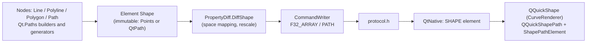

# Paths

Lines, polylines, polygons and free paths as vector shapes: the elements `Line`, `Polyline`, `Polygon` and `Path` (category `Qt.Elements`), the path value `QtPath` and the builder and generator nodes in `Qt.Paths`. The code is `src/VL.Qt/Paths/`, `src/VL.Qt/Elements/Shape.cs`, `src/VL.Qt/Nodes/Paths/`, the shape cases in `src/VL.Qt/Reconciliation/PropertyDiff.cs`, and on the native side `src/VL.Qt.Native/elements/type_shape.cpp` and `shape_path_element.cpp`. The user page is [../shapes.md](../shapes.md).

## Context

Two kinds of content run through the same nodes: motion graphics (few paths, animated trim, crisp edges) and data-heavy content (many points that change every frame). Qt Quick Shapes draws both. Its `CurveRenderer` draws curves exactly (no facets under magnification), anti-aliases edges without MSAA, and a transform costs nothing because the path stays untouched. Its alternative, the `GeometryRenderer`, tessellates on the CPU and needs MSAA for smooth edges.

Scene content takes one route: nodes build immutable C# data, the [reconciler](reconciler.md) diffs it, the command writer encodes it, QtNative applies it. Paths follow that route; nothing native lives in an element description.

## Design

### One element type, one path element

- All four nodes create one element type, `SHAPE` (`VLQT_ELEMENT_TYPE_SHAPE`). Its geometry is either a point list (`Points` plus `Closed`) or a `QtPath`; the latest set replaces the other.
- A `QQuickShape` holds one `QQuickShapePath`, and that holds one `ShapePathElement` (`elements/shape_path_element.cpp`), a subclass of Qt's private `QQuickCurve` like Qt's own `PathPolyline`. It takes a point list or a verb/point array and builds the `QPainterPath` in `addToPath`. Points go through it too, because curves need it anyway: one route for both, and one place that knows `Close` (a closed point list ends with `closeSubpath`, a real join at the start point instead of a cap).
- After a geometry change the element emits `changed()`, because Qt re-processes the path only on that signal; without it the old geometry stays on screen.
- It uses private Qt API (`QQuickCurve`, `QQuickPathData`); the list of such uses is in `elements/elements.h`, to check on Qt updates.

### Wire format

- `VLQT_VALUE_TYPE_F32_ARRAY` (10) is `u32 count` plus `count` `f32`; it carries point lists (x, y pairs) and the dash pattern.
- `VLQT_VALUE_TYPE_PATH` (11) is `u32 verbCount`, `u32 pointCount`, `verbCount` `u8` verbs padded with zeros to 4 bytes, then `pointCount` x 2 `f32`. The verbs are `Move` (1 point), `Line` (1), `Quad` (2), `Cubic` (3) and `Close` (0); QtNative rejects a path whose point count does not match its verbs and keeps the old geometry.
- The properties of `SHAPE` are the block 960.. of `protocol.h` (`VLQT_PROPERTY_SHAPE_*`). A stroke width of 0 or less is sent as -1 = no stroke.
- Command lengths are `u32` (at most 64 MB, `VLQT_MAX_COMMAND_PAYLOAD`), so a point list or path is not cut: there is no point limit from the protocol.

### `QtPath`

- `QtPath` is an immutable chain: each step references the previous path, so appending is O(1), also in a loop with an accumulator. The first read flattens the chain once, iteratively (chains of any length work), into the verb and point arrays and the bounds, and caches the result.
- Arcs become cubics in C#, so QtNative knows only five verbs. Conics do not exist (Skia only).
- Builder nodes return the same instance while their inputs are unchanged (`ChainMemo`). The element then compares by reference first and by flattened content when the reference differs; a path that did not change sends nothing. Nodes with a `Spread<Vector2>` input compare by reference, then by content.

### Nodes in `Qt.Paths`

The builders follow `Skia.Paths` in names and pins, so patchers know them. The first pin of every builder is `Input` (the path so far), the output is `Output`.

| Nodes | Pins besides `Input` |
|---|---|
| `MoveTo`, `LineTo` (each also as `(Relative)`) | `Point` |
| `QuadTo` | `Control Point`, `End Point` |
| `CubicTo` | `Control Point 1`, `Control Point 2`, `End Point` |
| `ArcTo` (tangent, oval, SVG; also `(Relative)`), `Close` | as in Skia |
| `AddRect`, `AddRoundRect` | `Rectangle` (default `0, 0, 1, 1`), `Direction`; `AddRoundRect` also `Radius` (default `0.1, 0.1`) |
| `AddOval`, `AddArc` | `Bounds` (default `0, 0, 1, 1`), `Direction` / `Start Angle`, `Sweep Angle` |
| `AddCircle` | `Center`, `Direction`, `Radius` (default `0.5`) |
| `AddPoly` | `Points`, `Closed` |
| `AddPath` | `Other`, `Mode` |
| `Bezier (Handles)` | `Anchors`, `In Handles`, `Out Handles`, `Closed`, `Handle Modes` (optional) |
| `Spline (CatmullRom)`, `Spline (BSpline)` | `Points`, `Closed`; Catmull-Rom also `Alpha`, `Tension` |

- Relative variants are separate nodes (`(Relative)` is part of the node name), as in Skia, not a pin.
- `AddRoundRect` scales radii that do not fit down together by one factor (`min(w / 2rx, h / 2ry)`), as Skia does, so a very large radius gives semicircular ends; a radius of zero or less gives a plain rectangle.
- `Bezier (Handles)`: `Handle Modes` apply cyclically like any spread (anchor *i* uses entry *i* mod count, empty = `Free`); `Mirrored` ignores the given in handle.
- `Spline (CatmullRom)`: an open curve has tangent 0 at its end points for every `Alpha`, as `curveCatmullRom` in d3. At `Alpha` 0 that differs from the classic end tangent (P2 − P1) / 2 on purpose: with the classic one the curve end would jump between `Alpha` 0 and a value just above it.
- Queries and operations (`Op`, `Simplify`, `SamplePath`, …) are not rebuilt; the planned route for path math is a Skia adapter (see Open questions).

### Elements: pins, defaults, geometry space

- `Line` has `From` (default `0.5, 0.5`) and `To` (`2.5, 1.5`); `Polyline` has `Points` and `Closed`; `Polygon` has `Points` and `Fill Color`; `Path` has `Path` and `Fill Color`. All have `Transform`, `Stroke Color` (white), `Stroke Width` (0.05), `Opacity` and the common pins; optional are `Cap`, `Join`, `Miter Limit`, `Dash`, `Dash Offset`, `Trim Start`/`End`/`Offset` and (`Polygon`, `Path`) `Fill Rule`, each where it applies (the exact set per node is in the node API snapshot `src/VL.Qt.Tests/Api/node-api.txt`).
- Defaults follow Skia: `Cap` `Flat` (Skia Butt), `Join` `Miter`, `Miter Limit` 4, `Fill Rule` `NonZero` (Skia Winding). `Miter Limit` is a `float` pin; QtNative rounds it, because `QQuickShapePath::miterLimit` is an `int` (the default 4 is exact).
- `Dash` lengths are absolute lengths in units, as in Skia. The reconciler divides them (and `Dash Offset`) by the stroke width, because Qt's `dashPattern` and `dashOffset` are in stroke-width units.
- `Trim Start` 0, `Trim End` 1 and `Trim Offset` 0 are fractions of the path length (Qt `ShapePath.trim`).
- Points are in the parent space, in units of the scene `Space` (like Skia's path layers); `Transform` applies around the parent's origin. The shape elements have no `Anchor` and no `Size` pin (the nodes pass a fixed top-left anchor): the size of the element is the extent of its geometry, `(max(0, maxX), max(0, maxY))`, which Row/Column and the tooltip preview use.

## Consequences

- No limit on the number of points comes from the protocol; the cost is the limit. Per frame on the measured machine, polylines whose points change every frame cost 5.3 ms at 4000 points and 16 ms at 8190 points (they miss the frame), paths with curves about a third per point; static or only transformed shapes handle many more. Trim and `Transform` are the cheap ways to animate: prefer them to changing points.
- A path that is rebuilt every frame by builders costs one flatten per change; keep inputs unchanged where possible so the memo returns the same instance.
- Changing the wire layout of `F32_ARRAY` or `PATH` means editing `protocol.h`, `Protocol.cs` and the writer together; `ProtocolDriftTests` and `NativeLayoutTests` protect the constants and layouts, the `shapes` SmokeTest scenario draws the shape element and the unit tests of `QtPath` and the diff protect the semantics.
- Shape patches need `Qt6::QuickShapes` linked and deployed with QtNative.

## Alternatives considered

- **A C# handle around a native `QPainterPath`:** bypasses the reconciler and protocol route; its path math falls behind Skia's. It returns only if the adapter does not suffice.
- **`PathSvg` for curves:** parsed at each change. One `PathCubic` QObject per segment: slow.
- **`Line` as a rotated `Rectangle`:** batches well, but has no joins, dash, trim or polylines.
- **QML `Canvas` and `QQuickPaintedItem`:** they raster on the CPU at every change.
- **`ConicTo`:** conics exist only in Skia; the adapter converts them to quads.
- **`Relative` as a pin on `LineTo` and the others:** separate `(Relative)` nodes match Skia and keep pins fixed.
- **A category per renderer (for the `GeometryRenderer`):** doubles nodes and help patches, and switching means re-patching; a pin on the same nodes is planned instead.
- **A second route for points (`PathPolyline`):** the custom element is needed for curves anyway, and it is the one place that knows `Close`.

## Open questions

All of these are tracked in [#155](https://github.com/sebllll/VL.Qt/issues/155):

- A `Renderer` pin (Advanced, default `Curve`) for the `GeometryRenderer`, with an optional `Asynchronous` pin; it pays off for large polylines that change every frame (1.0 ms against 16 ms at 8190 points) but shows facets on curves under magnification.
- Mass data: how the renderers scale far above 8190 changing points (not measured); the options are several elements, a resource route like images, or an element with its own `QSGGeometryNode`.
- An adapter `SKPath` → `QtPath` in an optional assembly `VL.Qt.Skia`, like `VL.Qt.Stride`, for Skia's path math (boolean operations, sampling, simplify); the conversion runs in C#, so the protocol route stays intact.
- More generators: `AddStar`, `AddSpiral`, `AddArrow`, `AddGrid`, `FromSVGPathData`.
- Gradient fills: Qt Shapes offers linear, radial and conical gradients and an item as texture fill (`fillItem`). Open: one value type for all elements or shapes only; which elements get it; one brush pin (color, gradient, image) or separate pins; protocol type for stops; gradients on strokes too.

## Evidence

[../research/shapes-benchmark.md](../research/shapes-benchmark.md): the benchmark behind the per-point costs, measured with Qt 6.12.0 on Windows arm64 with Direct3D 11; x64 not measured. Its scenario (`shapes-bench`) ran on a spike branch and is not in the repository; to repeat the measurement, write a SmokeTest that changes the points of a `SHAPE` every frame (the `shapes` scenario in `src/VL.Qt.SmokeTest/ShapeTest.cs` is the starting point).
