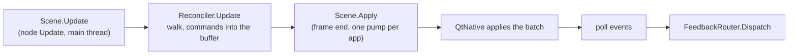
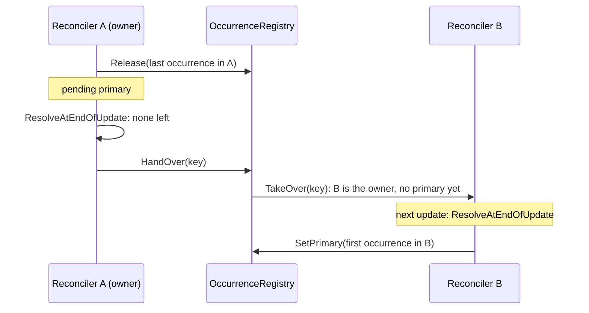

# Reconciler

How the reconciler turns the element tree of one renderer into commands for QtNative, frame after frame: the walk, the skip test, the order of the commands, occurrences, input handlers, effect chains, styles, self-made widgets and what happens when a reconcile throws. The code is in `src/VL.Qt/Reconciliation/`: `Reconciler` (the walk), `ItemMirror`, `HandlerMirror` and `EffectChainMirror` (what was sent), `PropertyDiff` and `HandlerPropertyDiff` (the SETs), `PrimaryOccurrences`, `OccurrenceRegistry` and `InteractionRegistry` (where things are shown), `FeedbackRouter` (the way back). The identity rules (position plus type, the key of an element, several renderers) are in [reconciler-identity.md](reconciler-identity.md); how events arrive in the nodes is in [events-and-interaction.md](events-and-interaction.md). Words as in the [glossary](../glossary.md): the element tree, an occurrence (one place where an element appears), a mirror (what was sent for one occurrence).

## Context

Descriptions go in, retained Qt objects come out. The patch builds immutable elements every frame; Qt Quick keeps its items alive between frames. The reconciler sits between them, one per renderer: it compares the element tree with the mirror of the last frame and writes the minimal commands (CREATE, SET, REPARENT, DESTROY, BIND) into an `ICommandSink` (`Wire/ICommandSink.cs`; the `CommandWriter` in production, a recording fake in tests). It does not talk to Qt.

Two facts shape the design. The mirror must say what QtNative holds, because only differences are written. And a patch changes little per frame, so a frame without changes must cost one reference comparison per subtree and allocate nothing.

## Design

### One frame

- `Scene.Update` runs in the update of the renderer node on the vvvv main thread, once per frame, after the element tree of that frame was evaluated. It writes clear colour, Clear and Space when they changed, then calls `Reconciler.Update` unless the `ResyncController` says to wait (see Errors and resync). It only writes commands.
- `Scene.Apply` sends the buffer to QtNative at the end of the frame, after all node updates. Events come back with the next poll (`FeedbackRouter.Dispatch`); the nodes read them one frame later.
- `Reconciler.Update` numbers the pass (`PassInfo.Pass`), walks the tree and ends with `PrimaryOccurrences.ResolveAtEndOfUpdate`. The pass is forced (`PassInfo.Force`: no skipping) at the first update and the first after a `Discard`, after `Invalidate` and when the unit scale of the `SpaceMapping` changed; a changed unit scale also sets `PassInfo.Rescale`, so every length is written again. A change of the space alone only moves the origin (SET_SPACE, written by the scene).
- Nothing here is thread-safe, and nothing needs to be.

### Skipping unchanged subtrees

A subtree is skipped when all five conditions hold:

1. the new element is reference-equal to the one in the mirror (`ItemMirror.Element`);
2. the pass is not forced;
3. the mirror is not marked `MustVisit` (a video inside it was taken over by an earlier occurrence, so it has to turn into a placeholder);
4. the subtree holds no self-made widget (`ItemMirror.ContainsStylable`; see Self-made widgets);
5. the style inherited at this position is reference-equal to the one the mirror was last reconciled with (`ItemMirror.InheritedStyle`).

Immutable descriptions make the first condition valid. A resolved style that stays equal keeps its reference (see Styles).

### Order of the commands

- **Parent before child, in this order per object:** CREATE, SET_STYLE (widgets), property SETs, REPARENT, BIND, the input handlers (see Input handlers), the effect chain with its objects, the children, then for a `Shader` element SET Source and the uniforms, which refer to the ids of the children.
- **The REPARENT index counts real objects only** (`live` in `ReconcileChildren`). Placeholders have no Qt object, and the objects of an effect chain are not children (no REPARENT), so neither counts. QtNative relies on this.
- **DESTROY goes to the topmost object of a removed subtree only;** QtNative destroys the rest. The ids of the whole subtree go back to the `IdAllocator`, whose `Free` throws on a double free or an unknown id.
- **Children change at the tail only.** A common prefix is diffed position by position, surplus old mirrors are destroyed from the end, new children are created at the end. Mirrors never change their parent. Together this keeps the traversal order of existing mirrors stable, which the primary logic relies on. The exception is the objects of an effect chain, rebuilt in the order of a new chain; it can only change which occurrence of a mask element is the primary one.
- **Properties:** `PropertyDiff` has one hand-written method per element type and writes a SET for what differs from the previous description. A just created object is compared with a default instance of its type, so only non-default values go out; the defaults of an element class have to equal what QtNative gives a new item. Handlers have their own diff, `HandlerPropertyDiff`.

### Occurrences and the primary

- `PrimaryOccurrences` (one per reconciler) registers every mirror in the app-wide `OccurrenceRegistry` under its `OccurrenceKey` and decides which occurrence is the primary one.
- A new occurrence becomes the primary one when it is the only one, or when the reconciler owns the element and the current primary was not reached yet in this pass (it comes later in traversal order, or is about to be destroyed). Traversal order is depth first, children in order; the objects of an effect chain count before the children of their item, in chain order.
- Occurrences are kept until their mirror lets go of the element, not rebuilt every frame: a skipped subtree is not visited. Only the primary occurrence reports state values (measured size, bounds, media, error). Its feedback id is flagged primary in the `FeedbackRouter`, and `PrimaryOccurrences` is the only writer of `ItemMirror.IsPrimary` and of that flag.
- When the primary lets go, the decision waits for the end of the update (`ResolveAtEndOfUpdate`): the first remaining occurrence in traversal order of the owner's tree is promoted with a new feedback id and BIND, so QtNative sends its current state again. If no occurrence is left in the owner's tree, the owner hands the element over to the next renderer that shows it (`OccurrenceRegistry.HandOver`). Deciding at the end keeps a move inside the owner's tree from handing the element to another renderer.

Between the hand-over and the next update of B the element has no primary: no state values arrive.

### Placeholders

A `Video` is shown once, app-wide (one player). The first occurrence of the owner renderer plays; every other occurrence is a placeholder, an `ItemMirror` with id 0 (no Qt object, no children, no binding) plus a warning in the element's feedback slot. Inside one tree the first occurrence in traversal order wins: an earlier occurrence takes the video over from a later one not reached yet in this pass, and the later subtree is marked `MustVisit`, so it is visited and turns into a placeholder. When the last real occurrence lets go, the reconcilers of waiting placeholders are invalidated (`Reconciler.Invalidate`): their next update visits the whole tree and one takes over.

### Input handlers

The interaction chain of an element becomes a list of handler mirrors per item (`ItemMirror.Handlers`), not children, so layouts never see them. `HandlerReconciler` matches the links of the chain to the list by their feedback slot (the order of the chain does not matter): a new key creates a handler (CREATE, SETs, REPARENT to the item, BIND with a new feedback id), the same instance costs nothing, a changed instance sends the differing SETs, a missing key destroys the handler. A reference-equal chain is skipped unless the pass is forced.

An interaction is active at one handler only, app-wide (`InteractionRegistry`, keyed by its slot). Unlike an element, the active handler keeps it as long as it exists; every further occurrence is a placeholder with a warning until the active one lets go, and the first reconciler to update then takes over.

### Feedback binding

Every visited item is bound to the feedback slot of its description (BIND with a feedback id from the `FeedbackRouter`); an element without a slot sends an unbind (id 0). A slot change takes a new feedback id, so late events of the old binding are dropped; ids count up and are not reused. Several ids may point to one slot (one per occurrence): hover and press are counted per id, events are taken from every id, state values from the primary id only; the ids of input handlers are always primary ([events-and-interaction.md](events-and-interaction.md#feedback-binding)).

### Effect chains

The Effect pin is cut into links in application order (`Effect.Segment`) and sent as one SET_EFFECT_CHAIN by `EffectChainWriter`, only when the chain instance changed (reference comparison; no chain is a chain of 0 links). The elements the links refer to (the mask of a merged run, the texture of a shader uniform) are objects of their own (`EffectChainMirror.Objects`): reconciled without REPARENT before the chain is sent, destroyed after it when no longer used. An unchanged chain only retries its objects, and is sent again when an object got another id or the unit scale changed.

### Styles

The base style is the inherited style under the window root. A `Group` and every widget merge their own style over the inherited one (`StyleMerge`), other elements pass it on. The merge only runs when the inherited or the own style changed by reference, and an equal result keeps the old reference, so unchanged children stay skipped under a re-merged parent. Widgets send their resolved style right after CREATE and later as a diff against `ItemMirror.SentStyle` (`StyleWriter`); primitives never get SET_STYLE. `StylableElements` is the one list of the classes that take part.

### Self-made widgets

A child that is a `StylableElement` (the placeholder of an `IStylable`) is built with the style inherited at its position, and the returned element is reconciled in its place. Build runs on every pass, because a patched widget is usually a mutable instance whose reference does not change; its ancestors are therefore never skipped (`ContainsStylable`), the elements around it still are. An exception, a cycle of stylables or a foreign `IElement` is caught per call and shown at the feedback of the parent (`MessageKind.BuildError`); the element of the last successful Build stays.

### Errors and resync

A reconcile that throws (for example a value above the size of one command) leaves the mirror half updated: ids, objects and occurrences exist that the mirror does not reach. No repair is attempted. `Scene.Update` catches the exception, drops the commands of the frame, keeps the exception (`ReconcileFault`; the renderer node logs it and marks itself in the phase "Reconcile", no error pin) and asks the `ResyncController`. A failed apply takes the same path, because QtNative aborts a batch at the first bad command:

1. one RESET wipes the scene of the window in QtNative;
2. `Reconciler.Discard` forgets everything without commands: mirror, ids, bindings, the messages the mirror shows, and every trace of the reconciler in both registries (`RemoveAll`; it does not walk the mirror: a cut-short visit leaves occurrences no mirror reaches);
3. the next update builds the tree from scratch, one frame later.

If the rebuild fails too, the controller gives up: the scene stays empty until the input changes by reference and a pause is over (2 frames, doubled per give-up up to 64, back to 2 after a successful apply).

### Invariants

- **Mirror and registries change together.** At the end of an update the mirrors, the `OccurrenceRegistry`, the `InteractionRegistry` and the `FeedbackRouter` agree on who is shown, who is primary and which feedback ids are live; a debug assertion checks the primary after a promotion. During a visit they can differ, and an exception in the middle breaks the agreement for good: therefore Discard and resync, never a partial repair.
- **One writer of `IsPrimary`:** `PrimaryOccurrences`, together with the primary flag of the feedback id.
- **One owner per feedback field:** the router writes what Qt reports, the node only takes what it consumed, and every message has its own source, so writers do not overwrite each other (`FeedbackState`).
- **Primaries and hand-overs are decided at the end of an update,** never in the middle of the walk.
- **Discard and RESET go together:** the mirror is dropped exactly when QtNative was wiped.

## Consequences

- Allocation contract: a frame without a structural change allocates nothing in the walk, the property diff, style resolution, effect chains, uniforms, handlers, the registry update for a new instance of a shown node and the router. `ReconcilerPerfTests` holds the common shapes at 0 bytes per frame, including one element in two renderers in both update orders.
- A new element type needs its `ElementType`, a method in `PropertyDiff`, an entry in the default instances (equal to QtNative's defaults) and the QtNative item; a new widget class is also added to `StylableElements`.
- A value that QtNative rejects, or one the writer cannot encode, costs one rebuild of the scene, not a stuck renderer.
- Tests that protect the rules: `ReconcilerStructureTests`, `ReconcilerSceneTests` (occurrences, two renderers, videos, faults), `OccurrenceRegistrySlotTests`, `FeedbackRouterTests`, `ReconcilerStylableTests`, `EffectChainReconcilerTests`, `InteractionTests`, `ResyncTests`, `ReconcilerPerfTests`.

## Alternatives considered

- **Rebuild the Qt objects every frame (the Skia way):** needs no mirror, but Qt Quick items are retained objects; creating them every frame is the cost the diff exists to avoid.
- **Let the node own its Qt object (the Stride way):** contradicts descriptions as data; the reconciler would no longer own the objects.
- **Repair the mirror after an exception:** a visit has already written commands, registered occurrences and allocated ids; a partial repair has to know every step. Wiping and rebuilding is complete for any cause.
- **Decide primaries during the walk:** a move inside the owner's tree would hand the element to another renderer for one frame. Deciding at the end sees the final tree.

## Open questions

None of its own. The open points of the identity rules (a `Key` pin, a `Mirror` element, reuse of expensive Qt objects that move among siblings) are in [reconciler-identity.md](reconciler-identity.md#open-questions).

## Evidence

- Unit tests, no GPU: `dotnet test src/VL.Qt.Tests --filter "FullyQualifiedName~Reconciler|FullyQualifiedName~ResyncTests|FullyQualifiedName~OccurrenceRegistry|FullyQualifiedName~FeedbackRouter|FullyQualifiedName~EffectChainReconciler|FullyQualifiedName~InteractionTests"`.
- SmokeTest scenarios `ReconcilerTest`, `ResyncTest`, `MultiPlacementTest`, `MultiRendererTest`, `StylableTest`, `EffectChainTest`, `VideoTest` (`dotnet run --project src/VL.Qt.SmokeTest -c Release -- --all`).
- Allocation: the `NoAllocations` tests of `ReconcilerPerfTests` count the bytes of a steady-state frame and need no GPU. Its `Fast` tests (category `Perf`) compare a median frame time with a budget; they are a guard, not a measurement.
