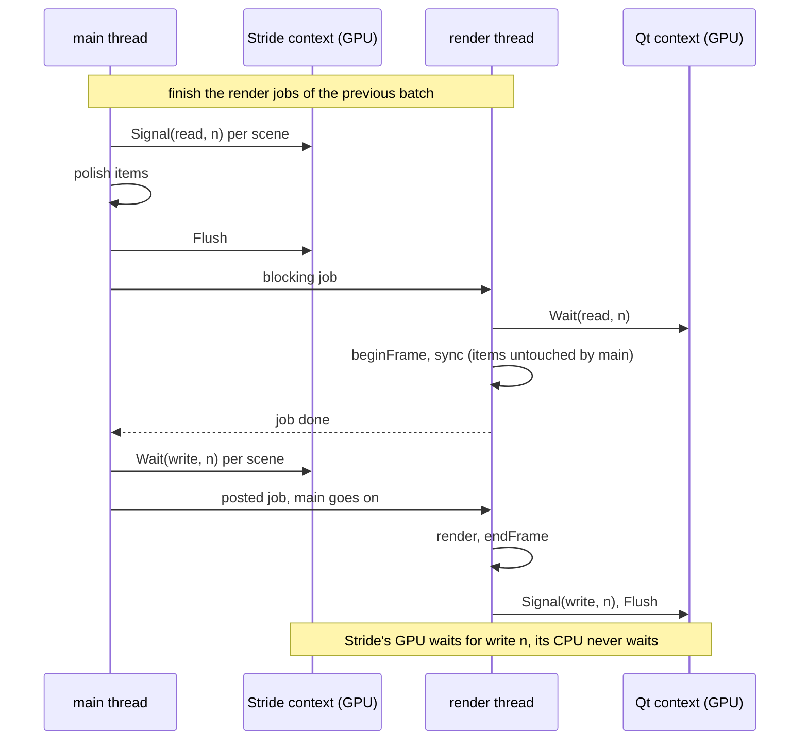

# Offscreen scenes and render threads

How an offscreen scene (the Qt side of `QtTexture` and `QtRenderer`) lives in QtNative and which thread runs what: `src/VL.Qt.Native/offscreen/` (`offscreen_scene.h`, `offscreen_binding.cpp`, `offscreen_render.cpp`), `src/VL.Qt.Native/device/render_thread.h` and `device/context_lock.h`. The pin `Render Threads` is described for users in [../diagnostics.md](../diagnostics.md#qttexture-render-thread); the nodes, the shared texture and the fences are in [stride-output.md](stride-output.md); measurements are in [../research/render-texture-measurements.md](../research/render-texture-measurements.md).

## Context

A scene is a `QQuickWindow` driven by a `QQuickRenderControl`: no native window, rendering into a texture of another device (Stride's) that the host passes to `bind`. Qt's scene graph and its `QRhi` (Qt's graphics abstraction) are bound to the thread that uses them, while the elements, the reconciler and all input stay on the main thread. Every scene of the process shares QtNative's one D3D11 device and its immediate context ([gpu-device.md](gpu-device.md)).

Windows use Qt's `basic` render loop on the main thread, on purpose ([render-loop.md](render-loop.md)); an offscreen scene has no render loop of its own and is driven through its render control. A render thread here is a thread that the scene's `QRhi` and scene graph are moved to with `QQuickRenderControl::prepareThread`, not a Qt `threaded` loop.

The goals are: the main thread spends only a fraction of a millisecond per scene, several scenes do not wait for each other more than necessary, and Stride shows the same frame without a CPU wait.

## Design

### Lifetime of a scene

- A scene exists from `vlqt_offscreen_create` to `vlqt_scene_destroy` and goes through `bind`, `render_batch` … `unbind` any number of times in between. Destroy first releases the binding and the scene graph (`release`), then deletes the `QQuickWindow`, then the render control and the scene's `QRhi` (`destroy`).
- The `QRhi` belongs to the render control and lives on QtNative's shared device from create on, so a scene is never bound to another device than the one its `QRhi` uses. `render_batch` refuses a context that belongs to another device than the one the scene was bound to.
- A binding is the foreign texture opened on QtNative's device (Qt's render target), QtNative's immediate context and two shared fences, each as created on QtNative's device and as opened on the foreign one. `readFence` means the foreign device is done reading the texture (Qt may write), `writeFence` means Qt is done writing (the foreign device may read). Both count up from 0 per binding.
- QtNative holds no reference to the foreign device of its own: the two fences opened on it keep it alive until `unbind`. A bound scene therefore keeps the device alive after its owner released it, and `unbind` or destroy frees it.
- When QtNative's device is lost, or moves to the foreign adapter in `bind`, a `device::Listener` unbinds every scene and drops its scene graph and `QRhi` (`lost`). `device::rebuild` then gives the scene's window, which has no `QRhi` now, the new device like any window that is not yet exposed, and `restored` initializes the render control again. The caller sees `is_bound` 0 and binds again.

### Render threads

- A pool of threads with a Qt event loop, shared by every offscreen scene of the process (scenes of every app host). Its size is the pin `Render Threads` of `QtTexture` and `QtRenderer` (exported as `vlqt_offscreen_set_render_threads`): default 1, range 0 … 16, **0 = main-thread mode**. There is one pool per process, so the **largest value of all nodes counts**; 0 applies only when every node has 0.
- The pool **only grows at runtime**: a larger size adds threads at once, a smaller one (or 0) applies to the scenes created afterwards and leaves the threads to the scenes that have them. The threads live until the process ends, like the shared device: stopping them at exit would run after Qt.
- A scene gets its executor at create (a thread, round robin, or inline on the main thread) and keeps it. Its scene graph and `QRhi` live there: `initialize`, `beginFrame`, `sync`, `render`, `endFrame`, `invalidate` and `unbind` run through it. The main thread waits for each of them except `render` + `endFrame` + `Signal` + `Flush`, which `render_batch` posts (inline they run at once). Items, polish, input, `apply` and `bind` stay on the main thread; a render thread touches items only in `sync`, while the main thread waits.
- Jobs of one thread run in queue order, so a blocking job runs after every job posted before it. That is how the main thread drains a thread before it unbinds, destroys, handles a device loss or an adapter move.
- Scene graph objects of a scene (a `QSGTexture` and the `QRhiTexture` under it) belong to its render thread: an item that holds one from the main thread lets it go through `render_thread::retire`, never by dropping the last reference itself.
- Main-thread mode runs the same batch code: its jobs run inline, in the same order, flush Stride's context after the read signals as the threaded path does, and a failing step is logged instead of aborting the batch (one `Executor` per scene, `offscreen_render.cpp`). It is the way to tell a render-thread problem from a scene problem.

### Device model under threads

QtNative keeps its one shared D3D11 device; the render thread uses its immediate context like the main thread. The context is multithread-protected (`ID3D11Multithread::SetMultithreadProtected(TRUE)`), so single calls need no lock, and every stateful sequence takes a recursive lock (`ContextLock`, `Enter`/`Leave`) so that it cannot interleave with another thread's sequence: a QRhi frame, `Wait` + `beginFrame`, `endFrame` + `Signal` + `Flush`, `Map` + `Unmap`. QRhi D3D11 records into its own command buffer and executes it in `endFrame`; `render()` only maps dynamic buffers, which the per-call protection covers.

Window frames hold the lock from `beforeRendering` to `afterFrameEnd`. The main thread never holds it while it waits for a render thread, because that job may take it too: `RenderThread::call` ends the window frame locks first and warns once if one was still held (the call came from inside a window frame).

### The frame of a batch

`render_batch` runs at the start of Stride's draw, on the main thread, for every scene whose content changed:

- The same frame is kept: the texture holds the content of the apply of this frame, and no latency mode exists. Stride's GPU waits for a value signalled later ("wait before signal"); its CPU never waits. If Qt's render takes longer than Stride's CPU frame, Stride's GPU waits.
- **Back pressure:** the next `render_batch` first waits for the render jobs of the previous one on every render thread. At most one frame per scene is in flight, and the main thread blocks only when a render thread is more than a frame behind. With several render threads this order is also needed for correctness: all scenes share Qt's immediate context, and a `Wait(read, n+1)` queued there ahead of another thread's frame n would make Qt's GPU wait for Stride's, which waits for `Wait(write, n)` of that very frame, a deadlock.
- Every queued `Wait(write, n)` must get its signal: the render job signals also when `beginFrame` or `render` fails.
- Stride's context is flushed once per batch after the read signals, so Qt's GPU need not wait for the host's next flush.

### WARP fallback

With a software device (WARP) as the foreign device, a foreign context that waits for a value the render thread signals later deadlocks. QtNative falls back for a binding with a software device: the main thread waits until the render thread has submitted the signal, then queues the wait. That gives no gain and is correct. Hardware devices never take this path.

### Thread affinity

| Object or call | Thread |
|---|---|
| `QQuickWindow`, items, `vlqt_scene_apply`, reconciler (`OffscreenScene`, `CommandWriter`), animation driver, `polishItems`, input events, `setGeometry` | main |
| `QQuickRenderControl::prepareThread` | main, once at create, before `initialize` |
| `initialize`, `beginFrame`, `sync`, `render`, `endFrame`, `invalidate`, the scene's `QRhi` and scene graph, `setRenderTarget` + `ensureCustomRenderTarget` in unbind | render thread (`sync` and the calls the main thread waits for: blocking job) |
| `bind` (open texture, fences: device calls are free-threaded) | main; its unbind and `initialize` run as blocking jobs on the render thread |
| unbind, Stride device loss, `vlqt_scene_destroy` | main, after a blocking job on the render thread (it runs after every posted render, so it drains): unbind there; destroy also `invalidate` and deletes the `QRhi` there, then the main thread deletes window and render control |
| QtNative device loss (`device::Listener`) and adapter move | main; `lost` and `restored` run per scene as blocking jobs on its render thread |
| `QQuickWindow` signals (`beforeSynchronizing`: `SceneChangeCounter`, `PerfMonitor`) | render thread; the sync ones while the main thread waits, `before/afterRendering` concurrently, so shared counters need atomics or per-thread values |
| Stride's immediate context (`Signal`/`Wait`) | main only (Stride draws there) |

## Consequences

- A change in what runs on a render thread starts at the thread table above; item code follows the rules in [render-loop.md](render-loop.md), "Item code".
- New code that holds the context lock follows the lock order above. The SmokeTest scenarios `qttexture` (both thread modes), `image-retire` (also `image-retire-pool-2`) and `qttextureperf` protect it.
- More than one thread helps only for several heavy scenes and costs CPU through contention (Qt-global locks, the context lock, cores shared with vvvv); keep the default 1 unless the frame time shows otherwise ([../diagnostics.md](../diagnostics.md#qttexture-render-thread)).

## Alternatives considered

- **One device per render thread:** uploaded images and `QtImageItem` textures live on the shared device and would have to be opened as shared resources per scene; device loss and adapter move would exist twice.
- **Deferred contexts:** QRhi D3D11 needs the immediate context (`Map` READ for readbacks and snapshots, timestamp queries, `Flush`), and `QQuickGraphicsDevice::fromDeviceAndContext` takes the immediate context.
- **One thread per scene:** about 3× CPU per scene, contention grows with the node count.
- **A one-frame-latency mode** (Stride never waits): not needed; if it comes, a GPU copy into a stable texture is preferred to double buffering, because consumers keep one instance.

## Open questions

- The thread numbers come from one arm64 notebook; measure once on an x64 desktop GPU ([../research/render-texture-measurements.md](../research/render-texture-measurements.md)).

## Evidence

Measurements of one render thread, a pool and the main-thread mode are on [../research/render-texture-measurements.md](../research/render-texture-measurements.md) (x64 not measured); rerun with SmokeTest `qttextureperf`. Also checked: a queued `Wait(write, n)` does not hang when QtNative's device is removed (the frame is discarded or completes), the main-thread users of the context take the lock (window frames, upload `QRhi` frames, staging copies), and snapshots of a threaded scene under load keep the same frame (`qttextureperf`, both modes).
