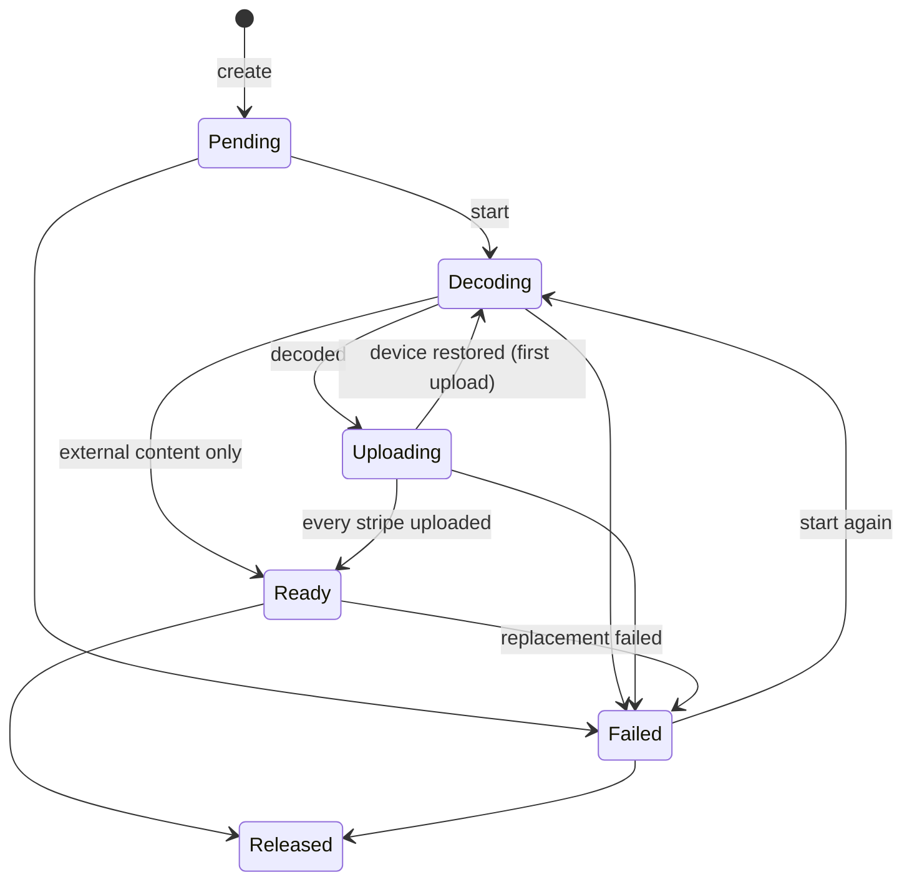

# Resources

The resource manager of QtNative: one process-wide table of resources (images, snapshots, shaders, audio taps) that is independent of any window. Code: `src/VL.Qt.Native/resources/` (`resources.h` is the interface that the exports in `resource_exports.cpp` and the pump in `app/app.cpp` call, `resource_kind.h` the interface of a resource kind), the kinds in `image_resource.*`, `snapshot_resource.*`, `shader_resource.*` and `resources/audio_tap.*`. Header comments in these files are short and point here. User pages: [images.md](../images.md), [video-audio.md](../video-audio.md).

## Context

C# holds only an id; everything else happens in QtNative. A resource is made once (decoded on a worker, uploaded to the GPU within a byte budget per frame) and then used by any number of elements in any number of windows. Bugs in this layer are hard to debug from vvvv, so the manager is simple and logs everything under the category `VL.Qt.Resources`.

## Design

### Ids

An id is a u64: index in the low 32 bits, generation in the high 32 bits, assigned by `vlqt_res_create`. After a resource is released its index is reused with a higher generation, so an old id never reaches a new resource. An unknown or stale id logs a warning and returns -9. Log lines write an id as `#index.generation` (`idText`).

### States

`Pending -> Decoding -> Uploading -> Ready | Failed -> Released` (`vlqt_resource_state` in `protocol.h`). Every change goes through one function, `transition`, which rejects and logs invalid changes and logs valid ones on debug level. `Decoding` means "the content is being made" for every kind: a decode on a worker, a snapshot grab in flight.

Any state except `Released` can go to `Released`. Every other change is rejected.

### Threads

- The table, the event queue, the upload queue and the free list belong to the vvvv main thread (the thread of `vlqt_app_process_events_for`) and have no lock. Every entry point checks the thread: a call from another thread returns `VLQT_ERR_WRONG_THREAD` (or nothing) and logs a critical message once.
- A fixed worker pool (default `min(4, cores - 1)`, environment variable `VLQT_RES_WORKERS`, started at the first job) runs only `Kind::decode` on pure data (bytes, `QImage`). Workers see only the Content of their job and never touch Qt Quick, the RHI or the table and never log. Jobs and results go through the two queues of the pool, guarded by its own mutex, the only one of the manager; it is never held across a decode or GPU work.
- Upload (`Kind::upload`) and destroy (`Kind::destroy`) run on the main thread: uploads in `beginFrame` within the byte budget per frame, frees in `endFrame`. An upload that has to wait (`UploadStatus::Waiting`, e.g. its copy task still runs) moves to the back of the queue and the next one goes; `beginFrame` stops when the budget is used or a whole pass only waited.

### Reference counts

A resource has one host reference (C#, dropped by `vlqt_res_release`) and element references (`acquire` and `releaseElement`: an Image element or a Shader item holds one on the id it shows and on the id it waits for). When both counts are zero the resource is freed at the end of the frame, never in a worker, because a worker may still read its content; a running decode is cancelled (`Content::cancel`) or finishes first.

### Event queue and status records

`vlqt_res_poll` returns records (byte layout: `protocol.h`, `resource_events.cpp`) with the header of the window poll: u16 event, u16 flags (0), u32 length, u64 id, payload (4-byte aligned, length = 8 + payload bytes).

| Event | Payload |
|---|---|
| STATE | u8 state |
| ERROR | UTF-8 text |
| INFO | u32 width, u32 height, u32 format, u64 bytes |
| WARNING | UTF-8 text (`Kind::takeWarning` after a decode, at most one per resource) |

STATE carries every state change C# needs to see. INFO describes the content: it is sent before STATE Ready for a first content and after the swap for a replacement, so C# never sees Ready without a size. The poll copies the whole queue into a caller buffer; when the buffer is too small the call reports the required size and keeps the queue. A host release drops the records of the id that are still queued, so C# gets no record for an id it released.
### Content and who touches it

A kind keeps the data of one resource in its `Content`. A field has one owner at a time: input fields are set on the main thread before `start`, decode fields by the worker that holds the content, upload fields on the main thread after the worker handed it back. `Content::cancel` is the only field a worker and the main thread both touch (atomic). The main thread never touches content a worker holds, and `Kind::destroy` runs only for content no worker holds, because a worker may be reading it.

### Replacement

`start` on a Ready resource decodes and uploads a second content next to the current one. The state stays Ready (no STATE record). When the new upload is complete the current content is swapped (the old one is destroyed) and a new INFO record is sent. A failed replacement makes the resource Failed. `start` on a Failed resource starts over (Failed -> Decoding). `start` while a decode or upload runs keeps only the newest content and starts it afterwards.

Content replaced every frame (a video through `vlqt_image_set_pixels`) costs no new GPU texture and no new raw buffer per frame: the image kind fills again a texture of the same size, format and flags that no content and no window wrapper holds any more (texture pool, `resources/gpu_texture.h`), and takes the raw buffer of an earlier frame of the same size (`resources/image_kind.cpp`). Both pools keep at most a few free entries and free those nobody took for about a second (`image::endFrame`), and the texture pool forgets everything on a device loss.

### Images

An image comes from a file (`vlqt_image_load`) or from pixels of C# (`vlqt_image_set_pixels`) and ends as a texture on the process device ([gpu-device.md](gpu-device.md)), independent of windows. The kind is `image_kind.*`, its two upload paths are `image_upload_rhi.cpp` and `image_upload_d3d11.*`.

- **Decode** (worker): a file is read with `QImageReader` (EXIF rotation applied) and converted to 8 bit premultiplied; pixels are copied into an own buffer in the entry point (the caller's buffer is free after the call) and converted in the worker (format table in `image_kind.cpp`). Optionally a preview with the longest edge of at most 256 px is made for the editor tooltip.
- **Upload paths** (pin `Upload`, `vlqt_image_upload`; `Auto` = the path of the source):
  - *Worker path* (D3D11 only; default for files and for mipmaps): the worker creates an empty texture and an empty staging texture; the main thread maps the staging texture, a copy task writes the pixels into it (an image within the frame budget: the main thread), then `Unmap` and `CopyResource` (a GPU copy) put them into the texture, which QRhi wraps without owning it. Mipmaps: the texture is created with its mip chain, the main thread copies level 0 and records `GenerateMips`.
  - *Stripes path* (default for pixels): stripes of at most the frame budget through one offscreen frame of the upload QRhi per resource and pump; `generateMips` follows the last stripe. Ready only when every stripe is there.
  - Why: `CreateTexture2D` with initial data blocked the render for as long as it ran, and the first write into a new 4K texture on the main thread is slow (see Evidence); the worker path keeps the main-thread cost of a file below one millisecond. Pixels set per frame (video) take the stripes path, which fits the frame budget and refills a pooled texture.
- **Replaced every frame** (a video through `set_pixels`): no new texture and no new raw buffer per frame, see Replacement. A texture is shared by the image content that filled it, the texture pool and the window wrappers; the pool owns every texture (`resources/gpu_texture.h`) and fills one again only when no content and no window shows it any more, so refilling cannot change a picture on screen. The pool keeps at most two free textures per size, format and flags, none longer than about a second.
- **Handles.** A window never uses the resource's texture directly: `image_texture_cache.h` gives one `QRhiTexture` per window, QRhi and source, created from the native texture (`createFrom`, no copy). The wrapper holds a reference on the native texture (a COM `AddRef`), so a resource freed or replaced meanwhile never leaves a dangling texture. The QRhi is part of the key because Qt replaces a window's QRhi after a device loss while the `QQuickWindow` stays. Items let their textures go on the thread that made them (the render thread) or through `render_thread::retire` before the window's QRhi goes, because a texture belongs to the thread that made it.
- **No shared device** (Linux, `VLQT_SHARED_DEVICE=0`, software backend): there is no texture. The resource keeps the converted `QImage` and is Ready after the decode; each window makes its own texture of it (`createTextureFromImage`), once per window.
- **Draw rule.** The Image element shows the old image until the new one is Ready, so there is no empty frame. Content of an older device generation (`ImageContent::generation`) gets no texture until its replacement is Ready.

### External content

A snapshot (`snapshot_resource.h`) is made on the main thread (`beginExternal` / `finishExternal`) without a worker and without an upload, so Decoding -> Ready is allowed for that kind only. `vlqt_res_wait` does not block on it. An audio tap is Ready at its init.

A snapshot grabs one element with `QQuickItem::grabToImage` (never `grabWindow`): the window renders the item into an offscreen texture in its next render and reads it back, and the result arrives on the main thread in that or a later pump as a CPU copy (premultiplied BGRA8, no texture, no upload budget). Only the newest grab of an id counts; older ones in flight are kept alive (Qt still references them) but their result is ignored. A grab never stays in Decoding: every pump fails it when the element or the window was destroyed, the window is no longer exposed, or nothing came for 10 s (`timeoutMs`). An offscreen scene is never exposed; while bound it is marked dirty so that the batch renders it.

### Device loss

The manager is a device listener (`device.h`).

- **Lost:** `Kind::releaseDevice` runs on every content that no worker holds: textures, staging buffers and running uploads of the old device go, the sources stay.
- **Restored:** every Ready resource with GPU content gets a replacement from `Kind::restore` (decode and upload within the budget). The state stays Ready, INFO is sent after the swap, so C# sees no change. What `restore` starts from is the source the kind kept: an image from a **file** keeps only the path (no CPU copy of the pixels or the file bytes after the upload) and is **read from disk again**, so a file that was changed meanwhile shows its new content and a file that is gone ends in Failed; an image from **pixels** keeps its converted copy and its raw buffer and only uploads them again. A running replacement or queued content is renewed the same way. A first upload restarts its decode (Uploading -> Decoding, allowed only here).
- A decode that ran for the old device (`Kind::stale`) is restarted when its result comes back, also when it failed.
- Uploads that fail because the device is removed report no error (the `Kind::upload` contract) and wait for the rebuild instead of ending in Failed.
- Snapshots are CPU only and stay as they are.

## Consequences

- A new resource kind implements `Kind` and is registered in `resource_registry.cpp`, the only file that names every kind.
- Workers take jobs and hand back results while the main thread uploads or destroys: no lock is held across GPU work.
- Content a worker holds is never touched by the main thread until the worker hands it back; `destroy` is called only for content no worker holds.

## Alternatives considered

- **Create the texture with initial data on the main thread:** `CreateTexture2D` with initial data blocked the render for as long as it ran.
- **Stripes for files too:** the first write into a fresh 4K texture on the main thread costs milliseconds; loading 20 such images gave hitches in 22 % of the frames (Evidence).
- **Keep a CPU copy of a file image for the restore after a device loss:** costs the CPU memory of every image. A file image is read from disk again instead, which means a changed file shows its new content.

## Open questions

None.

## Evidence

Upload paths: measured while the worker path was built, on a developer machine that was not recorded; 4K image on the main thread: under 1 ms with the worker path, about 9 ms for the first write into a new texture with stripes, about 1 ms per 8 MB after it, 20 × 4K gave hitches in 22 % of the frames; an offscreen frame of the upload QRhi waited actively for the GPU, 2.2 ms per frame in the profile. Rerun: SmokeTest scenario `ImageResourceTest`, pin `Upload` of the image nodes for A/B.

`ImageResourceTest` (state machine, budget, wait, replacement) and `DeviceLostTest` in `src/VL.Qt.SmokeTest`; the F5 overlay, Resources page, shows the table live (`docs/diagnostics.md`).
