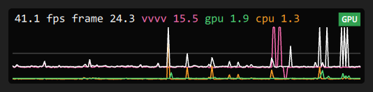
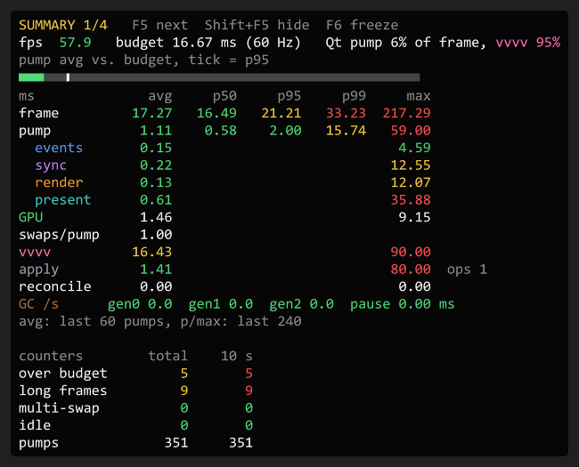
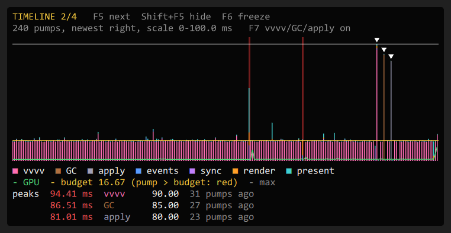
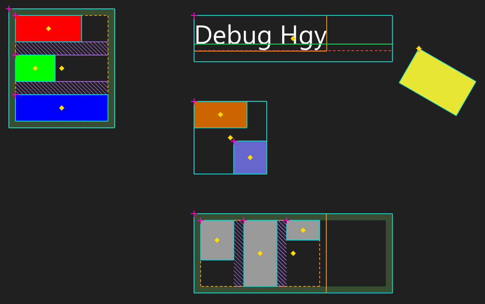

# Diagnostics

## Performance overlay

Press these keys in a Qt window (no modifiers). Both overlays are drawn by QtNative, so they cost no vvvv time.

<table>
<tr>
<td valign="top"><b>F2</b> perfmeter </td>
<td valign="top"><b>F5</b> stats panel, Summary and Timeline pages  </td>
</tr>
</table>

| Key | Action |
|---|---|
| F2 | Meter: small frame/pump graph in the corner, on/off |
| F5 | Stats overlay on, then page by page: Summary, Timeline, Scene, System, Resources (live images: state, size, upload queue/budget, stuck or failed first), then off (the last page is remembered) |
| Shift+F5 | Stats overlay hide/show, page kept |
| F6 | Freeze the stats (only while the stats are visible, otherwise F6 goes to the scene) |
| F7 | Timeline: show/hide the host segments (vvvv, GC, apply), only while the stats are visible |

The same numbers are available in a patch: `Renderer [Qt]` has an optional `Perf` output (`PerfStats`), see `help/Qt/HowTo Read Performance.vl`. `PerfStats (Split)` exposes the frame, pump, sync, render, present and GPU timings; `Split Percentiles`, `Split Counters`, `Split Host` (vvvv, wait, apply, reconcile, ops) and `Split Gc` read the further fields.

### Overhead of the overlays

The overlays are cheap: with a typical scene the native pump takes a few hundredths to a few tenths of a millisecond longer per frame, depending on the page (the Summary page is the cheapest, the Timeline page and the F2 meter the most expensive). Hide them when you measure the scene itself.

### Pump spikes: where they come from

When a pump takes longer than the frame budget, the warning in the vvvv log ends with the Qt phases of each window's last pump (`vlqt_window_get_perf_sample`: sync, render, present, gpu, events, swaps). Use them to find out which phase a spike is in.

The replay attributes spikes the same way: `dotnet run --project src/VL.Qt.SmokeTest -c Release -- --replay anim[:frames[:rects]] [outDir] --paced [--loop N] [--load N]` plays a built-in animated scene (moving semi-transparent rectangles plus texts that change every frame) at 60 fps. Every spike above 8 ms goes to its largest phase (apply, advance, events, sync, render, present), and the run ends with a `REPLAY spike attribution` line and the number of pumps whose present took longer than 4 ms. `--load N` keeps N threads busy on the CPU meanwhile.

Result (win-x64, D3D11, flip model, swap interval 0, maximum frame latency 2; 3600 frames per run):

| Run | Pump median | Spikes > 8 ms (steady) | Dominant phase | Present > 4 ms |
|---|---|---|---|---|
| 300 rectangles | 0.75 ms | 1 | present (once after the window was shown) | 1 of 3591 pumps |
| 4000 rectangles (GPU-heavy) | 4.9 ms | 1 | present (once after the window was shown) | 1 of 3591 pumps |
| 300 rectangles, every core busy | 0.69 ms | 13 | apply 8, events 4, present 1 (once after show) | 1 of 3591 pumps |

Present does **not** block in steady operation. Outside start-up it stays at 0.1 ms or less, also with a GPU-heavy scene or a fully loaded CPU. The only slow present comes once per window, 10 to 25 frames after it is shown: it takes 10 to 32 ms, and the frame interval of that pump is about 40 ms. The window is then going through its first frames with the compositor (5 replays in a row: once in every round). The spikes under CPU load are in the C# apply and in the Qt event phase (`events`: posted events, polish, animation ticks): the thread was preempted, nothing is waiting on the GPU or the compositor. So a frame latency waitable object, a tearing present or a present outside the pump would not remove them. Look for CPU contention (other processes, too many busy threads) or work in the events phase instead.

## Debug overlay

Every element node and the `Renderer [Qt]` have a `Debug` pin. On an element it draws the overlay for that element only, on the Renderer for the whole scene. The overlay is drawn on top of the scene and does not affect layout, measured sizes or hit-testing:

- frame cyan (solid: `Size`, dashed: `Auto Size` on), implicit size orange (what Auto Size would give, only where it differs)
- children extent blue dotted, children outside the frame (overflow) translucent red
- padding translucent green, Row/Column spacing hatched violet
- origin magenta cross, anchor yellow diamond
- Text: baseline green, ascent/descent dashed

The legend is also in the `Debug` pin's tooltip. See `help/Qt/HowTo Debug Overlay.vl`.

## Logging and errors

All messages of VL.Qt go to the vvvv **Log window**, nothing goes to the console. If Qt rejects a property of an element, the element node turns orange with the message; QtNative errors appear on the Renderer's `Error` output.

- **Qt and QtNative:** every `qDebug`/`qInfo`/`qWarning`/`qCritical`/`qFatal`, including QML/JS warnings (e.g. a binding error or a Video that cannot open its file). Levels map Debug → Debug, Info → Information, Warning → Warning, Critical → Error, Fatal → Critical. The log category is the Qt logging category verbatim (`qml`, `js`, `qt.rhi.general`, `vlqt.gpu`, ...), uncategorized messages use `Qt`. Qt's own filter rules (`QT_LOGGING_RULES`) apply before that.
- **VL.Qt itself:** process-wide messages (pump, `[vlqt.stats]`, slow-frame warnings) use the category `VL.Qt`; the Renderer logs with its own node logger, so the Log window links to the node.
- **Errors at the node:** if Qt rejects a property of an element (e.g. a QML error), the element node shows an orange warning ("Qt rejected <Property>: ..."), logged as Warning; it clears with the next successful apply. Other QtNative errors (window creation, apply without an element, poll) appear on the Renderer's `Error` output and once in the log. Exceptions in the per-frame pump are logged, shown on `Error` and at the Renderer node (red) until that phase succeeds again. Exceptions in a node's Update are reported by vvvv itself (node turns red, entry in the Log window).
- **Into a file:** add a logging provider as shown in the VL.CoreLib help `System/Logging/HowTo Configure logging providers` (e.g. AddFile/Serilog). VL.Qt writes no log files of its own.
- **stderr:** Qt/QtNative messages from Critical (= Error) upwards always also go to stderr, so exports without a log provider still show them. Set `VLQT_LOG_STDERR=1` before the process starts to mirror all levels.

## GPU device loss

On Windows, Qt Quick shares one Direct3D 11 device with all windows and images. If the GPU driver resets (TDR), the GPU is removed or switched, VL.Qt rebuilds the device, the windows and all images itself. The patch does not have to do anything.

- **What you see:** windows briefly show the last frame or black, then the scene is back. Images stay `Ready` (no `Loading` flicker), snapshots are kept. Rebuilding takes typically around 0.1 s; a real driver reset adds the time Windows needs to detect and reset the GPU (TDR, about 2 s by default).
- **Log:** Warning "shared D3D11 device lost (GetDeviceRemovedReason ...)", then Info "device rebuilt in ... ms" and Info "device lost: N resource(s) upload again".

## CPU profiling

For repeatable CPU measurements see [Profiling](profiling.md).
