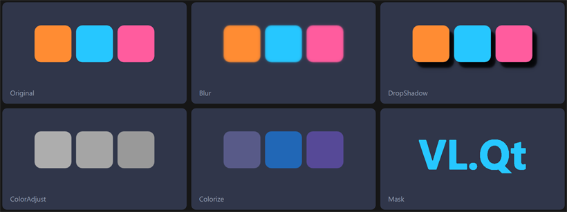
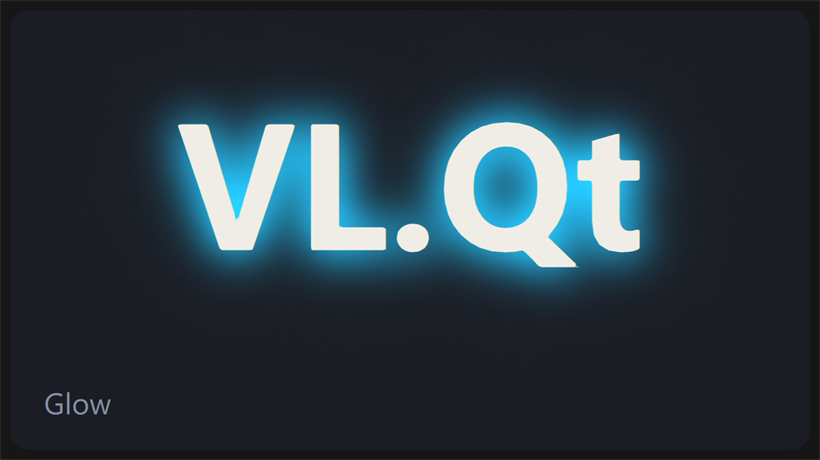
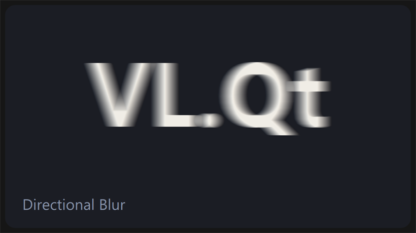
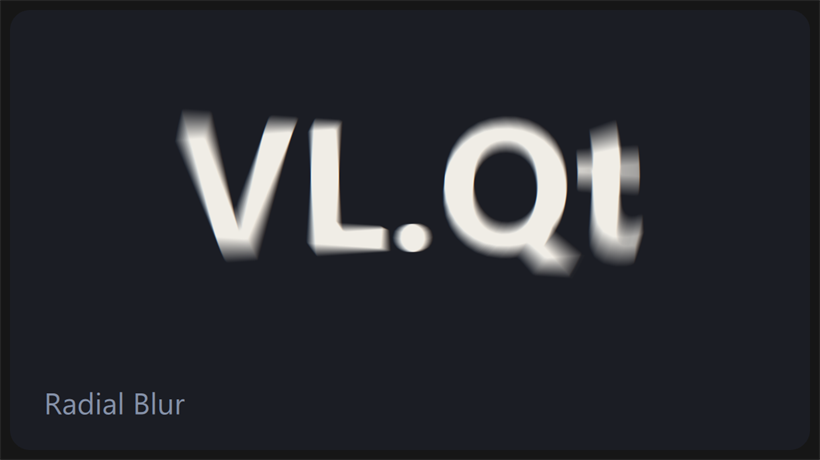
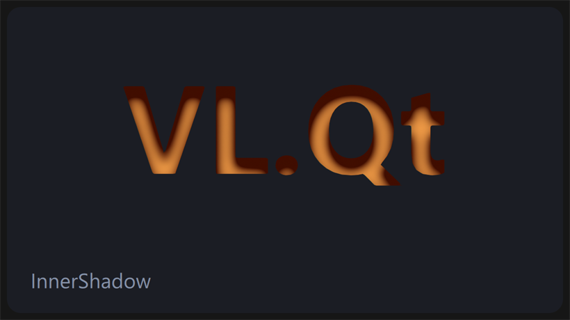
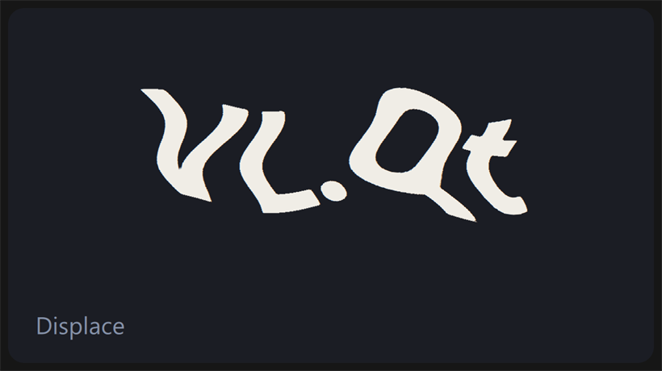
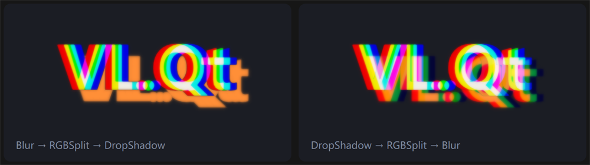
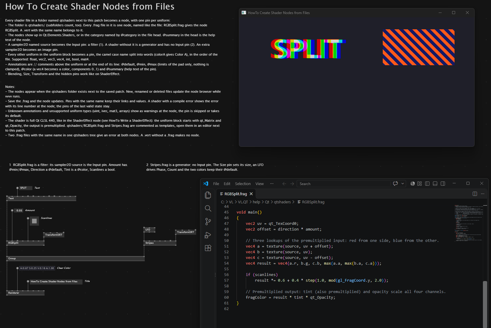

# Effects and shaders

## Effects

Every element has an `Effect` pin. Chain the nodes of `Qt.Effects` to it, like the Interaction nodes on the `Interaction` pin:

| Node | Effect |
|---|---|
| `Blur` | blur the element |
| `DropShadow` | shadow behind the element |
| `ColorAdjust` | brightness, contrast, saturation |
| `Colorize` | tint the element |
| `Mask` | use another element as alpha mask, `Inverted` flips it |
| `Glow` | soft glow around the element (behind it, or `Additive` on top), `Radius` can be animated up to several hundred DIP |
| `InnerShadow` | shadow inside the element, like CSS `inset` |
| `DirectionalBlur` | motion blur along a line (`Angle`, `Length`) |
| `ZoomBlur` | streaks along rays from `Center` |
| `RadialBlur` | arcs around `Center` (`Angle` in degrees) |
| `Displace` | shifts the pixels by a displacement map, any element as `Map` |
| `Blend` | blends any element as `Layer` over the base with a `Mode` (Multiply, Screen, Overlay, Add, Subtract, Difference, Darken, Lighten, Soft Light, Hard Light, Color Dodge, Color Burn) |



The chain runs in data flow order, like TextureFX in Stride: the top node acts first, the node at the `Effect` pin last. Neighbouring `Blur`, `DropShadow`, `ColorAdjust`, `Colorize` and `Mask` nodes are merged into one offscreen layer; inside such a run Qt applies them in its own fixed order, so their order among each other does not matter. A shader node (see [Shaders in the effect chain](#shaders-in-the-effect-chain)) ends the run and costs a layer of its own. Size, transform and layout stay with the element.

### Mask and padding

- **Mask:** any element works as mask, e.g. a Text. It lives in the coordinates of the parent, like a sibling: the mask covers exactly the place where it would be drawn on its own.
- **Optional pins:** Blur `Max`, `Multiplier`, `Auto Padding`, `Padding`; DropShadow `Scale`, `Auto Padding`, `Padding`. With Auto Padding on (default) the layer grows automatically; if it is off on any Blur or DropShadow, the whole layer uses the largest Padding per side.

### Shader effects

`Glow`, `InnerShadow`, `DirectionalBlur`, `ZoomBlur`, `RadialBlur`, `Displace` and `Blend` are shader effects with their own passes; the pictures show the first six applied to the text `VL.Qt`. Lengths are in units of the renderer's space, angles in degrees. They end a run of merged layers and cost a layer of their own; Glow and InnerShadow use a blur pyramid, so their cost hardly depends on the radius.

<table>
<tr><td align="center"><br>Glow</td><td align="center"><br>Directional Blur</td><td align="center"><br>Zoom Blur</td></tr>
<tr><td align="center"><br>Radial Blur</td><td align="center"><br>InnerShadow</td><td align="center"><br>Displace</td></tr>
</table>

### Shaders in the effect chain

Every filter shader from a `qtshaders/` folder (one with a `sampler2D source`, see [Shader nodes from files](#shader-nodes-from-files)) also appears as a node in `Qt.Effects`, with the same name and pins. Put it anywhere in the chain; here the order does matter, because each shader works on what comes out of the node before it:



A shader that draws beyond the element (a blur, a shifted copy) declares its room with `// @padding` in the file head, in DIP: one number or `left, top, right, bottom`; without it the shader stays inside the element. The help patch `HowTo Chain Effects` builds the two chains above.

Help patches: `HowTo Chain Effects`, `HowTo Mask an Element`, `HowTo Add a Glow`, `HowTo Use Motion Blurs`, `HowTo Displace an Element`, `HowTo Blend Elements`. See [Help patches](help-patches.md).

## Shaders

Own fragment shaders (optionally with a vertex shader) are written in Qt's GLSL (version 440, the dialect Qt's `qsb` tool expects). There are two ways to use them; the first one is the normal way:

**Shader nodes from files (normal way):** every `.frag` file in a `qtshaders/` folder becomes a node with one pin per uniform (see [Shader nodes from files](#shader-nodes-from-files)).

**ShaderEffect node (runtime variant):** for shader code that is built, generated or loaded at runtime, which a file cannot cover. The node is marked advanced, so it only shows in the node browser with the advanced filter. The shader code goes into the `Fragment Code` string pin, or `Fragment Shader` points to a pre-baked `.qsb` file. VL.Qt bakes it in a worker; while a new version is baking or has errors, the last working one keeps drawing. Compile errors show at the `Error` output with their line number. Uniforms come from the nodes in `Qt.Elements.Uniform` (also advanced, except `Sampler`) and are matched by name, an element or Group on `Input` becomes the `source` texture.

### Sampler node

`Qt.Elements.Uniform` has a `Sampler` node that sets how a shader reads a texture. `Filter` (Linear, Point), `Mip Filter` (None, Point, Linear; also renders the sampled element's layer with mipmaps), `Address U` / `Address V` (Clamp, Wrap, Mirror). Connect it to `Input Sampler` of a shader node or a ShaderEffect, the `Sampler` pin of the `Texture` / `Image` uniform nodes, the sampler pin next to an image pin of a shader node, `Layer Sampler` of Blend or `Map Sampler` of Displace. Without a Sampler an element's layer is read Nearest, Clamp, without mipmaps. A float layer format and anisotropic filtering are not available (limits of Qt). Help patch: `HowTo Set a Sampler`.

### Shader nodes from files

Every `.frag` file in a folder named `qtshaders` next to the patch becomes a node, with one pin per uniform (the screenshot shows the help patch). Middle click on the node (or right click > Definition > Open) opens the `.frag`, and a `.vert` with the same name, in your default editor. Edit, save, and the node updates while vvvv runs.

- `RGBSplit.frag` gives the node `RGBSplit`, a `.vert` with the same name belongs to it. Subfolders count too.
- A `sampler2D source` becomes the `Input` pin: the shader is a filter. Without it, it is a generator without Input pin. Further `sampler2D` become image pins.
- Uniforms become pins in the order of the file, the name split into words (`pixelSize` → `Pixel Size`). Types: `float`, `vec2`, `vec3`, `vec4`, `int`, `bool`, `mat4`.
- Annotations as `//` comments: `@category` and `@summary` in the file head; `@default`, `@min`, `@max` (limits of the pad only), `@color` (a `vec4` becomes a color) and `@summary` at a uniform.
- Pins with the same name keep their links and values when the file changes. Compile errors, unknown annotations and unsupported uniform types (`uint`, `ivec`, `mat3`, arrays) show at the node.
- A filter shader is also a node of the effect chain, see [Shaders in the effect chain](#shaders-in-the-effect-chain).



#### Example: a filter with three pins

```glsl
#version 440
// @category Qt.Elements.Shaders.Examples
// @summary Shifts the red and blue channel of the Input in opposite directions.

layout(location = 0) in vec2 qt_TexCoord0;
layout(location = 0) out vec4 fragColor;

layout(std140, binding = 0) uniform buf {
    mat4 qt_Matrix;
    float qt_Opacity;

    // @summary Distance of the shifted copies, as a fraction of the element size.
    // @default 0.02
    // @min 0
    // @max 0.2
    float amount;

    // @default 1, 0
    vec2 direction;

    vec4 tint; // @color
};

layout(binding = 1) uniform sampler2D source;

void main()
{
    vec2 offset = direction * amount;
    vec4 a = texture(source, qt_TexCoord0 + offset);
    vec4 b = texture(source, qt_TexCoord0);
    vec4 c = texture(source, qt_TexCoord0 - offset);
    fragColor = vec4(a.r, b.g, c.b, max(a.a, max(b.a, c.a))) * tint * qt_Opacity;
}
```

The full, commented templates are `help/Qt/qtshaders/RGBSplit.frag` (filter) and `Stripes.frag` (generator).

### Notes

- The output is premultiplied alpha: multiply all four channels by `qt_Opacity`.
- The nodes appear once the `qtshaders` folder exists next to the saved patch.
- Do not name a uniform or sampler like a GLSL builtin (`length`, `distance`, `texture`, ...): the OpenGL translation (Linux) renames it and then never sets it. The node shows a warning on every backend.
- Two `.frag` files with the same name in one `qtshaders` tree give an error at both nodes. A `.vert` without a `.frag` makes no node.
- **Export:** the `qtshaders/` folder next to the exported patch is copied next to the exe automatically, and the exported app bakes the shaders at runtime like the editor does. Only that folder is copied: shader files that live next to other documents or in other packages have to be copied by hand.
- **Limitations:** exported apps bake shaders at runtime (no pre-baked `.qsb` shipped for `.frag` nodes), the editor keeps no pipeline cache, and uniform arrays are not supported.

Help patches: `HowTo Create Shader Nodes from Files`, `HowTo Write a ShaderEffect` (runtime variant), `HowTo Blur an Image with a Control Mask`, `HowTo Set a Sampler`. See [Help patches](help-patches.md).
