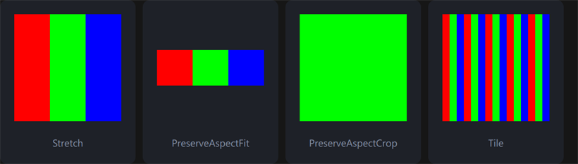

# Images

Images are GPU resources (`QtImage`), separate from the `Image [Qt]` element that draws them. A loaded image is uploaded once and can be shown by any number of Image elements in any window; switching between loaded images costs nothing.

## Nodes

| Node | Use |
|---|---|
| `LoadImage` | Loads a file (PNG, JPG, BMP, … everything Qt reads, EXIF rotation applied). Blocks the frame: for startup or Create. |
| `LoadImage (Async)` | Same without blocking: decoding runs in a worker, the GPU upload is spread over frames. The previous image stays until the new one is ready (`Keep Previous`); `Is Loaded` and `On Loaded` tell when it is. |
| `ToQtImage` | Uploads an `IImage` of vvvv (Skia, OpenCV, camera, …). Uploads only when a new image arrives; 16 bit and float are reduced to 8 bit with a warning. |
| `VideoSourceToQtImage` | Shows a VL.Video source (VideoPlayer, camera, …) in the Image element. Each new frame replaces the content of the same `QtImage`; frames are copied from CPU memory. |
| `FileWriter` | Writes an `IImage` to a file, the format comes from the extension (PNG, JPG, BMP, …). 16 bit (`R16`) and half/full float RGBA go to a 16-bit PNG (float values clamped to 0..1); every other file format gets 8 bit and a warning in the log. |
| `Snapshot` | The other way: grabs an element or Group (with children) as an `IImage` on `Grab`, e.g. for thumbnails, export or processing in Skia/OpenCV. Asynchronous, `Is Ready` comes one frame later. `Scale` sets pixels per DIP independent of the screen scaling. |
| `FileWriter (Element)` | Grabs an element (or a Group with its children) on `Write` and saves it; the extension of `File Path` picks the format (PNG, JPG, BMP, …). `Scale` sets the pixels per DIP, so 2 doubles the resolution regardless of the screen. Asynchronous: `Is Done` comes in a later frame, `Success` says whether the file was written, the reason of a failure goes to the log. The element tree of a help patch can write its own picture this way (`HowTo Write an Element to a File`). |

## Mipmaps, frame budget, errors, device loss

- **Mipmaps** (pin on the loaders) make images smoother when drawn much smaller, at +33 % GPU memory.
- **Frame budget:** uploads are spread so that loading does not stall the frame. Load a spread of files ahead with `LoadImage (Async)` (see `HowTo Preload Images`).
- **Upload** (optional pin of the four upload nodes, hidden by default) chooses how the pixels reach the GPU: `Auto` (files in a worker, pixels on the main thread), `MainThread` (stripes within the frame budget) or `Worker` (texture made in a worker, D3D11). For measurements; `Auto` fits nearly always.
- **Errors** go to the log. A failed load or upload (`LoadImage`, `LoadImage (Async)`, `ToQtImage`, `VideoSourceToQtImage`) also marks the node until an input changes, and the failed image draws nothing; a failed `Snapshot`, `FileWriter` or `FileWriter (Element)` is only logged (the writers have `Success` next to `Is Done`).
- **F5 → Resources** lists all live images with state, size, references and age, failed or stuck ones first, plus upload queue and budget.
- **Device loss:** after a GPU reset all windows and images are rebuilt; the output comes back by itself (see [GPU device loss](diagnostics.md#gpu-device-loss)); images loaded from a file are read again from disk, so a file changed meanwhile shows its new content (a deleted file ends in a failed image).

## Help patches

`HowTo Draw an Image`, `HowTo Preload Images`, `HowTo Use an IImage`, `HowTo Take a Snapshot`, `HowTo Write an Element to a File`, `HowTo Show a VL.Video player in Qt`. See [Help patches](help-patches.md).
