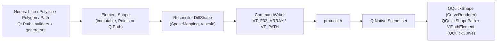

# Plan: Lines, Paths and Splines

Decisions: [docs/decisions/paths.md](../../decisions/paths.md). Packages 01–05 are the subtasks of issue #154 (milestone 1.0), packages 06–10 those of issue #155 (milestone 2.0); the issue bodies hold the full package texts. One PR per package.

## Goal
Shape elements in VL.Qt on Qt Quick Shapes: `Line`, `Polyline`, `Polygon` and `Path` in `Qt.Elements`, a path value `QtPath` built with Skia-like nodes in the new category `Qt.Paths`, and generators for Bézier curves with handles and splines. Milestone 1.0. Renderer: Qt's `CurveRenderer` only (anti-aliased without MSAA, exact curves, transforms cost nothing).

## Architecture

- One element type `SHAPE` for all four nodes. Geometry is either a point list (`Points` + `Closed`) or a path (`QtPath`).
- Geometry reaches Qt through one custom path element `VlPathElement`, a subclass of the private `QQuickCurve` (like Qt's `PathPolyline`). It takes a point list or a verb/point array and builds the `QPainterPath` in `addToPath`. Points go through it too: the element is needed for curves anyway, so there is one route for points and paths and one place that knows `Close` (spike: `PathPolyline` with a repeated point joins as well, so this is not a seam fix).
- Path values are plain immutable C# data; nothing native lives in an element (one route: reconciler → command writer → protocol).

## Packages and order

| # | Package | Milestone | Depends on | Issue |
|---|---|---|---|---|
| 01 | Spike: Qt Quick Shapes, custom path element, CurveRenderer benchmark | 1.0 | – | #154 |
| 02 | Foundation: protocol value types, SHAPE element in QtNative, `Shape` element and `QtPath` core in C# | 1.0 | 01 | #154 |
| 03 | Nodes `Line`, `Polyline`, `Polygon` with help patches | 1.0 | 02 | #154 |
| 04 | `Qt.Paths` builder nodes and the `Path` element node | 1.0 | 03 | #154 |
| 05 | Generators `Bezier (Handles)`, `Spline (CatmullRom)`, `Spline (BSpline)` | 1.0 | 04 | #154 |
| 06 | `Renderer` pin with `GeometryRenderer` | 2.0 | 05 | #155 |
| 07 | Mass data beyond about 8000 points | 2.0 | 06 | #155 |
| 08 | Adapter `SKPath` → `QtPath` (`VL.Qt.Skia`) | 2.0 | 04 | #155 |
| 09 | More `Add…` nodes and `FromSVGPathData` | 2.0 | 04 | #155 |
| 10 | Brainstorm: gradient fills | 2.0 | – | #155 |

01 → 02 → 03 → 04 → 05 strictly in order: 02–05 all touch `Shape.cs`, `PropertyDiff.cs` and the help folder.

## Fixed in the plan (from the decisions, made concrete here)
- Protocol: `VLQT_TYPE_SHAPE = 26`, value types `VLQT_VT_F32_ARRAY = 10` (u32 count + count × f32) and `VLQT_VT_PATH = 11` (u32 verbCount, u32 pointCount, verbCount × u8 padded to 4 bytes, pointCount × 2 × f32), property block 960+, `VLQT_PROTOCOL_VERSION` 13 → 14.
- Limits from the u16 `payloadLen` of SET (65535 − 8 bytes SET fields): at most **8190 points** per point list; a path at most as many verbs and points as fit (`4 + 4 + pad4(verbs) + 8 × points ≤ 65527`). C# checks before writing; the node draws the first part and shows a warning. Tooltip hint for polylines changing every frame: about 4000 points (spike [research/02_shapes-spike.md](../../research/02_shapes-spike.md)).
- Defaults follow Skia: cap `Flat` (Skia Butt), join `Miter`, miter limit 4 (pin `float`, QtNative rounds to int: `QQuickShapePath::miterLimit` is an `int`), fill rule `NonZero` (Skia Winding). Stroke width 0 = no stroke (as `Rectangle`); QtNative gets −1 then.
- Dash lengths are absolute lengths in units (as Skia); the reconciler divides by the stroke width, because Qt's `dashPattern` and `dashOffset` are in stroke-width units.
- Trim: `Trim Start` 0, `Trim End` 1, `Trim Offset` 0, fractions of the path length (Qt `ShapePath.trim`, Qt 6.10+).
- Geometry space: points are in the parent space (like Skia's path layers); `Transform` applies around the origin. The shape nodes have no `Anchor` and no `Size` pin; the element's size is the extent of the geometry (`max(0, maxX)`, `max(0, maxY)`), for Row/Column and the tooltip preview.
- Change detection: nodes compare `Spread<Vector2>` inputs by reference first, then by content; `QtPath` nodes return the same instance when their inputs did not change, and the element compares the flattened arrays when the reference differs. A path that did not change sends nothing.

## Not in this plan (2.0 or later)
`GeometryRenderer`, mass data, Skia adapter, `AddStar`/`AddSpiral`/`AddArrow`/`AddGrid`, `FromSVGPathData`, gradients, `ConicTo` (rejected), path math (length, sample, boolean operations: through the Skia adapter), hit testing on strokes.

## Rules for every package
- Read `AGENTS.md` first (code style, encoding, help patch rules, PR flow: branch from `develop`, draft PR against `develop`, `gh pr ready` only after `tools/build.ps1 -Test` passes).
- Help patches: load the skills `vvvv-fileformat` and `vvvv-pad-layout`; a patch written directly gets the label `manual-check`.
- Protocol changes: edit `protocol.h`, mirror `Protocol.cs` by hand, run `dotnet run --project src/VL.Qt.SmokeTest -c Release -- --drift`.
- After native changes: `tools/build-native.ps1` (or `tools/build.ps1`), restart vvvv.
