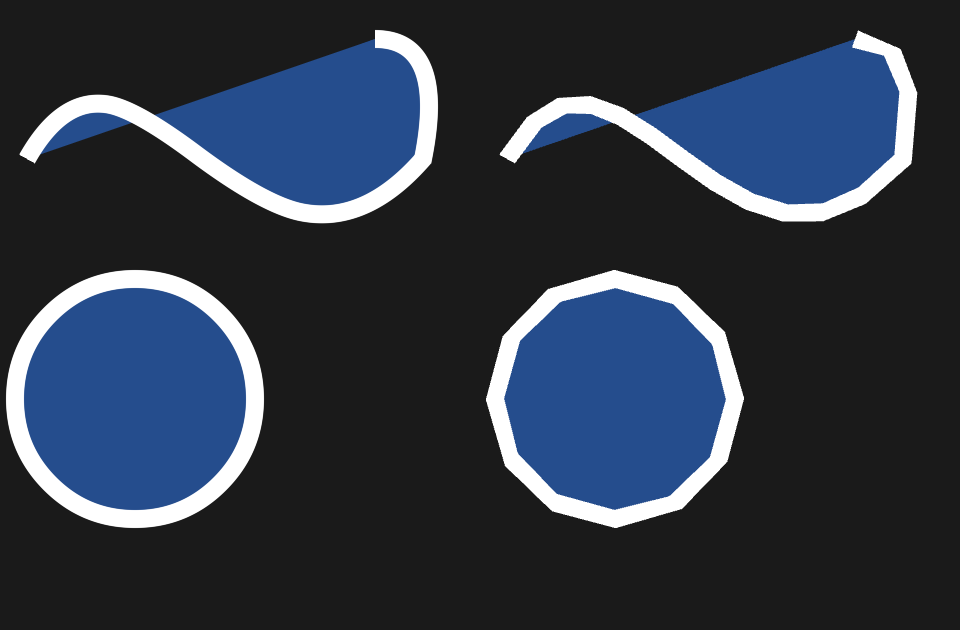
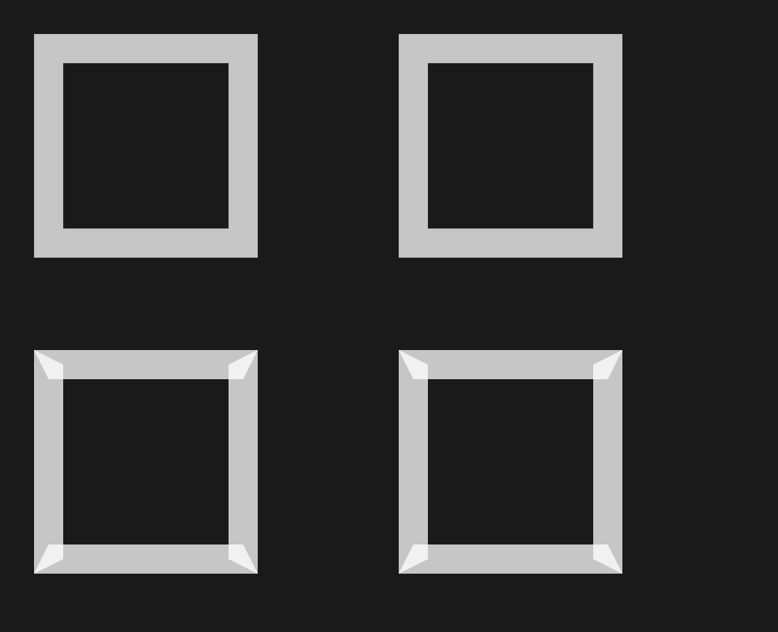

# Qt Quick Shapes spike (research, 2026-11-18)

Spike for issue #154, package 01 ([plan](../plans/paths/01_spike.md), decisions in [decisions/paths.md](../decisions/paths.md)). Question: does the planned native route (`QQuickShape` with the `CurveRenderer`, one `QQuickShapePath`, our path element `VlPathElement`) work, and where does it reach its limits?

## Sources

- Spike branch: https://github.com/sebllll/VL.Qt/tree/spike/154-shapes (commits `78ee4db`, `7a2ffef`; not merged, package 02 reuses the code).
- Prototype files on that branch:
  - [`src/VL.Qt.Native/pathelement.h`](https://github.com/sebllll/VL.Qt/blob/spike/154-shapes/src/VL.Qt.Native/pathelement.h) and [`pathelement.cpp`](https://github.com/sebllll/VL.Qt/blob/spike/154-shapes/src/VL.Qt.Native/pathelement.cpp): `VlPathElement`, a subclass of the private `QQuickCurve`.
  - [`src/VL.Qt.Native/test_shapes.cpp`](https://github.com/sebllll/VL.Qt/blob/spike/154-shapes/src/VL.Qt.Native/test_shapes.cpp): `vlqt_test_shape_*` entry points (create shape, set points or path, stroke, trim, renderer).
  - [`src/VL.Qt.SmokeTest/ShapesSpikeTest.cs`](https://github.com/sebllll/VL.Qt/blob/spike/154-shapes/src/VL.Qt.SmokeTest/ShapesSpikeTest.cs): scenarios `shapes-spike` (Q2–Q6, PNGs) and `shapes-bench` (Q7).
- Run: `dotnet run --project src/VL.Qt.SmokeTest -c Release -- build/smoke --only shapes-bench`; PNGs and the benchmark table land in `build/smoke/` (`shapes_q*.png`, `shapes_bench.md`).
- Qt 6.12.0 on Windows arm64, Direct3D 11. x64 numbers are not measured (no x64 machine in the spike).

## Findings

### Q1 Linking and deploy: yes

`tools/build-native.ps1` builds with `Qt6::QuickShapes` and `Qt6::QuickShapesPrivate` linked into `vlqt`; `runtimes/win-arm64/native/` then contains `Qt6QuickShapes.dll` and `qml/QtQuick/Shapes/` (`import QtQuick.Shapes` in `qml/deploy.qml` makes `windeployqt` take them).

Consequence: package 02 takes the CMake lines and the import from the spike branch. Whether the module lists of the deployment and the LGPL check in CI need `QuickShapes` is checked in package 02.

### Q2 Custom element: yes, curves are exact

`VlPathElement` inside a `QQuickShapePath` renders with the `CurveRenderer` (`rendererType` 4). At 8× scale through the item transform the cubics of the `CurveRenderer` show no facets; the `GeometryRenderer` next to it does (left and right in the picture).

Re-processing: a new path is only drawn after `QQuickPathElement::changed()` (`QQuickPath::processPath` runs `addToPath` again, then `QQuickShapePath` emits `shapePathChanged`). Without the signal the old line stays on screen (`shapes_q2_signal_1_nonotify.png` vs. `shapes_q2_signal_2_notify.png` on the branch).

Consequence: every data change in QtNative ends with `emit changed()` (`VlPathElement::notifyChanged`), once per frame and element after all properties are set. The route in [decisions/paths.md](../decisions/paths.md) holds.

### Q3 Closing join: no seam in either variant

Square, stroke 24, `Miter` join, flat cap, start point top left. `VlPathElement` with `Close` joins at the start point, and so does `PathPolyline` with the first point repeated: Qt treats a sub path that ends at its start as closed, in both renderers. The earlier assumption that the repeated point leaves a seam with two caps is wrong.

Top row `CurveRenderer`, bottom row `GeometryRenderer`; left `VlPathElement` with `Close`, right `PathPolyline` with a repeated point. The stroke is semi-transparent (`0xC0FFFFFF`): the bottom row shows brighter triangles at the miter corners, because the `GeometryRenderer` blends overlapping stroke pieces twice. The `CurveRenderer` draws the corner once.

Consequence: the decision "points go through our element" stays, with a different reason: the element is needed for curves anyway, so there is one route for points and paths and one place that knows `Close`. The seam argument is dropped from the decisions and the plan. Semi-transparent strokes are only clean with the `CurveRenderer` (relevant for 2.0).

### Q4 Trim: yes

`trim` start, end and offset work with the `CurveRenderer` and `VlPathElement` (and with the `GeometryRenderer`). In the picture, top `CurveRenderer`, bottom `GeometryRenderer`: lines trimmed to 0.25..0.75 and to 0..0.25 with offset 0.5, and a circle trimmed to a half. A pure trim change draws at once, without `changed()` on the element.

Cost of animating only the trim: see the table. The `CurveRenderer` processes the path again at every trim change (2.5 ms at 8190 points, 0.3 ms at 100); the `GeometryRenderer` is cheaper (0.8 ms at 8190).

Consequence: `Trim Start`/`End`/`Offset` map directly to `ShapePath.trim`. Animated trim is fine up to the point limit.

### Q5 Dash: confirmed

`dashPattern` and `dashOffset` are in units of the stroke width. With the `CurveRenderer` dashes also work on curves: width 10 and pattern `[2, 1]` give dashes 20 long with 10 gaps (`shapes_q5_dash.png` on the branch).

Consequence: the plan holds: the reconciler divides the Skia-like absolute dash lengths by the stroke width. Stroke width 0 turns the stroke off, so no division by 0 arises.

### Q6 Size, negative coordinates, MSAA

- A `Shape` with width and height 0 draws.
- Negative coordinates draw outside the item bounds (no clipping to the item) (`shapes_q6_size0_negative.png`).
- The `CurveRenderer` smooths edges without MSAA. MSAA 4 adds GPU time: from about 0.15 ms to 0.5–3 ms, fluctuating (`shapes_q6_msaa1.png`, `shapes_q6_msaa4.png`).
- `QQuickShapePath::miterLimit` is an `int`: the default 4 is fine, fractional values are not representable.

Consequence: the plan's "element size = extent of the geometry, no `Size` pin" works; no minimum size and no offset trick needed. Recommend MSAA off for shape-only scenes (the renderer pin of #118 stays the user's choice). The miter limit is rounded in QtNative, see [decisions/paths.md](../decisions/paths.md).

### Q7 Benchmark

Conditions (details in `shapes_bench.md` on the branch):

- 2026-11-18, Windows 11 arm64, 8 logical CPUs, Qt 6.12.0, D3D11, Release builds. One window 1280×720 DIP (1920×1080 pixels), VSync off, MSAA 4 (window default); frame budget of a 60 Hz screen 16.7 ms.
- Per case and point count 60 warm-up frames, then 300 measured frames, 3 runs with new shapes (5 when the runs spread by more than 1.5×). Values: median over the runs of the per-run mean and p95.
- Stroke width 2, no fill, `CurveRenderer` unless the row says otherwise. Geometry: sine wave across the window (8 periods). Cubic path: Move + (n − 1)/3 cubics, so 8190 points are 2729 segments. "100 elements": 10×10 grid of 100-point polylines, each rotated every frame.
- **GUI and render thread are the same thread** in VL.Qt (Qt's basic render loop), so the times are wall-clock ms on the main thread, split by phase. **GUI** = setting the data (P/Invoke, `changed()`, `processPath`) plus polish (`QQuickShape` hands the path to its renderer). **Render** = sync (`updatePaintNode`) plus recording the commands. Present, vsync and GPU time are in the details of `shapes_bench.md`.
- Creative Cloud keeps about 55 % of the CPU busy on this machine: read the numbers as upper bounds.

Result, ms per frame, mean / p95:

| Case | 100 points | 1000 points | 8190 points |
|---|---|---|---|
| Polyline, all points change every frame | GUI 0.31 / 0.64 render 0.09 / 0.26 | GUI 0.80 / 1.14 render 0.14 / 0.25 | GUI 12.6 / 14.2 render 3.34 / 4.41 |
| Cubic path (points/3 segments), all change every frame | GUI 0.22 / 0.43 render 0.08 / 0.24 | GUI 0.74 / 1.04 render 0.10 / 0.20 | GUI 3.91 / 4.45 render 0.95 / 1.34 |
| Static cubic path, only `Transform` animated | GUI 0.06 / 0.11 render 0.02 / 0.03 | GUI 0.05 / 0.10 render 0.01 / 0.02 | GUI 0.05 / 0.10 render 0.01 / 0.02 |
| Static cubic path, only trim animated | GUI 0.19 / 0.36 render 0.07 / 0.23 | GUI 0.27 / 0.45 render 0.08 / 0.21 | GUI 2.09 / 4.32 render 0.41 / 1.18 |
| 100 elements × 100 points, static, `Transform` animated | GUI 0.10 / 0.20 render 0.22 / 0.40 | – | – |
| Polyline changing, `asynchronous` | GUI 0.06 / 0.12 render 0.06 / 0.23 | GUI 0.10 / 0.19 render 0.20 / 0.35 | GUI 0.21 / 0.30 render 0.60 / 3.34 |
| `GeometryRenderer`, polyline changing, sync | GUI 0.09 / 0.15 render 0.04 / 0.07 | GUI 0.14 / 0.26 render 0.07 / 0.19 | GUI 0.68 / 0.85 render 0.38 / 0.48 |
| `GeometryRenderer`, polyline changing, `asynchronous` | GUI 0.07 / 0.14 render 0.04 / 0.07 | GUI 0.11 / 0.19 render 0.10 / 0.28 | GUI 0.29 / 0.50 render 0.46 / 0.69 |
| `GeometryRenderer`, cubic path changing, sync | GUI 0.21 / 0.45 render 0.16 / 0.35 | GUI 0.37 / 0.62 render 0.25 / 0.43 | GUI 0.66 / 0.98 render 0.29 / 0.50 |
| `GeometryRenderer`, static cubic path, only `Transform` | GUI 0.09 / 0.20 render 0.04 / 0.18 | GUI 0.08 / 0.15 render 0.04 / 0.19 | GUI 0.07 / 0.16 render 0.03 / 0.14 |
| `GeometryRenderer`, static cubic path, only trim | GUI 0.20 / 0.48 render 0.11 / 0.33 | GUI 0.27 / 0.66 render 0.14 / 0.34 | GUI 0.56 / 1.00 render 0.19 / 0.39 |

Polyline changing every frame, `CurveRenderer`, GUI + render (mean of the run means, from the details):

| Points | 100 | 1000 | 2000 | 4000 | 8190 |
|---|---|---|---|---|---|
| ms per frame | 0.4 | 0.9 | 1.3 | 5.3 | 16.0 |

Cubic path changing every frame (same unit): 0.3 / 0.8 / 1.0 / 1.3 / 4.9 ms for 100 / 1000 / 2000 / 4000 / 8190 points.

Findings:

- The cost of a polyline in the `CurveRenderer` grows steeply above about 2000 points (1.3 → 5.3 → 16 ms for 2000 → 4000 → 8190); the time goes into the polish step, where the renderer processes the path. A cubic path of the same point count costs a third (4.9 ms at 8190 points), because it has a third of the segments.
- A static path costs nothing: `Transform` animation takes about 0.07 ms, independent of the point count; 100 static elements with an animated transform take 0.3 ms.
- `asynchronous` on the `CurveRenderer` does not keep up at 8190 points: 754 of 900 measured frames were still `Processing`, i.e. the screen showed an older path (visible stutter). The GUI cost drops to 0.2 ms, but the path arrives late.
- The `GeometryRenderer` is far cheaper for changing polylines (1.0 ms at 8190 points against 16 ms), and its `asynchronous` mode lags there too (79 of 900 frames still processing) and gains little.
- The `GeometryRenderer` has visible flaws: facets on curves at large scale (Q2) and doubled blending of semi-transparent strokes at miter corners (Q3).

Consequence: see the limits below.

## Recommended limits

For the tooltips of the 1.0 nodes (`Line`, `Polyline`, `Polygon`, `Path`):

- **8190 points per element** was the hard limit then (size of one command, lifted since: see [decisions/paths.md](../decisions/paths.md)); the measurements below stay valid.
- **Polylines whose points change every frame: about 4000 points** (5.3 ms of the 16.7 ms frame on this loaded arm64 machine; 8190 points take 16 ms and miss the frame). Static or only transformed polylines and paths can use the full 8190 points.
- **Paths with curves** (`Path`, splines) cost a third per point; 8190 points (2729 segments) changing every frame take 4.9 ms and need no extra warning.
- Animated trim is cheap up to the limit (2.5 ms at 8190 points, 0.3 ms at 100); trim and `Transform` are the cheap ways to animate, prefer them to changing points.
- Do not offer an `asynchronous` pin in the first version: with the `CurveRenderer` it lags at the size where it would help.
- Many small shapes are fine (100 elements × 100 points: 0.3 ms); the cost is the per-element path processing, not the count.

For the 2.0 issues (#155):

- **`GeometryRenderer` (package 06):** worth it for large changing polylines (1.0 ms against 16 ms at 8190 points). Its limits to document: facets on curves under magnification, double blending of semi-transparent strokes at joins, and the `asynchronous` pin (optional) brings little. The `Renderer` pin stays on the same nodes with default `Curve`.
- **Mass data (package 07):** the `CurveRenderer` cannot handle more than the 8190-point limit in changing data (it already misses the frame at that size), and the `GeometryRenderer` took 1.0 ms at 8190 points. How it scales above 8190 points is not measured; package 07 measures it before choosing between several elements, a bigger payload and a custom `QSGGeometryNode`.
- **Package 08 (Skia adapter):** `SKPath` is converted in C#; the point limit applies to the converted path, the adapter should report when it is exceeded.

## Open points

- x64 numbers: repeat `shapes-bench` on an x64 machine before the 1.0 release and correct the limits if they differ.
- The numbers were taken with Creative Cloud load; a quiet machine may be faster. The recommended limits are on the safe side.
