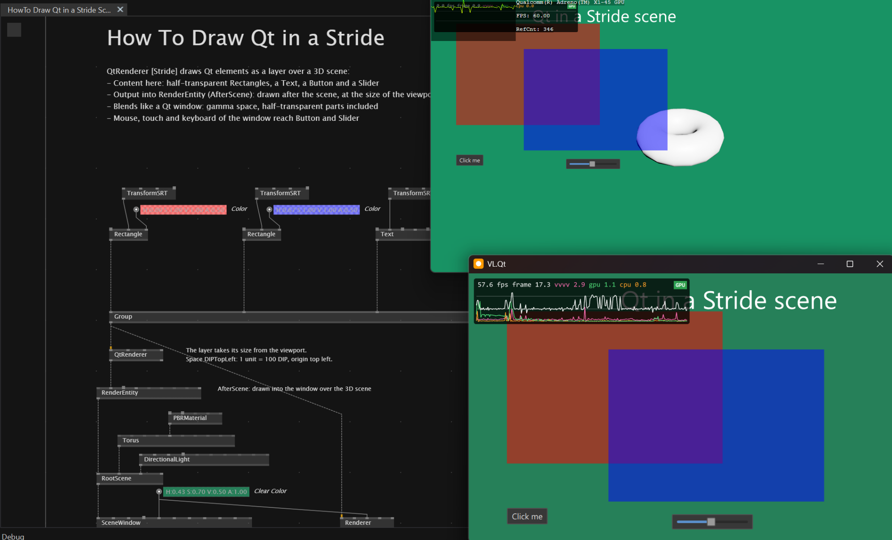

# Qt in Stride

The companion package `VL.Qt.Stride` brings a Qt scene into a [Stride](https://www.stride3d.net) scene of vvvv gamma. Two nodes do it: `QtTexture` outputs the scene as a Stride `Texture`, `QtRenderer` draws it as a layer into a render target. A third node, `ToTexturePixels`, maps window input onto a texture. **Windows only (Direct3D 11) and experimental**: the nodes carry the experimental smell and their pins may still change. Why it is built this way: [Stride output](design/stride-output.md).

Add `VL.Qt.Stride` to the dependencies of your patch. It pulls in `VL.Qt` with the same version; Stride comes with vvvv. Both packages are built and released together from this repository, see [development.md](contributing/development.md#packages).

## QtTexture or QtRenderer?

*`HowTo Draw Qt in a Stride Scene`: the `QtRenderer` layer over a 3D scene in the Stride window (top) and the same elements in a Qt window (bottom right); the half-transparent rectangles blend the same way.*

| | `QtTexture` | `QtRenderer` |
|---|---|---|
| Category | `Stride.Textures.Source` | `Stride.Rendering` |
| Output | a Stride `Texture` | a layer (`IGraphicsRendererBase`), no texture |
| Use it to | mix, post-process (TextureFX), put on a mesh, feed to other nodes | draw Qt over the 3D scene of a window or a render texture |
| Size | the `Size` pin | the viewport of the target |
| Half-transparent colours | blend in linear light, so they differ slightly from a Qt window | blend like a Qt window (into a window or a typeless 8-bit render texture) |
| Input | `Input Notifications` pin | the window's mouse, touch and keyboard input, automatic |

Use `QtRenderer` for a user interface or an overlay on top of a scene. Use `QtTexture` when you need the pixels as a texture.

## QtTexture

`QtTexture` works like `Renderer [Qt]`, but opens no window: it renders the element tree at `Input` offscreen into a texture.

- **GPU only:** there is no readback to the CPU. Qt renders on its own Direct3D 11 device into a texture shared with Stride's device, and Stride waits on the GPU until Qt has written.
- **Same frame:** the texture shows the scene of this frame. The scene is rendered only when it changed, and several `QtTexture` nodes do not block each other.
- **Alpha:** the texture is **premultiplied**. Draw it with `AlphaBlendPremultiplied`; vvvv's `AlphaBlend` expects straight alpha and darkens half-transparent parts. Where straight alpha is needed, unpremultiply first (RGB divided by alpha).
- **Output instance:** the same `Texture` until `Size` or `Format` change. Do not dispose it and do not keep it across such a change.

| Pin | Default | Meaning |
|---|---|---|
| `Input` | none | root element; no element renders an empty scene |
| `Size` | 1920, 1080 | size of the texture in pixels, clamped to 1×1 up to the largest texture of Stride's device (16384 on feature level 11) |
| `Space` | `DIPTopLeft` | origin and unit of the coordinates, see [Coordinates](#coordinates) |
| `Clear Color` | 0, 0, 0, 0 | background of the texture, straight alpha; alpha 0 gives a transparent texture |
| `Clear` | on | off keeps the previous frame (trails, feedback); the alpha of `Clear Color` is then the fade strength per frame, see [Clear and MSAA](design/clear-and-msaa.md) |
| `Format` | `B8G8R8A8_UNorm_SRgb` | see [Format](#format) |
| `Enabled` | on | off freezes the node: nothing is updated or rendered, `Output` keeps the last content |
| `Input Notifications` | optional | mouse, touch and keyboard input for the scene, see [Input](#input) |
| `Debug` | off, optional | debug overlay for all elements, as at `Renderer [Qt]` |
| `Multisample Count` | `None`, optional | anti-aliasing of the edges; more samples cost GPU time and memory, a count the device does not support is lowered with a warning at the node; effect layers render without it |
| `Render Threads` | 1, optional | see [Performance](#performance) |
| `Output` | | the `Texture`; null while the texture cannot be created or bound, the node then shows the reason |

### Format

- **8-bit RGBA or BGRA (`UNorm` or `SRgb`) and `R16G16B16A16_Float`** are allowed; any other format is an error at the node.
- **`UNorm`** holds what Qt renders, the gamma-space values of a Qt window.
- **`SRgb` and `Float`** hold linear premultiplied values, which is what Stride expects when it samples them. Opaque pixels look as in a Qt window.
- Half-transparent colours differ from a Qt window in every format, because Stride blends in linear light and a Qt window in gamma space. For a layer that looks like a Qt window use `QtRenderer`. Background: [Stride output](design/stride-output.md#formats-colour-space-and-alpha).
- The help patch `HowTo Draw a QtTexture with Transparency` shows the same scene in a `QtTexture` and in a Qt window.

## QtRenderer

`QtRenderer` is a Stride layer like `SkiaRenderer`: it draws the element tree into the render target it is drawn into and outputs no texture. Connect its output where a Stride renderer goes, after the 3D scene (as in the help patch), not inside it.

| Pin | Default | Meaning |
|---|---|---|
| `Input` | none | root element |
| `Space` | `DIPTopLeft` | see [Coordinates](#coordinates) |
| `Clear Color` | 0, 0, 0, 0 | background of the layer, straight alpha; alpha 0 shows the target through it |
| `Enabled` | on | off freezes the layer: nothing renders, no input reaches the scene, it keeps drawing the last content |
| `Debug` | off, optional | debug overlay for all elements |
| `Render Threads` | 1, optional | see [Performance](#performance) |
| `Output` | | the layer |

- **Size:** the viewport of the target. A resize shows one frame later. Before the first draw nothing renders.
- **Target:** into a window or a typeless 8-bit render texture the layer blends like a Qt window. Into any other target (sRGB, float) it still draws, but blends in linear light like `QtTexture`; the node shows a warning, also written once to the log.
- **One target per frame:** connected to a second window, that one stays empty and the node warns "QtRenderer draws into one target per frame; use one QtRenderer per window".
- **Not drawn:** a layer that is not drawn freezes and renders nothing.

## Coordinates

- **Pixels:** 1 DIP = 1 pixel in `QtTexture` and `QtRenderer` (the device pixel ratio is 1), so `DIPTopLeft` and `PixelTopLeft` give the same pixels. The origin of the texture is the top left, y points down.
- **Units:** lengths are in units of the `Space` pin, as in a Qt window: `DIPTopLeft` (default) has its origin at the top left and 1 unit = 100 DIP. All four spaces: [Coordinates and layout](coordinates.md).
- **Input positions** are texture pixels with the origin at the top left, whatever `Space` is.

## Input

`QtTexture` takes input at the optional pin `Input Notifications` (vvvv notifications: mouse, touch, keyboard, focus). Without it, `Interaction` in the scene is inert. `QtRenderer` needs no pin: it subscribes to the input of the window it is drawn in and subtracts the origin of the viewport.

- **Window input to a texture:** the positions of a window are not texture pixels. `ToTexturePixels` (category `Stride.Input`, experimental) maps them for a texture on Stride's unit quad. Its pins: `Input` (the notifications of the window), `World`, `View`, `Projection` (a zero matrix counts as identity), `Texture Size` (default 1920, 1080; the `Size` of the `QtTexture`) and the output `Output`. Fullscreen is `World` = Scaling (2, 2, 1) with identity `View` and `Projection`. Positions off the quad lie outside 0 … `Texture Size`; keyboard notifications pass unchanged.
- **Focus:** a press inside the texture gives the scene the keyboard focus, a press outside takes it. With several textures fed by one window only the last one pressed has the focus.
- **Other meshes:** for a texture on an arbitrary mesh, do the raycast to UV in the patch and send pixel positions to `Input Notifications` directly.

How input is translated and injected: [Offscreen input](design/offscreen-input.md). Help patch: `HowTo Interact with a QtTexture`.

## Performance

`QtTexture` and `QtRenderer` scenes render on a Qt render thread, so the vvvv main thread spends only a fraction of a millisecond per scene. The hidden pin `Render Threads` of both nodes sets the pool: 1 (default) is one thread for all of them, 0 renders on the main thread (for diagnosis), 2 to 16 gives a pool. The largest value of all nodes counts. A scene keeps the thread it got when it was created: a larger value adds threads at once, a smaller value and 0 apply to scenes created afterwards. All values, the log lines, how to use 0 to find a render-thread problem, and measurements: [Diagnostics](diagnostics.md#qttexture-render-thread). Design: [Render thread](design/render-thread.md).

- **Cost:** a changed scene costs Qt's render time on the GPU and a short hand-off on the main thread; an unchanged scene and a node whose output nobody draws cost next to nothing.
- **`Clear` off:** costs one more full-size texture, and Qt renders every frame then.
- **Many textures:** `HowTo Render many QtTextures` creates one `QtTexture` per slice of a `ForEach`.

## Errors and limits

- **No `Error` pins:** errors and warnings show at the node and go to the log, once per distinct text.
- **Windows only, experimental:** the nodes need Direct3D 11 and Stride; Linux exports have neither.
- **Same GPU adapter:** Qt's device must sit on Stride's adapter. It follows Stride's adapter as long as no Qt window renders on it; with a Qt window on another adapter the node shows an error and `Output` stays empty. See [GPU device](design/gpu-device.md#same-adapter-and-adapter-move).
- **Device loss:** if Stride resets its device, the node frees its texture and creates a new one in the next frame. If Qt's device is lost, the texture stays and the scene binds again. What to look for in the log: [Diagnostics](diagnostics.md); details: [Stride output](design/stride-output.md#device-loss-on-either-side).

## Help patches

The five patches are in the Help Browser under the topic `Stride` (package `VL.Qt.Stride`, folder `VL.Qt.Stride/help/`):

- `HowTo Draw Qt in a Stride Scene`: `QtRenderer` as a layer over a 3D scene, input reaches Button and Slider
- `HowTo Render Qt into a Stride Texture`: `QtTexture` with a transparent `Clear Color`, composed over a 3D background with `AlphaBlendPremultiplied`
- `HowTo Interact with a QtTexture`: `ToTexturePixels` feeds the input of a window into the scene
- `HowTo Draw a QtTexture with Transparency`: premultiplied alpha, `Format`, the same scene in a Qt window to compare
- `HowTo Render many QtTextures`: one `QtTexture` per slice of a `ForEach`

Patches that a person checks in vvvv and that no test runs: [manual checks](../src/VL.Qt.Stride/help/manual-checks/README.md). The list of all help patches: [help-patches.md](help-patches.md#stride).
