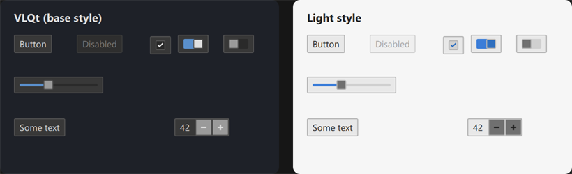

# Styles

All widgets (Button, Toggle, Slider (Float), Input (String), Input (Int)) are drawn in VL.Qt's own base style **VLQt**: flat, neutral, the same on Windows and Linux. Every widget and every `Group [Qt]` has a `Style` pin to change it:

- A style only holds what you set; everything else is inherited. It is resolved top-down: base style → each Group on the way → the widget's own Style pin.
- A Group passes its style to everything inside, also to Row/Column and nested Groups. A Style on a single widget overrides only its set fields.
- Each field has a value per state: Normal, Hovered, Pressed, Disabled, Checked. An unset state falls back to Normal.

## Style nodes

The nodes live in `Qt.Style`. Build a style by chaining them, each one adds to the style before it:

| Node | Part | Fields |
|---|---|---|
| `SetColors` | all parts | six colors in one node: Frame, Border, Text, Indicator, Track, Track Fill |
| `SetFrame` | background of the control | Radius, Border Width, Padding X/Y, Min Width/Height |
| `SetText` | label | Font Family, Font Size, Font Weight |
| `SetIndicator` | slider handle, check mark, switch knob, SpinBox −/+ | Size, Radius, Border Width |
| `SetTrack` | slider groove, switch track, check box | Thickness, Radius |

Every setter has the pin `States`: the states the values apply to, combinable. `SetColors`, `SetFrame`, `SetText`, `SetIndicator`, `SetTrack` and `Merge` are process nodes: they return the same style while their inputs do not change, so the scene stays untouched.

- **Presets:** `Dark` and `Light` are complete styles to start from.
- **Merge:** combines two styles, set fields of Input 2 win.
- **Single setters** (`SetRadius`, `SetFontSize`, `SetColor`, … in the Advanced aspect) set one field, for quick overrides.
- **Getters** (`Colors`, `Frame`, `Text`, `Indicator`, `Track`, the single `Radius`, `FontSize`, `Color`, …, and `ResolveState`) return resolved values for one state, also without a connected style (then the base style applies). A setter reads `SetX`, the getter of the same field `X`.

Sizes in a style are DIP (device-independent pixels). Rectangles and Text have no Style pin: they are primitives, their look comes from their own pins.

## Self-made widgets

A patched class that implements `IStylable` behaves like a built-in widget: connect it wherever an element goes (Group, Row, Column, Renderer, Labeled, an effect input), and its `Build` operation is called with the style resolved at that position; the returned element is shown. Build may return another stylable, which is built in turn; one that returns itself or a cycle shows nothing and warns. Inside Build, use the getters to read colors, radius and font for the current state and draw the widget from primitives. Build runs once per frame; element nodes return the same instance while nothing changes, so the scene stays untouched. In a patched class the output pin of Build must be named `Result` (see `IStylable`).

## Adding a style field

A field lives in its part file (`src/VL.Qt/Styles/FrameStyle.cs`, `TextStyle.cs`, `IndicatorStyle.cs`, `TrackStyle.cs`). The part holds the property, its merge (`Merge`, through `MergeTally.Pick`), its wire mapping (`Visit`) and its text for `Style.ToString` (`Describe`). Editing a new field, in this order:

1. Part file: property, one line each in `Merge` (`Pick`, and the initializer), `Visit` and `Describe`.
2. `BaseStyle.cs`: the default value of the VLQt base style.
3. `StyleNodes.cs`: the single setter `Set<Field>` and the getter `<Field>` (Advanced aspect) and `Apply` of the part node; the bundle node of the part (`Nodes/Style/Set<Part>Node.cs`) takes the new pin and its value in the cache key.
4. `protocol.h` and `Wire/Protocol.cs` (`StyleField` id), mirrored by hand; run the drift tests.
5. QtNative: the entry in the style table.
6. `StyleTests`: add the field to `fieldCases`; the test sets it alone on the upper style and checks that `Merge` keeps it and `ToString` lists it. A field missing from `Merge` fails there.

## Help patches

`HowTo Style a Widget`, `HowTo Style Control Parts`, `HowTo Style Widgets with a Group`, `HowTo Patch a Stylable Widget`. See [Help patches](help-patches.md).
