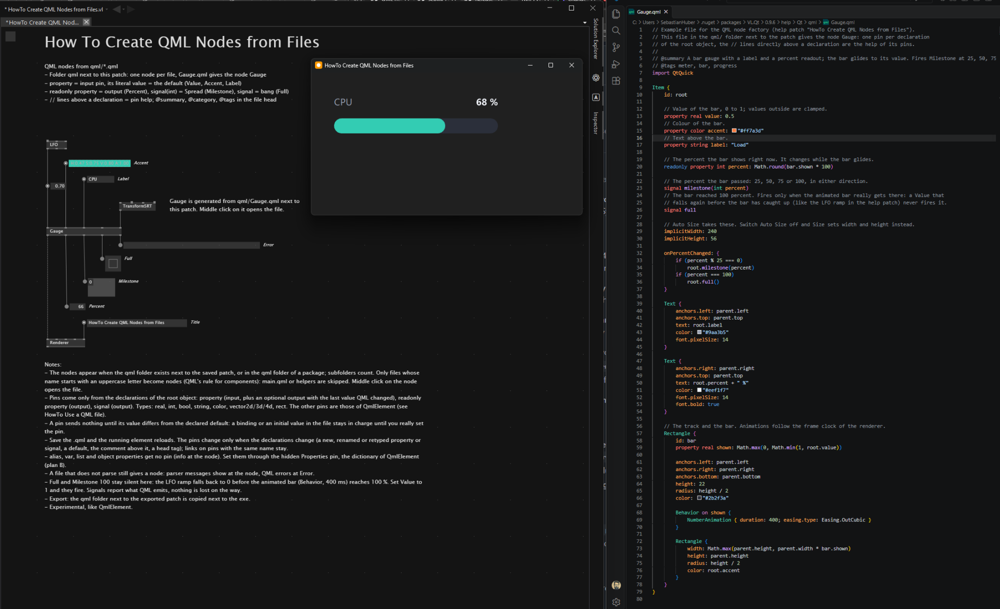

# QML files as elements

`QmlElement` loads a `.qml` file of your own into the element tree. The patch sets properties of the QML root by name, and the properties QML changes and the signals it emits come back as outputs. It is an escape hatch for existing QML components and for things VL.Qt has no element for, not a second UI model: the patch still owns the tree, QML is one leaf (or one subtree) in it.

Experimental (`SymbolSmell.Experimental`): pins and behavior can still change, see [Versioning](versioning.md). Help patch: `HowTo Use a QML file` with the sample `help/Qt/QmlElement Example.qml`. To get a node with named pins from a `.qml` file instead of the dictionary, see [Nodes from QML files](#nodes-from-qml-files). Why it is built this way: [design/user-qml.md](design/user-qml.md).

## Pins

| Pin | Type | Meaning |
|---|---|---|
| `File` | `Path` | The `.qml` file. Its root must be an `Item` (Rectangle, Item, ... but not a `Window`), else the node shows an error. Empty = nothing loaded. |
| `Properties` | `Dictionary<string, object>` | Values for properties of the QML root, by name. Only entries that changed are sent. |
| `Auto Size` | `bool` | On (default): the element takes the size of the QML root. Off: `Size` sets `width` and `height` of the root. |
| `Size` | `Vector2` | Optional. Width and height of the element, in units of the renderer's `Space` (default `DIPTopLeft`: 1 unit = 100 DIP), only with `Auto Size` off. |
| common element pins | | `Transform`, `Anchor`, `Opacity`, `Clip`, `Debug`, `Interaction`, `Effect`, like every element ([element model](design/element-model.md)). |
| out `Output` | `Element` | The element, connect it to a `Group` or `Renderer`. |
| out `Properties` | `Dictionary<string, object>` | Last value of each root property that QML changed. |
| out `Signals` | `Spread<QmlSignal>` | Signals of the root emitted since the last frame, in order. `QmlSignal` has `Name` and `Arguments` (`Spread<object>`). |
| out `Measured Size`, `Scene Bounds` | | Optional, like on the other elements. |

Property values are passed on unchanged in DIP (what QML calls units), only `Size` is in units of the renderer's `Space`.

## Value types

The same types go both ways:

| vvvv | QML |
|---|---|
| `float`, `double` | `real` |
| `int` | `int` |
| `bool` | `bool` |
| `string` | `string` |
| `Color4` | `color` |
| `Vector2`, `Vector3`, `Vector4` | `vector2d`, `vector3d`, `vector4d` |
| `Vector2` | `point` (x, y), `size` (width, height) |
| `RectangleF` | `rect` |
| `Path` (or `string`) | `url` |
| `Spread<float>`, `Spread<int>`, `Spread<bool>`, `Spread<string>`, `Spread<Path>`, `Spread<Color4>`, `Spread<Vector2>`, `Spread<Vector3>`, `Spread<Vector4>`, `Spread<RectangleF>` | `list<real>` (also `list<double>`), `list<int>`, `list<bool>`, `list<string>`, `list<url>`, `list<color>`, `list<vector2d>` (also `list<point>`, `list<size>`), `list<vector3d>`, `list<vector4d>`, `list<rect>` |

- A value of another type, or `null`, is not sent: the node shows an error line and ignores the value.
- Qt converts to the type of the QML property. A `float` set on an `int` property works, a string that is no number for a `real` property does not: error line, value ignored.
- A `url` property takes the text of a `Path` or a `string`: an absolute local path (`C:\media\a.png`, also with spaces or umlauts) becomes the URL of that file; any other text is read as a URL, so `https:`, `qrc:` and `file:` URLs stay as written and a relative one stays relative, which the item that uses it (an `Image`) resolves against its own file.
- Back to the patch the same types arrive (integers outside the `int` range are clamped, a `url` arrives as its text, `file:///C:/media/a.png` for a local file, a `rect` as `RectangleF`, a `point` as `Vector2(x, y)`, a `size` as `Vector2(width, height)`). A signal argument of any other QML type (an object, a list of objects) arrives as its string form. A property of such a type is not reported: the node shows one line for it.

### Lists

A `Spread` in the `Properties` dictionary goes to a QML property that is a `list<T>` or a `var`; a list property or a list argument of a signal comes back as a `Spread`:

- The elements of the spread are of one of the types of the table above and there are at most **65536** of them; otherwise the node shows an error line naming the property and the value is not sent.
- Qt converts the elements to the type of the property: a `Spread<Vector2>` fills a `list<point>`, a `list<size>` or a `list<vector2d>`, a `Spread<int>` a `list<real>`. An empty spread fits every list property. A `var` property gets a JavaScript array.
- Back to the patch, a list whose elements all have one type arrives as a `Spread` of it (`int` and `real` mixed give a `Spread<float>`; an empty list keeps the type its property declares). A list without a common element type, such as `[1, "a"]` in a `var`, arrives as a string in JSON form.
- A list of lists or of objects has no pin type. A signal argument of such a type arrives as its string form.
- Two spreads are equal when their elements are, so a pin that gets the same content again sends nothing.

## What comes back

Only what the **root of the file declares** comes back, not what `Item` already has (`width`, `x`, `opacity`, ...):

- every `property ...` and `readonly property ...` of the root: its change arrives on the `Properties` output (one entry per property, the last value of the frame);
- every `signal ...` of the root: each emission arrives on `Signals` with its arguments, in order. More than 256 signals in one frame are dropped and the node says so for that frame.

```qml
Item {
    property real value: 0.5          // set by the patch, comes back when QML changes it
    property int percent: ...         // changed by QML only: arrives on the Properties output
    signal milestone(int percent)     // arrives on the Signals output
}
```

The output `Properties` is a new dictionary whenever something changed, otherwise the same instance. It keeps the last value of every property that changed since the file was loaded.

### No echo

The patch's own `Properties` entry is not reported back: setting `value` from the patch does not make `value` appear on the output. That only covers the set itself. If QML changes the property afterwards (a `Behavior`, an animation, a binding) or if properties that depend on it change (`percent` follows `value`), those changes do come back.

## Size

- **Auto Size on:** the element takes `width` and `height` of the root. For most files that is `implicitWidth` and `implicitHeight`; if the file declares an explicit `width`/`height` on its root, that one wins.
- **Auto Size off:** `Size` sets `width` and `height` of the root, the file's own size is ignored.

`Measured Size` reports what Qt measured, and `Debug` shows it (orange frame).

## Input

Pointer and keyboard input inside the file are supported, so a widget can be written in QML: a `MouseArea`, pointer handlers (`TapHandler`, `DragHandler`, …), `Keys` and focus work as in any Qt Quick scene. Results go back to the patch through properties and signals.

- **Same rules as the `Interaction` pin.** The input reaches QML as ordinary Qt input, and the handlers of the `Interaction` pin are ordinary Qt handlers at the element ([input](design/input.md#grabs-and-hit-testing)). The topmost item that takes a press gets it: where a `MouseArea` of the file covers the element, a `Click` on the element gets nothing, `Hover` still reports, and elements below get nothing either (`Touch Points` with `Occlusion` included). Where the file has no input of its own, the press goes on to the element's handlers and to the elements below.
- **Focus.** A press on an item that takes the focus (`forceActiveFocus`, `TextInput`) gives it the keys. The element counts as one widget: a press on another part of it keeps the focus, a press outside the element releases it.
- **Esc** is a key like any other and reaches the file; the focus stays. Only the built-in `InputString` and `InputInt` use Esc to discard an edit and release the focus.
- **Keys the renderer keeps:** F2, F5, F6 and F7 open the diagnostics (switch off with `Enable Keyboard Shortcuts`), F11 and Alt+Enter switch fullscreen.
- **Hot reload during a press** ends the press: the new instance starts without it and the release clicks nothing.
- **Other elements** are not reached from inside the file. A widget that acts on other elements emits a signal or changes a property, and the patch passes it on (an on-screen keyboard: a signal per key, a channel into the value of an `InputString`). Setting the focus from the patch is not possible.

## Hot reload

The node watches the **folder of the file** for changes of the file itself, of any `*.qml` next to it and of `qmldir` (components the file imports by relative path). On a change QtNative clears the component cache for the file, builds a new instance and sends all property values again. A new element of a file that changed on disk since QtNative last compiled it also reads the file again, not the cached component, so a node rebuilt after a declaration change never shows the old version. The outputs start empty again (`Properties`, `Signals`), the message at the node goes when the new version compiles. Saving the file while vvvv runs is all it takes.

Limits:

- Only that one folder: subfolders are not watched, nor are `.js` files or images the QML uses. After editing those, save a `.qml` in the folder (or set `File` again).
- If the folder does not exist when `File` is set, nothing is watched until `File` is set again.
- A property error stays at the node until the name is set again or the file is reloaded, even when the entry was removed from the dictionary in the meantime.

## Dictionary behavior

- Only entries that changed since the last frame are sent, the node compares by content (changing the dictionary in place works).
- A key that is **removed** is not reset in QML: the property keeps its last value. Set the value you want, e.g. the default, to reset it.
- A new `File` gets all entries again and nothing of the old file: a value set for a property the new file does not declare is not carried over.
- Unknown property names are an error line, the other entries are applied.

## Time: animations and timers

QML animations (`Behavior`, `NumberAnimation`, `SpringAnimation`, states with transitions, ...) run on the frame clock of the renderer (the same clock as everything else, see [Timing](design/timing.md)): they are deterministic and follow the time of the patch.

A QML **`Timer`** runs on wall time, it does not follow the frame clock. Use animations or drive the time from the patch (a property) where timing must be reproducible.

## Nodes from QML files

Instead of `QmlElement` with a `Properties` dictionary, a `.qml` file can become **a node of its own** with named pins, like the shader nodes from `qtshaders/`. Put the file in a folder named `qml/` next to the saved patch, or in the `qml/` folder of a package (subfolders count), and the node appears in the node browser, category `Qt.Elements.Qml`. Middle click on the node (or right click > Definition > Open) opens the `.qml` in your default editor. Help patch: `HowTo Create QML Nodes from Files` (example files `Gauge.qml` and `TrendCard.qml` in `help/Qt/qml/`; `TrendCard` takes its curve as a `list<point>` and its labels as a `list<string>`, both `Spread` pins). Decisions in [design/user-qml.md](design/user-qml.md).

Experimental: the generated nodes can change like `QmlElement`, although vvvv shows no experimental mark on them (a node factory cannot set one, see [Limitations](#limitations-of-the-generated-nodes)).



### Which files become nodes

- Only files whose name **starts with an uppercase letter**, as QML requires for component files. `main.qml`, `helpers.qml` and so on are ignored without a message.
- The node name is the file name: `Gauge.qml` → `Gauge`. A `_` splits off a variant, like at the shader nodes: `Gauge_Round.qml` → `Gauge (Round)`.
- Two files with the same name in one `qml/` tree give an error at both nodes. The nodes appear once the `qml/` folder exists next to the saved patch.
- The root of the file must be an `Item` or derived from it (as at `QmlElement`). A root type that is another `.qml` file **in the same folder** (`Gauge { … }` with `Gauge.qml` next to it) works: its declarations come first, a redeclaration in the derived file replaces the inherited one, and a plain assignment `name: value` in the derived root replaces the default of an inherited property. Only a type name that starts with an uppercase letter and has no dot (`Controls.Slider`) is looked up as a sibling file.

### Which declarations give which pins

Only the declarations of the **root object** count (nested objects and functions are not read), and only the types `QmlElement` can pass:

| Declaration | Input pin | Output pin |
|---|---|---|
| `property <type> name` | yes | the last value QML changed (optional pin) |
| `property list<type> name` | yes, a `Spread` | the same, a `Spread` |
| `readonly property list<type> name` | no | yes, a `Spread`, **visible** |
| `property <type> name: <binding>` | yes | same, but **visible** |
| `readonly property <type> name: …` | no | yes, **visible** |
| `required property <type> name` | yes, always sent | optional |
| `default property <type> name` | like `property` | like `property` |
| `signal name` / `signal name()` | no | `bool`: true in the frame it fired |
| `signal name(type a)` | no | `Spread<T>`: the values of the emissions of this frame (a `list<…>` argument gives a `Spread<Spread<T>>`) |
| `signal name(type a, type b, …)` | no | `Spread<QmlSignal>`: one entry per emission, `Name` and `Arguments` |

The types and their vvvv counterparts are those of [Value types](#value-types): `real`/`double` → `float`, `int`, `bool`, `string`, `color` → `Color4`, `vector2d/3d/4d` → `Vector2/3/4`, `point` and `size` → `Vector2`, `rect` → `RectangleF`, `url` → `Path`, and a `list<…>` of these → a `Spread` of the type ([Lists](#lists); `list<point>` and `list<size>` give a `Spread<Vector2>`). A signal argument of a type without a pin type (`var`, a list of other types, an object) makes the pin a `Spread<object>`, the value arrives as its string form (or whatever supported type it has). Both argument spellings work: `signal moved(real x, real y)` and `signal moved(x: real, y: real)`; an argument without a name is called `arg1`, `arg2`, …

The input and the output of one property have **the same name** ("Accent Color" in and out), vvvv tells them apart by their kind. The output starts with the declared default, shows the last value QML changed, and goes back to the default after a reload of the file. A signal output is false/empty in every frame without an emission.

Not given a pin: `property alias`, `var`, a `list<…>` of another type than the table above (a list of lists, `list<Item>`), object types (`Item`, `Rectangle`, …) and value types without a counterpart (`font`, `date`, …). The node lists them in one **info message** (the dot at the node), with their lines. Use the `Properties` pin for them, see below. A declaration you mark as internal gets no pin and no message either, see [Internal declarations](#internal-declarations).

### Defaults, and when a value is sent

- A **literal initializer** is the default of the pin: numbers (also hex and with a sign; an `int` needs a whole number, a `real` takes an integer too), `true`/`false`, strings (`"…"` or `'…'`), colours as `"#rgb"` / `"#rrggbb"` / `"#aarrggbb"` or a colour name, and `Qt.rgba`, `Qt.rgb`, `Qt.vector2d/3d/4d`, `Qt.point`, `Qt.size`, `Qt.rect` with numeric literal arguments. A **list** takes an array literal of such literals as its default (`[1, 2, 3]`, `["a", "b"]`, `[Qt.point(0, 1), Qt.point(1, 2)]`; line breaks and a trailing comma are fine, `[]` is the empty list). One element that is not a literal of the element type makes the whole initializer a binding. Colour names (`"tomato"`, case does not matter) come from Stride's colour table, with the `grey` spellings of the `gray` names, `transparent` and `rebeccapurple` added; an unknown name or hex form is not a literal. `Qt.rgba`/`Qt.rgb` take 0 to 1 per channel, a value outside that range makes it a binding.
- A **url** literal (`"images/logo.png"` or `Qt.resolvedUrl("images/logo.png")`, also in a `list<url>`) is resolved against the folder of the `.qml` file, as QML does, so the pin shows the full path; a URL with a scheme (`https:`, `qrc:`) stays as written. Back from QML, a `file:` URL arrives as its local path, a relative url resolved the same way, any other URL as its text in the `Path`.
- A **binding** (`property real half: width / 2`), any other expression (also a literal of another type), or **no initializer** gives the default of the type (0, `false`, empty string, transparent black, an empty `Spread` for a list, …).
- **Binding rule:** the patch sends a value only **after it differs from the declared default** (exactly, so a tiny step counts; a list: after its elements differ, not its instance); from then on every change is sent, also back to the default. Until then the pin is silent, so a binding or an initial value in the file stays alive and is not overwritten by the pin's default. Consequence: a pin that still shows its default does not "hold" that value in QML, it leaves the file in charge.
- A value is never "reset": setting a pin back to the default sends the default, it does not restore a binding.
- A `required property` is sent from the first frame on: QtNative creates the root with the values of that frame as initial properties, so the file loads and the value is there from its first evaluation.

### Pin names and help

- The name comes from the QML name like at the shader pins: `accentColor` → **Accent Color**, `max_value` → **Max Value**.
- A name taken by a common pin (`Size`, `Opacity`, `Transform`, `Output`, `Properties`, …) or by an earlier declaration becomes "Size 2", with a warning at the node.
- The common pins are those of `QmlElement`, in its order: the inputs `Auto Size`, `Size`, `Transform`, `Anchor`, then the pins of the properties (where `QmlElement` has `File`), `Properties` (optional) and `Opacity`, `Clip`, `Debug`, `Interaction`, `Effect`, `Enabled`; the outputs `Output`, the property and signal outputs, `Measured Size`, `Scene Bounds`. They are defined once in `QmlCommonPins.cs`, and a test compares that table with `QmlElement`.
- The `//` **comment lines directly above a declaration** are the help of its pins (several lines are joined with spaces; no blank line or code in between, and an empty `//` line ends the block). Without a comment the help only says the QML type and name.

```qml
// @category Qt.Elements.Examples
// @summary A round gauge with a needle and a milestone signal.
// @tags dial, meter
import QtQuick

Item {
    // Value in the range 0 to 1.
    property real value: 0.25
    // Colour of the needle.
    property color accentColor: "tomato"
    // Value as a whole percentage.
    readonly property int percent: Math.round(value * 100)
    // Fires when value passes 0.5.
    signal milestone(int percent)
    signal tapped
    // …
}
```

This file gives a node `Gauge` with the inputs `Value` (0.25) and `Accent Color` (tomato), the outputs `Percent` (visible, it is readonly), `Milestone` (`Spread<int>`) and `Tapped` (`bool`), and the common pins.

### Internal declarations

State of the component that the patch should not see (computed layout values, parsed data, an animated copy of an input) stays out of the pins when it is marked **internal**:

- a line `// @internal` in the comment block directly above a root `property`, `readonly property` or `signal`, or
- a name that starts with `_` (`property real _gap`).

An internal declaration gets no input, no output and no info message; the rest of its comment block is not pin help. It stays a normal declaration for QML. A redeclaration of an inherited property as internal removes the inherited pin. Only `//` lines count, not `/* */`.

```qml
Item {
    property real amount: 10
    // @internal
    // The amount that glides to Amount.
    property real shownAmount: amount
    Behavior on shownAmount { NumberAnimation { duration: 700 } }
    // Layout helper, no pin either.
    readonly property real _top: 34
}
```

This gives the pin `Amount` only (and the common pins). `TrendCard.qml` in `help/Qt/qml/` marks its layout values, its sorted points and its animated amount like this; a child object (`QtObject { id: priv }`) works too, the parser does not read it.

### Head tags

`//` comment lines **before the root object** (also between the `import` lines) can carry tags for the node. A tag takes the rest of its line; the comment lines **directly** below it without a tag are appended to it (joined with spaces, at `@tags` as further entries); a blank line, an empty `//` line or code ends it. A tag with an empty value counts as not given. An unknown tag (`@foo`) gives a warning at the node. Comments after the root object starts are not read as tags.

| Tag | Effect |
|---|---|
| `@category` | Category in the node browser, default `Qt.Elements.Qml`. |
| `@summary` | Help of the node. |
| `@tags` | Search words of the node browser, comma separated. |

A change of `@category` or `@tags` moves the node: vvvv builds the node list again.

### The Properties pin (plan B)

The generated node still has the optional `Properties` input (`Dictionary<string, object>`, hidden until you show it), the same as at `QmlElement`, for what gets no pin: an `alias`, a `var`, a list of another type or an object property. A pin of the node wins over a dictionary entry of the same name once the pin differs from its default. There is no `Properties` or `Signals` **output**, the typed pins replace them. Values of properties that get no pin do not come back to the patch.

### Hot reload of generated nodes

- Saving the `.qml` file (or a sibling `.qml` of the same folder that it inherits from) reloads the running instance, exactly as at `QmlElement` (see [Hot reload](#hot-reload), with the same limits).
- The **pins** change only when the **declarations** change: a new, removed, renamed or retyped property or signal, a changed literal default, comment text above a declaration, a head tag. Internal declarations do not count (marking or unmarking one does). Editing the body of a component (colours, animations, layout inside the root) reloads the QML but does not rebuild the node in the patch.
- When the pins are rebuilt, vvvv keeps the links on pins that still have the same name.

### Errors

- A file that does **not parse** (no root object, unbalanced braces, unterminated string or comment) or cannot be read (locked by the editor that saves it) keeps the pins of its last version that did, so a typo does not drop the node, its links and its values; the error shows at the node and in the log. Without an earlier good version the node has the common pins, its head tags and the parser messages, and no property or signal pins until the file parses.
- A sibling root type that does not parse or cannot be read is **not** an error of the file: the message is a warning (with the sibling's file name) and its declarations are missing.
- Parser messages show as messages at the node: errors, then warnings, then one info for the declarations without a pin. The same lines go to the vvvv log.
- Compile, load and type errors of the QML itself, and values that could not be set, show at the node (warning, the message as tooltip) and in the vvvv log, as at `QmlElement`.

### Limitations of the generated nodes

- **No experimental mark:** `QmlElement` carries `SymbolSmell.Experimental`, but vvvv's node building API has no smell for factory nodes. The generated nodes are experimental all the same.
- **No pin** for `alias`, `var`, lists of lists or of objects, object types and value types such as `url` or `font` (info message at the node, use `Properties`). A list has at most 65536 elements.
- Only the **root object** is read, and only a sibling file of the same folder as root type (not an import from another folder or module).
- The `qml/` folder is searched next to saved documents and in packages, not elsewhere. **Export:** the `qml/` folder next to the exported document is copied with its structure next to the exe (like `qtshaders/` and `fonts/`), where the node factory of the exported app finds it. The `qml/` folders of other documents and packages are not copied.
- A node always represents one file: there is no `File` pin.

## Licensing of imports

VL.Qt ships only the LGPL modules of Qt (see [QtNative deployment](design/deployment.md)). There is no import filter: an `import` of anything that is not shipped, such as `QtQuick3D`, `QtCharts` or `QtDataVisualization`, fails to load and the message shows at the node and in the vvvv log. Qt Quick (`import QtQuick`) and its basic modules are available.

## Out of scope

- Pins for what has no type in the table of [Value types](#value-types) (`alias`, `var`, lists of lists or of objects, objects): the `Properties` dictionary stays the interface for those, also at the generated nodes.
- C# objects or models handed to QML as context properties (the idea of Qt Bridge for C#, see [qt-bridge.md](design/qt-bridge.md)).
- Calling QML functions from the patch.
